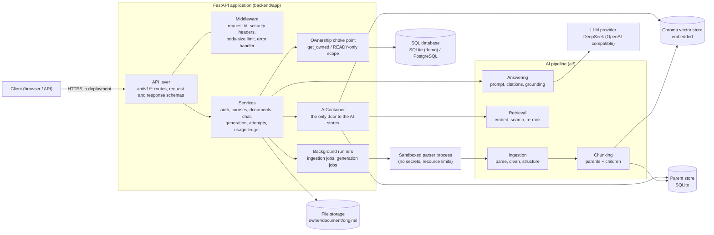
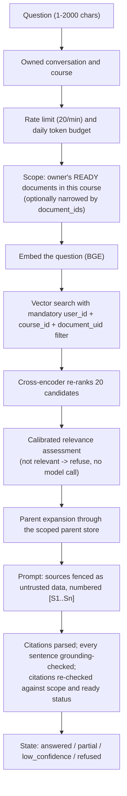
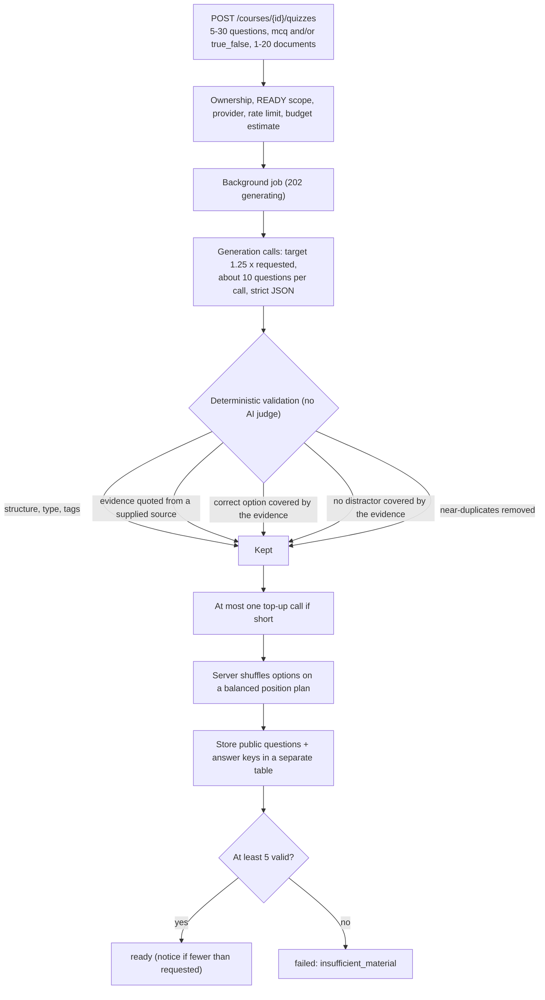
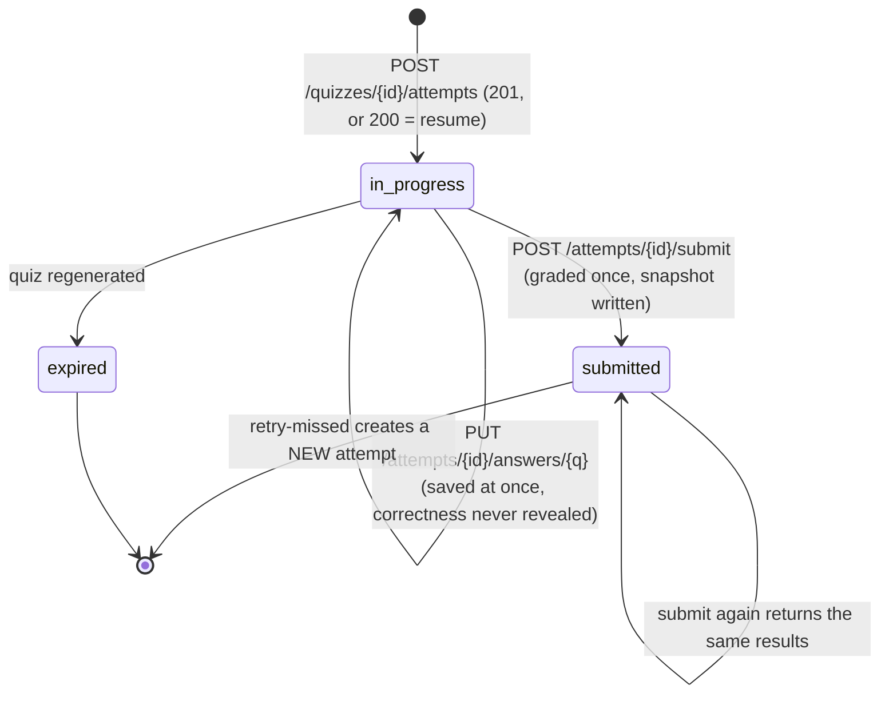
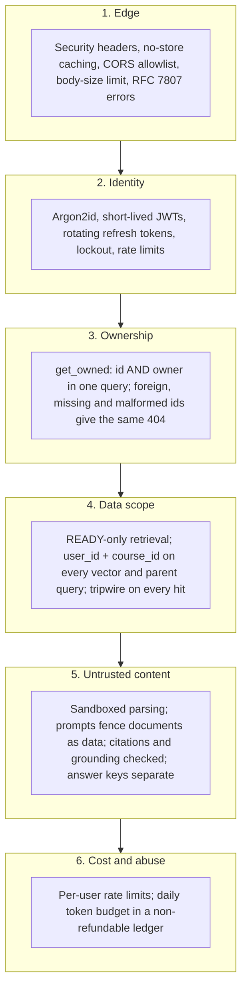
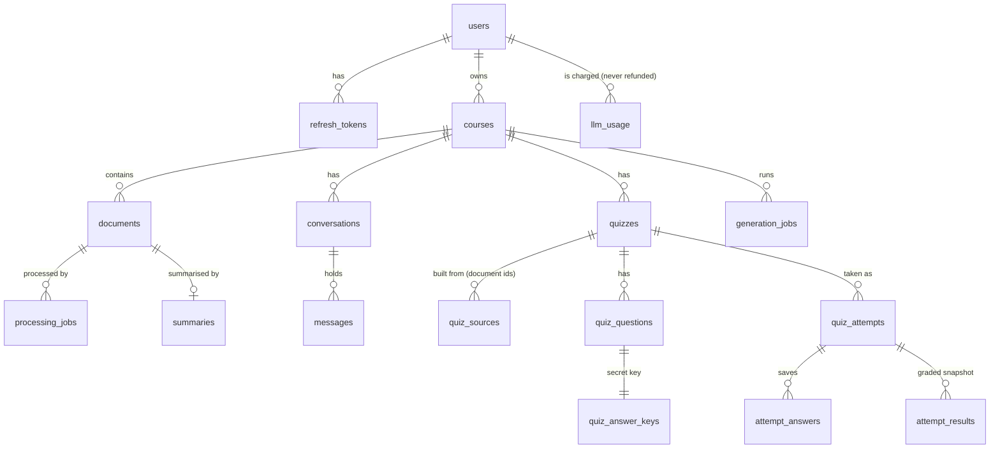

# IntelliStudy Backend: Final Architecture

**For:** graduation-project reviewers. **State:** backend vertical slice, milestones M0-M5 complete and approved
(2026-11-25), branch `post-eval-quality`, last green CI run #13 (commit `8f7404d`).
**Companion documents:** [`backend_security_contract.md`](backend_security_contract.md) (the security rules, cited
below by id such as `OWN-03`), the release gates ([`SECURITY_MERGE_GATE.md`](SECURITY_MERGE_GATE.md) for M1-M2,
[`M3_RELEASE_GATE.md`](M3_RELEASE_GATE.md), [`M4_RELEASE_GATE.md`](M4_RELEASE_GATE.md),
[`M5_RELEASE_GATE.md`](M5_RELEASE_GATE.md)), [`SECURITY_VERIFICATION.md`](SECURITY_VERIFICATION.md),
[`RELEASE_READINESS_PLAN.md`](RELEASE_READINESS_PLAN.md) and [`DEMO_RUNBOOK.md`](DEMO_RUNBOOK.md).

---

## 1. What the backend does

IntelliStudy is a study assistant for university students. A student creates a course, uploads lecture files (PDF,
PPTX, DOCX) and then:

* **asks questions** and gets answers grounded in their own lectures, with numbered citations to pages or slides;
* **generates summaries** of a document, every sentence cited;
* **generates quizzes** (multiple choice and true/false) whose answers are proven by quotes from the lectures;
* **takes quizzes**, is graded automatically, sees a cited explanation for every mistake, and retries the questions
  they missed.

Three principles shaped every design decision:

1. **A student only ever sees their own material.** Every query is scoped to one user and one course, from the
   database down to the vector index.
2. **The AI model is never trusted.** Its output is parsed, checked against the student's documents and stored as
   data. Grading never uses a model.
3. **Every security claim has a test.** Each milestone had a release gate whose items are automated tests: 298 in
   total.

---

## 2. Overall architecture



| Layer | Technology | Responsibility |
|---|---|---|
| HTTP API | FastAPI (`create_app()` factory), Pydantic v2 | 38 operations under `/api/v1`, strict request models (unknown fields rejected), RFC 7807 errors |
| Middleware | pure ASGI | request ids, security headers, body-size limit (also for chunked bodies), an error handler that never leaks traces |
| Services | Python | business rules; every read of user data goes through the ownership layer |
| Persistence | SQLAlchemy 2 + Alembic (7 migrations) | SQLite with WAL for the demo; PostgreSQL by configuration only |
| AI pipeline | `ai/` package (separate test suite, 800 tests) | parsing, chunking, embeddings (`BAAI/bge-small-en-v1.5`), Chroma, re-ranking (`cross-encoder/ms-marco-MiniLM-L-6-v2`), answer grounding |
| Background work | two in-process runner threads | ingestion jobs and summary / quiz generation jobs, claimed atomically, recovered after a restart |
| LLM provider | DeepSeek through one provider interface | also OpenAI and local (Ollama / vLLM) providers; retries, timeouts, redacted errors |

**Why a modular monolith?** One deployable process keeps the demo simple and the security boundary small. Every
external dependency (database, vector store, parent store, LLM provider) sits behind an interface, so the
production path (PostgreSQL, a Chroma server, Redis for rate limits) needs configuration and adapters, not a redesign
(see [`RELEASE_READINESS_PLAN.md`](RELEASE_READINESS_PLAN.md)).

---

## 3. Authentication flow

```mermaid
sequenceDiagram
    actor S as Student
    participant A as API /auth
    participant DB as Database
    S->>A: POST /auth/register (email, name, password)
    A->>DB: store Argon2id hash
    S->>A: POST /auth/login
    A->>DB: verify hash (dummy hash for unknown emails), lockout check
    A-->>S: access token (body, 15 min) + refresh cookie (HttpOnly, Secure, SameSite=Strict, Path=/api/v1/auth)
    S->>A: any request with Authorization: Bearer <access token>
    Note over A: HS256 only; sub iss aud iat exp jti typ required;<br/>checked against the app clock and tokens_valid_after
    S->>A: POST /auth/refresh (cookie + X-Requested-With)
    A->>DB: conditional UPDATE claims the refresh row (rotation)
    A-->>S: new access token + new refresh cookie
    Note over A,DB: re-use of a rotated refresh token revokes the whole session family
```

| Mechanism | Design | Rule |
|---|---|---|
| Passwords | Argon2id (m=64 MiB, t=3, p=1), rehash when parameters change; 10-128 characters with a letter and a digit, not a common password | NFR-SEC-02 |
| Login defence | 5 failures lock the account for 15 minutes, indistinguishable from a wrong password; unknown emails cost the same time; rate limits per IP and per account | JWT-13, 9a |
| Access tokens | 15-minute HS256 JWTs, accepted only from the `Authorization` header (never query strings or cookies), one generic 401 for every failure | JWT-01..09 |
| Refresh tokens | 256-bit opaque values stored as SHA-256; rotated on every use; reuse revokes the family; 7-day idle and 30-day absolute lifetime; refresh and logout require a CSRF header and an allowed origin | RT-01..09 |
| Revocation | logout-all and password change set `tokens_valid_after`; issue times have sub-second precision, so revocation is exact | JWT-05 |
| Roles | `STUDENT` and `ADMIN`; the admin role grants **no** access to students' courses or content | OWN-03 |

---

## 4. Document processing flow

```mermaid
sequenceDiagram
    actor S as Student
    participant API as Upload API
    participant FS as File storage
    participant J as Ingestion runner
    participant C as Sandboxed parser child
    participant AI as ai/ pipeline
    participant V as Chroma + parent store
    S->>API: POST /courses/{id}/documents (multipart, 1-10 files)
    API->>API: course ownership checked before any byte is stored
    API->>FS: stream each file to an exclusive 0600 file, hashing, abort at 100 MB
    API->>API: extension and magic bytes must agree; quota and rate limits
    API-->>S: 202, documents "queued"
    J->>J: claim the job (conditional UPDATE)
    J->>C: preflight (ZIP bomb, macros, encryption) then parse in a child process
    Note over C: allowlisted environment (no secrets), CPU / memory / file-size limits,<br/>10-minute wall clock, 30 s OCR timeout per image
    C-->>J: parsed document (JSON, never pickle)
    J->>AI: clean, detect structure, chunk (parents and children)
    AI->>V: embed children, store vectors with user, course and document ids; store parents
    J->>J: status extracting -> embedding -> indexing -> ready
```

* **Statuses:** `queued -> extracting -> embedding -> indexing -> ready`, or `failed` with a code from a fixed list,
  or `deleting`. Progress is visible through `GET /documents/{id}`.
* **Parsing:** PyMuPDF and pdfplumber (PDF), python-pptx (PPTX), python-docx (DOCX), Tesseract OCR for images, table
  extraction, figure captions.
* **Chunking:** heading-aware children of up to 480 tokens with a 60-token overlap, inside parents of up to 1,600
  tokens. Children are embedded for search; parents give the model the surrounding context.
* **READY-only rule:** vectors are written before a document becomes `ready`, so the retrieval layer accepts only
  documents whose status is exactly `ready`, and re-checks every hit after the search. This rule was a declared release
  blocker (F-M2-10) until M3 proved it.
* **Deletion (ISO-03):** mark `deleting` (never retrievable again) -> vectors and parents -> the stored file ->
  summaries, quizzes, attempts -> the row. A failure part-way leaves the document `deleting` and is retried.

---

## 5. Retrieval flow (grounded chat)



* Chat keeps the top 6 passages (`chat_retrieval_k`). The model must cite them; uncited or unsupported sentences are
  removed, and an answer with nothing left is refused (`uncited_answer`, `unsupported_claims`).
* Refusal reasons are fixed: `no_results`, `not_relevant`, `model_declined`, `uncited_answer`, `unsupported_claims`,
  `llm_unavailable`, `scope_violation`. A provider failure never becomes a 500. The student gets a refusal with the
  nearest material.
* Images and HTML are stripped from model text, so a document cannot make the client load an attacker's URL
  (F-M3-02).

---

## 6. Summary flow

```mermaid
sequenceDiagram
    actor S as Student
    participant API as Summary API
    participant R as Generation runner
    participant L as Scoped source loader
    participant M as LLM (metered)
    S->>API: POST /documents/{id}/summary
    API->>API: owned READY document; stored summary returned as is (200)
    API->>API: provider configured, rate limit, token-budget estimate
    API-->>S: 202 "generating"
    R->>L: owned ready row -> parent keys -> get_many(user, course) -> tripwire per parent
    loop batches of ~2,500 tokens covering every section once
        R->>M: budget re-checked, one call per batch
        M-->>R: blocks "### [S#]" with cited sentences
        R->>R: parse citations, drop invented tags, grounding-check every sentence
    end
    R->>R: re-check the document is still ready, then store atomically
    S->>API: GET /documents/{id}/summary -> sections, [n] citations, page/slide ranges
```

* One structured summary per document, in document order. Headings come from the document, page or slide ranges from
  the citations, never from the model's text.
* Stored and served until an explicit `regenerate`; a failed regeneration keeps the old summary.
* Every provider call writes one row to the **usage ledger**, the single source of truth for the daily token budget.
  Deleting content never refunds tokens (F-M3-05).

---

## 7. Quiz generation flow



* **Why deterministic validation?** The team excluded AI-based judging (decision T-6). A question survives only if
  its evidence is a contiguous quote from the cited source, and that quote proves the marked answer. Line-end word
  splits in PDFs (soft hyphens) are handled without loosening this check (F-M4-06).
* **Answer keys never leave the server before submission.** They live in `quiz_answer_keys`; no API module imports
  that model, and a static test enforces it.
* **Deletion rules (T-1..T-3):** deleting a document deletes its summary; a quiz built only from it is deleted; a quiz
  with several sources becomes `invalid` and must be regenerated.
* Measured on real lectures with DeepSeek: a 10-question quiz in 18.1 s (target under 45 s), 10 of 10 delivered.

---

## 8. Quiz attempt flow



* **One attempt in progress per student and quiz** (a partial unique index); starting again resumes it with its
  saved answers.
* **Grading** is deterministic and makes **no model call**: the chosen option or true/false value is compared with the
  stored key. Unanswered questions score 0.
* **Results** (only for the owner of a submitted attempt): score, percentage, per-topic scores, time spent, and for
  each question the correct answer, the validated evidence quote, a citation to the student's own page or slide, and
  the model's rationale marked as `generated`.
* **Immutability (ISO-11):** submission claims the attempt row with a conditional `UPDATE` and writes a result
  snapshot in the same transaction. Nothing changes a submitted attempt afterwards: not a second submission, not a
  retry, not a quiz regeneration. Tests include two submissions racing and a save racing a submission.
* **Lifecycle:** regenerating a quiz expires attempts in progress; deleting or invalidating a quiz deletes all its
  attempts and snapshots, because snapshots contain document text (D5-5).
* Measured: answer save 2-7 ms, submit and grading 10 ms (targets 300 ms and 1 s).

---

## 9. Security architecture

The security contract ([`backend_security_contract.md`](backend_security_contract.md)) was written before the code;
each milestone gate turned its rules into tests.



| Threat | Main controls | Evidence |
|---|---|---|
| Cross-user data leakage (P0) | ownership choke point (OWN-01..08), scoped queries (ISO-01), scoped retrieval and vector isolation (RET, VEC) | isolation tests in every gate; whole-API tests call every id route as another user (G5-SEC-04) |
| IDOR, id guessing | canonical-UUID check, identical 404, security event for foreign ids | G1-IDOR, G5-SEC-03 |
| Malicious uploads | content-type by magic bytes, ZIP-bomb and macro checks, sandboxed child without secrets, resource limits | M2 gate (39 items) |
| Prompt injection | documents fenced as untrusted data, invented citation tags dropped, grounding, deterministic quiz validation | G3-PI, G4-INJ, G5-KEY-06 |
| Answer-key leakage | separate key table, no correctness feedback before submission, key fields only in the results schema | G4-KEY, G5-KEY, G5-SEC-07 |
| Token theft and session abuse | refresh rotation with reuse detection, CSRF header for cookie routes, exact revocation | G1-RT, G1-JWT |
| Unbounded consumption | rate limits (contract 9a), token ledger, quiz taking uses no tokens | G4-BUD, G5-GRD-06 |
| Secret exposure | secrets only in environment variables, redaction in logs, gitleaks in CI | M0 tests, CI |

**Release verification.** [`SECURITY_VERIFICATION.md`](SECURITY_VERIFICATION.md) maps all 70 rows of the contract's
security test matrix to passing tests and records the OWASP Top 10 (2021) and OWASP Top 10 for LLM Applications
(2025) review, with no open item. It was signed off on 2026-11-25. The accepted residual risks and the work required
before production or public use are in [`RELEASE_READINESS_PLAN.md`](RELEASE_READINESS_PLAN.md).

---

## 10. Data model



| Table | Purpose | Notes |
|---|---|---|
| `users`, `refresh_tokens` | accounts and sessions | refresh tokens stored as SHA-256 only |
| `courses` | a student's course | every user table has a non-nullable path to one user (OWN-01) |
| `documents`, `processing_jobs` | uploaded files and their ingestion | status machine with `deleting`; file name display-only |
| `conversations`, `messages` | chat history | messages keep state, citations and token counts |
| `llm_usage` | one row per provider call | linked only to the user; the budget's single source of truth |
| `summaries`, `generation_jobs` | stored summaries; background summary and quiz jobs | one summary per document |
| `quizzes`, `quiz_sources`, `quiz_questions`, `quiz_answer_keys` | quizzes, their source documents, public questions, secret keys | `generation` number increments on regeneration |
| `quiz_attempts`, `attempt_answers`, `attempt_results` | attempts, saved answers, immutable graded snapshots | at most one attempt in progress per user and quiz |

Outside the SQL database:
* **Chroma** holds one vector per child chunk, with `user_id`, `course_id` and `document_uid` metadata on every record.
* **The SQLite parent store** holds parent chunks under the same scope.
* **File storage** holds originals at `{root}/{owner}/{document}/original.{ext}`, built from UUID components only.

All ids are server-generated UUIDv4 strings; all times are UTC.

---

## 11. CI/CD and gates history

**Pipeline** (`.github/workflows/backend.yml`, every push), three jobs:
1. **secret scan:** gitleaks over the full history;
2. **dependency audit:** `pip-audit` on the pinned lock file, with recorded exceptions (contract Appendix C);
3. **lint, types, tests:** ruff, mypy (159 files), backend suite (402 tests), `ai/` suite (800 tests).

**Gate rules (all milestones):**
* Every gate row has exactly one test named after it. A traceability test fails on any missing or extra test.
* A row passes only without skips in CI.
* Changing an expected result requires a recorded gate or contract change first.
* Critical controls were mutation-checked: removed one at a time to prove a test fails.

| Milestone | Scope | Gate items | CI run (commit) | Notable findings |
|---|---|---|---|---|
| M0 | foundations: config and secrets, middleware, logging, providers, CI | 74 tests | #1 (`7892321`) | Pillow upgraded (42 advisories); a catch-all error handler would have dropped security headers on 500s |
| M1 | identity, courses, ownership | 79 | #2 (`1afb037`) | |
| M2 | upload, sandboxed parsing, job lifecycle | 39 | #3 (`eeed7bd`) | F-M2-05 (pickle from the child replaced by JSON), F-M2-06 (secrets in the child environment), **F-M2-10 release blocker**: vectors exist before `ready` |
| M3 | grounded chat on READY-only scoped retrieval | 52 | #4 (`c410fd7`), #5 (`f05bf8e`) | F-M2-10 closed; F-M3-02 (model-emitted images stripped); F-M3-05 (token budget refunded by deletions, fixed with the usage ledger) |
| M4 | summaries and quiz generation | 67 | #6 (`cc8042e`) | F-M4-01 (a foreign key masked a missing re-check, test strengthened) |
| M4.1 | quality patch after the DeepSeek run on a real PDF | 15 regression tests | #7 (`c1ee771`) | F-M4-05 (sentence fragments), F-M4-06 (quiz yield 5/10 -> 8-10/10) |
| M5 | quiz attempts, grading, release verification, end-to-end slice | 61 | #8 (`4ee4404`), #9 (`d990509`) | F-M5-01 (stale state after the submission claim, fixed); D5-11 immutability proven with race tests |
| Close-out | documentation, flaky-test fixes | - | #10 failed, #11 green; #12 failed, #13 green (`8f7404d`) | two flaky tests stabilised: a CPU-timing ratio, and a Chroma equivalence check that used approximate search to list stored records |

**Totals:** 298 gate items across M1-M5, plus M0's 74 foundation tests; 402 backend tests and 800 `ai/` tests per run.
Manual evidence with the real DeepSeek provider (M4 section 2.12, M5 section 2.11): every performance target met.

| Measure (real lectures, DeepSeek) | Target | Result |
|---|---|---|
| 44-page PDF processed | under 90 s for 50 pages | 10.4 s |
| 10-question quiz generated | under 45 s | 18.1 s, 10 of 10 questions |
| Answer save / submit and grade | under 300 ms / 1 s | 2-7 ms / 10 ms |
| Tokens for a full study session (chat, summary, quiz) | within 200,000 per day | 28,315 |

---

## 12. Known limitations and next steps

* **Deployment** (before any cloud release): HTTPS with HSTS, client addresses behind a proxy, a shared rate-limit
  store, secret management, alerting, backups. Planned as R1.
* **Public users** (before anyone outside the team): a privacy notice and recorded consent for sending document text
  to DeepSeek, and account deletion. Planned as P1.
* **Frontend:** must render all model text as plain text (contract UPL-15). This is a release blocker for any
  web release.
* **Quality** (M6): repair split words at ingestion (F-M4-07); fewer valid questions dropped; question flagging.
* **By design:** no short-answer or essay questions, no adaptive exams, no AI-based grading (team decision T-6).

Details, owners and milestones: [`RELEASE_READINESS_PLAN.md`](RELEASE_READINESS_PLAN.md).
