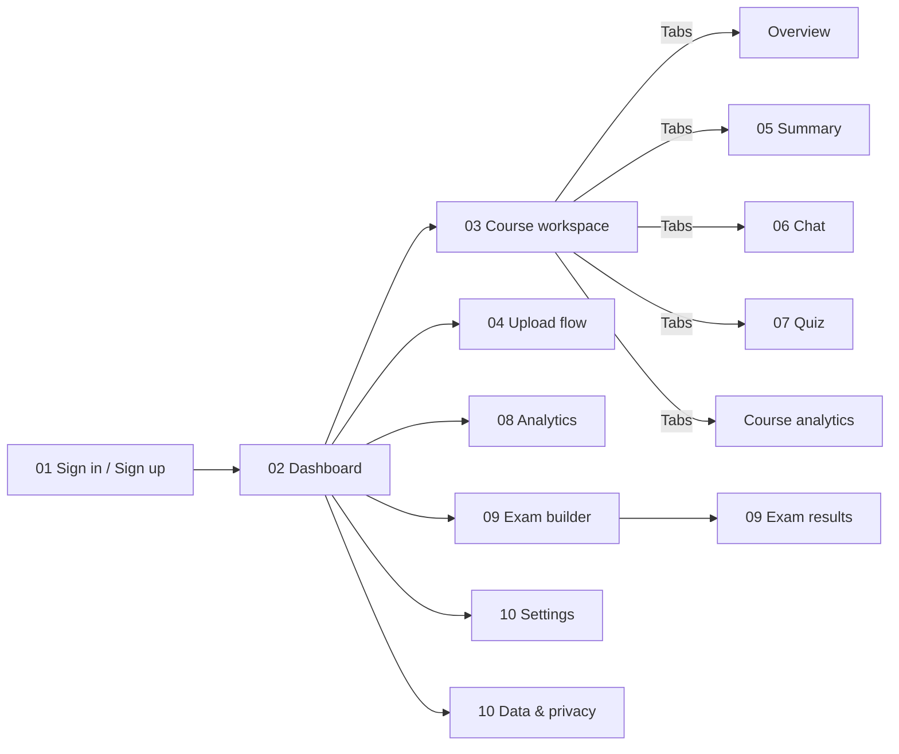
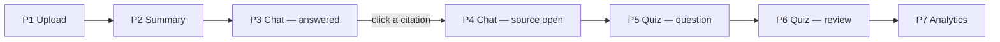
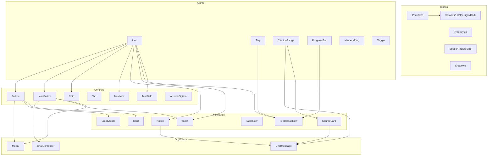

# DESIGN_SPEC.md — IntelliStudy Web App

> **Source:** Figma file "IntelliStudy – Web App (Copy)" · file key `BgsDyU2RAXD4qT3M5ep3Dr`
> **Extracted:** 2026-11-26 via the Figma MCP server (read-only)
> **Spec version:** 2.0 (complete: Figma-extracted values + [Inferred] completion; see §0.1 and §18)
> **v1.0 frozen copy:** `DESIGN_SPEC.v1.0.frozen.md` (SHA-256 `cf7cc8b1d827a0887b213f69797efa20bc01ba35a946e14cd8713925220717a8`)

---

## 0. Read this first: coverage and confidence

This spec separates three kinds of information. Every value carries one of these labels:

| Label | Meaning |
|---|---|
| **[Figma]** | Read directly from Figma: variables, styles, component code, or node geometry. Exact. |
| **[Geometry]** | Worked out from exact node positions and sizes, e.g. "child sits at x=25 inside a card with a 1px border, so padding is 24px". The arithmetic is exact, but the *intent* (padding vs. absolute position) is an interpretation. |
| **[Inferred]** | My recommendation or interpretation. It is not in the file. |
| **Not specified** | Not available from what could be extracted. |

### What was fully extracted
- **All 3 pages** and every top-level frame in them (100% inventory).
- **All design tokens**: every primitive color, every semantic color in **Light and Dark**, spacing, radius, all 12 text styles, 3 shadow styles, focus and touch-target specs, and the full contrast table.
- **The descriptions of all 22 component sets** (written by the designer in Figma) and the section notes on the Components page.
- **Full styling code for 8 component sets:** Button, Input/TextField, Tab, Chip, Tag, CitationBadge, ProgressBar and MasteryRing, plus every Foundations specimen. Icons were inventoried (names and sizes).
- **Exact geometry of every node in every screen:** 20 desktop screens, 4 mobile screens, 7 prototype frames, and the 31 dark-mode duplicates. That covers 4,100+ layers, with position and size for each.

### What could NOT be extracted (and why)
The Figma account `your-email@example.com` is on a **Starter plan with a View seat**. Figma caps MCP read calls on that plan at a small monthly allowance (currently 20 per month per Figma's docs; older docs say 6). The cap was reached partway through extraction, before these could be read:

1. **Internal styling** (fills, borders, padding, typography) of these 14 component sets: Card, SourceCard, IconButton, TableRow, Toast, Modal, EmptyState, FileUploadRow, NavItem, Notice, Toggle, AnswerOption, ChatComposer and ChatMessage, plus the internals of the 30 icons. Their **variants, states, sizes and documented behaviour are listed**. Their exact colours and paddings are marked *Not specified*.
2. **Screen-level fills, strokes, text styles and actual copy (text content).** Screen metadata gives layer names, which are mostly generic ("Title", "Subtitle"), and exact geometry. It does not give the words on screen.
3. **Prototype connections** (click targets, transitions). The prototype frames were found and identified, but their interactions can't be read.

§17 lists how to unblock the remaining 0→100%. The fastest path is free for students: a **Figma Education plan** gets the same allowance as a Professional Full seat (200 calls/day).


### 0.1 v2.0 completion (read with the labels above)
Version 2.0 completes every remaining gap **without new Figma reads**. The rules:

1. **Nothing extracted was changed.** Every [Figma] and [Geometry] value from v1.0 is still here, word for word. Where an old line said *Not specified*, v2.0 appends "→ v2.0 …" after it instead of deleting it.
2. **Every new value is tagged [Inferred]** and derived in this priority order:
   1. Figma measurements
   2. Existing tokens
   3. The 8 fully extracted components
   4. Existing screen patterns
   5. The designer's written notes
   6. UX judgement
3. **No new colours, text styles, radii or shadows were created.** New "roles" (e.g. Info) are aliases of existing tokens (§8.2.1). Motion (§9.8) and opacity (§9.5.2) are new token *categories* because Figma had none; they are marked as such.
4. Each completed component has a "*.1 completed specification" sub-section. Each screen has a "Content & styling [Inferred]" block. The audit is in §18.
5. **Still Not specified** (can't be honestly inferred): icon vector paths, hidden layers, the in-app file viewer. See §17.1.1.

When Figma access becomes available, any [Inferred] value can be confirmed or corrected with the call plan in RESUME_PLAN.md.
---

## 1. Project Overview

| Item | Value |
|---|---|
| Product | **IntelliStudy**: a study assistant. Students upload lecture files (PDF, PPTX, DOCX). The app extracts and indexes them, then produces cited summaries, a chat grounded in the files, quizzes, mastery analytics and personalised exams. **[Figma]** (from screens and component docs) |
| Design principle (Foundations header) | "Calm, focused, trustworthy." **[Figma]** (the subtitle text was truncated in the metadata after this phrase) |
| Platforms designed | Desktop web at **1440px** (20 screens) and Mobile at **390px** (4 screens). **[Figma]** |
| Themes | **Light and Dark.** Every desktop and mobile screen exists in both. The Dark copies are structurally identical (same layers, sizes and positions; verified programmatically) and differ only by the variable mode. **[Figma]** |
| Font | **Inter** (Regular 400, Medium 500, Semi Bold 600, Bold 700) **[Figma]** |
| Grid | "8px grid with a 4px half-step." **[Figma]** |
| Accessibility target | WCAG 2.2 AA. Minimum hit area 44×44. 2px focus ring. Status is never shown by colour alone. **[Figma]** |
| Component architecture | "Every component binds to semantic tokens only. Variant props: Property=Value. Interactive controls are ≥44px. Focus = 2px outside ring (color/focus/ring). Names map to React components (Button, TextField, Tab, Chip, Tag …)." **[Figma]** |
| Sample domain content | Courses: *Aspect-Oriented Programming*, *Queueing Theory*, *Operating Systems*. Topics: *Cross-cutting concerns*, *Join points and pointcuts*, *Advice: before, after, around*, *Advice: order of execution*, *Weaving: compile-time vs run-time*, *AspectJ annotations*, *Key terms*. **[Figma]** (layer names) |

---

## 2. Figma File Structure

```
IntelliStudy – Web App (Copy)
├── Page 0:1  "Foundations"
│   └── Frame 4:2  "Foundations / Overview"  1680×4472
│       ├── Section / Primitive colors              (4:5)
│       ├── Section / Semantic color — Light and Dark (4:150)
│       ├── Section / Spacing, radius and size       (4:452)
│       ├── Section / Type scale — Inter             (4:412)
│       ├── Section / Accessibility foundations      (4:516)
│       └── Section / Contrast check                 (4:529)
├── Page 1:4  "Components"
│   └── Frame 6:2  "Components / Overview"  1680×12058
│       └── 23 sections (Icons + 22 component sets) — see §4
└── Page 1:5  "Screens"
    ├── Section 22:1969   "Desktop — 1440"                      6280×6594  (20 frames)
    ├── Section 22:1970   "Mobile — 390"                        2080×1044  (4 frames)
    ├── Section 22:1971   "Prototype — Upload → Summary → Chat → Quiz → Analytics"
    │                                                            10960×1480 (7 frames)
    ├── Section 2018:2160 "Desktop — 1440 · Dark"               (20 frames, mirror)
    ├── Section 2018:4835 "Mobile — 390 · Dark"                 (4 frames, mirror)
    └── Section 2018:5192 "Prototype … · Dark"                  (7 frames, mirror)
```

### 2.1 Screen inventory (every frame on the Screens page)

| # | Frame (Light) | Node | Size | Dark node | Shell |
|---|---|---|---|---|---|
| 01a | 01 Auth / Sign in | 12:2 | 1440×900 | 2018:2161 | Split auth layout |
| 01b | 01 Auth / Sign up | 12:55 | 1440×900 | 2018:2190 | Split auth layout |
| 02 | 02 Dashboard | 12:123 | 1440×1086 | 2018:2220 | Sidebar |
| 03 | 03 Course workspace | 15:158 | 1440×900 | 2018:2343 | Rail |
| 04 | 04 Upload flow | 15:393 | 1440×1168 | 2018:2486 | Sidebar |
| 05 | 05 Summary | 15:606 | 1440×900 | 2018:2529 | Rail |
| 06a | 06 Chat / Answered | 17:482 | 1440×900 | 2018:2653 | Rail |
| 06b | 06 Chat / Answered — source open | 17:615 | 1440×900 | 2018:2692 | Rail |
| 06c | 06 Chat / Refused | 17:780 | 1440×1060 | 2018:2751 | Rail |
| 06d | 06 Chat / Partial | 17:927 | 1440×900 | 2018:2790 | Rail |
| 06e | 06 Chat / Loading | 17:1048 | 1440×900 | 2018:2829 | Rail |
| 06f | 06 Chat / Low confidence | 17:1147 | 1440×900 | 2018:2868 | Rail |
| 07a | 07 Quiz / Question (multiple choice) | 18:1013 | 1440×900 | 2018:2907 | Rail |
| 07b | 07 Quiz / Short answer | 18:1095 | 1440×900 | 2018:2949 | Rail |
| 07c | 07 Quiz / Review | 18:1165 | 1440×1280 | 2018:2991 | Rail |
| 08 | 08 Analytics | 20:1139 | 1440×1244 | 2018:3051 | Sidebar |
| 09a | 09 Exam / Builder | 20:1384 | 1440×1000 | 2018:3218 | Sidebar |
| 09b | 09 Exam / Results | 20:1576 | 1440×1100 | 2018:3306 | Sidebar |
| 10a | 10 Settings | 21:1349 | 1440×1320 | 2018:3386 | Sidebar |
| 10b | 10 Data & privacy | 21:1493 | 1440×1211 | 2018:3452 | Sidebar |
| M3 | M3 Course workspace | 22:1467 | 390×844 | 2018:4836 | Mobile app bar + tab bar |
| M5 | M5 Summary | 22:1580 | 390×844 | 2018:4903 | Mobile + bottom sheet |
| M6 | M6 Chat | 22:1682 | 390×844 | 2018:4961 | Mobile app bar |
| M8 | M8 Analytics | 22:1742 | 390×844 | 2018:4973 | Mobile app bar + tab bar |

**Prototype frames.** All 7 are exact copies of desktop screens. I verified this layer by layer; only the frame name and position differ.

| Prototype frame | Node (Light / Dark) | Copy of |
|---|---|---|
| P1 Upload | 22:1972 / 2018:5193 | 04 Upload flow |
| P2 Summary | 22:2015 / 2018:5236 | 05 Summary |
| P3 Chat — answered | 22:2139 / 2018:5360 | 06 Chat / Answered |
| P4 Chat — source open | 22:2178 / 2018:5399 | 06 Chat / Answered — source open |
| P5 Quiz — question | 22:2237 / 2018:5458 | 07 Quiz / Question (multiple choice) |
| P6 Quiz — review | 22:2279 / 2018:5500 | 07 Quiz / Review |
| P7 Analytics | 22:2339 / 2018:5560 | 08 Analytics |

No hidden frames or alternative screen designs were found beyond those listed. The metadata doesn't expose layer visibility, so hidden *layers inside* frames: **Not specified**.

---

## 3. Complete Screens Documentation

Conventions for this section:
- Coordinates are `x,y` relative to the parent, and sizes are `W×H`, in px. All values are **[Figma]** unless marked otherwise.
- "Card padding 24 [Geometry]" means children start at 25px inside a container. That matches a 1px border plus 24px (`space/24`) of padding.
- Instance names in Figma follow `Component / Label`, e.g. `Button / Upload files`. The part after the slash is the **layer name**. It usually matches the button label, but that is not guaranteed **[Inferred]**.
- **Copy (text content)** is *Not specified* unless the layer name is itself the text.

### 3.0 Shared shells

#### Shell A — Sidebar layout (Dashboard, Upload, Analytics, Exam, Settings, Data & privacy)

| Element | Geometry | Notes |
|---|---|---|
| Sidebar | x0, y0, **264 × full height** | |
| Wordmark | 16,24 · 132×56 | Contains **Mark** (32×32, holding an 18×18 icon at 7,7) and the text "Wordmark" at 44,4, 88×24 |
| NavItem ×6 | x16, y84 → y324, step **48** (44 high + 4 gap) · **231×44** each | Labels: **Dashboard, Courses, Analytics, Personalised exam, Settings, Data & privacy** |
| Spacer | 16,372 · flexible height | Pushes the user block to the bottom |
| User block | 231×60, 24px from the bottom | **Avatar** 36×36 at 12,12 with initials "LH" (16×16 text). **Name** text (20px line) and **Program** text (16px line) at 60,12 |
| Main | x **264**, width **1176** | Content inset **48px** left and right, giving a content width of **1080** [Geometry] |
| Page header | 48,40 · 1080×68 | Title (40px line, i.e. `text/h1`) + Subtitle (24px line) at y44 |
| Content start | y **140** | 32px below the header [Geometry] |

Which NavItem shows `State=Selected` on each screen: **Not specified** (not extracted). [Inferred] It is the one matching the screen. v2.0 lists it in each screen's "Content & styling" block.

#### Shell B — Rail layout (Course workspace, Summary, Chat, Quiz)

| Element | Geometry | Notes |
|---|---|---|
| Rail | 0,0 · **72 × full height** | |
| Wordmark (mark only) | 19.5,24 · 32×56 | |
| RailItem ×6 | x13.5, y84 → y324 step 48 · **44×44**, each holding a 20px icon at 12,12 | Same 6 destinations as the sidebar, shown as icons only |
| Spacer | 1px wide | |
| Avatar | 17.5, (bottom−60) · 36×36 · "LH" | |
| Main | x **72**, width **1368** | |

RailItem is a **frame**, not a component instance. The NavItem component has no icon-only variant **[Figma]**.

#### Shell C — Mobile (390×844)

| Element | Geometry |
|---|---|
| App bar | 390×61. **Back** hit area 44×44 at 8,8, with a 20px icon at 32,12 inside it. Screen title at 60,18 (322×24). M8 uses a 41px app bar with the title only. |
| Body | from y61, 16px side insets (content width 358) [Geometry] |
| Tab bar | y775 · 390×69. 4 × **TabItem** 93.5×52 starting at x8 (each has a 20px icon at 36.75,8 and a 16px-line label at y28) |
| TabItem labels | **Home, Courses, Analytics, Settings** (layer names) |

---

#### 3.0.1 Shell styling and shared copy [Inferred]
*Derivation:* the surfaces follow the token roles. `bg/canvas` is the page and `bg/surface` the panels and cards, as in the Foundations and Components frames, which use `bg/canvas` page + `bg/surface` panels. Text styles are chosen by the line heights measured in §3, which match exactly one style each.

| Element | Spec |
|---|---|
| Page background (Main) | `bg/canvas` |
| Sidebar / Rail | fill `bg/surface` · right border 1px `border/default` |
| Mark | 32×32 · radius `md` 8 · fill `accent/default` · `icon/book` 18 in `text/on-accent` |
| Wordmark text | "IntelliStudy" · `text/title` 16/24 Semi Bold · `text/primary` |
| NavItem states | Selected = the current page (see each screen) |
| User block | 231×60 · radius `md` · hover `bg/subtle` · opens the account menu |
| Avatar | 36×36 circle · fill `accent/subtle` · initials "LH" `text/caption-strong` `accent/fg` |
| Name / Program | "Laila Hassan" `text/label` `text/primary` / "Computer Eng. · Year 3" `text/caption` `text/secondary` |
| Page title / subtitle | `text/h1` `text/primary` / `text/body` `text/secondary` |
| Breadcrumb | `text/caption`; ancestors `text/link` (underline on hover), current page `text/secondary`; separator " / " `text/tertiary` |
| Cards (all screens) | Card spec §4.10.1: `bg/surface`, 1px `border/default`, `radius/xl`, padding 24 (16 on mobile with `radius/lg`) |
| Card titles | `text/h3` where the line is 28; `text/title` where it is 24 |
| Course tab bar | Tabs + 1px `border/default` bottom rule (the 45th pixel row) |
| Mobile app bar | fill `bg/surface` · bottom border 1px `border/default` · Back = `IconButton` with a left chevron (§10.3) · title `text/title` |
| Mobile tab bar | fill `bg/surface` · top border 1px `border/default` · TabItem = 20px icon + `text/caption` label; active item `accent/fg` icon + `text/caption-strong` label `accent/fg`; inactive `text/secondary` |
| Section labels (eyebrows) | `text/caption-strong` · `text/tertiary` · UPPERCASE |

**Terminology (used consistently across all copy):**
- **Course** (not "class")
- **Materials / files** (not "documents")
- **Summary**, **Topic**
- **Mastery** levels: Not started · Weak · Learning · Proficient · Mastered
- **Personalised exam** (British spelling, as in the Figma nav label "Personalised exam"; also "practise", "recognised")
- **Source / citation**

Tone: calm, specific, no exclamation marks.

**Mastery thresholds [Inferred]:** Weak 0–49 · Learning 50–69 · Proficient 70–89 · Mastered 90–100 · Not started = no attempts. These reproduce every sample in Figma (Ring samples 32/56/78/94). Tag tones: Weak → Danger, Learning → Warning, Proficient → Accent, Mastered → Success, Not started → Neutral. The Tag widths on the Analytics and Results screens (49 / 67 / 73 / 72 / 83) match the labels "Weak", "Learning", "Proficient", "Mastered" and "Not started" [Geometry].

### 3.1 — 01 Auth / Sign in (12:2) · 1440×900

**Layout:** a two-column split.

| Region | Geometry | Contents |
|---|---|---|
| **Brand panel** | 0,0 · 640×900 | Wordmark 80,244 (132×32). **Headline** 80,308 · 480×96 (96px tall = 2 lines of `text/display` 48px [Geometry]). **Subhead** 80,436 · 480×84 (3 lines at 28px = `text/body-lg` [Geometry]). **Trust points** 80,552 · 412×104: 3 rows at y0/40/80, each with a 20px icon at 0,2 and text at 32,0 (24px line). Row widths 297 / 361 / 412. |
| **Form side** | 640,0 · 800×900 | **Auth card** centred: 180,196.5 · **440×507** |
| Auth card → Tabs | 41,41 · 358×45 | `Tab / Sign in` (78×44, Selected [Inferred]) + `Tab / Create account` (135×44). The 45th pixel row is [Inferred] a 1px divider. |
| Auth card → Title | 41,110 · 170×32 (`text/h2` line height) | |
| Auth card → Fields | 41,166 · 358×188, gap 16 | `Input / University email` 358×100 (label + field + helper). `Input / Password` 358×72 (label + field, no helper). |
| Auth card → Button / Submit | 41,378 · **358×44**, full width | Primary [Inferred] |
| Auth card → Footnote | 41,446 · 360×20 (`text/body-sm`) | |

- Card inner padding: **40px** (1px border + 40) [Geometry]. Vertical rhythm: Tabs → Title 24, Title → Fields 24, Fields → Button 24, Button → Footnote 24 [Geometry].
- Copy: *Not specified* (layer names only).

**Content & styling [Inferred]**

| Element | Spec |
|---|---|
| Brand panel fill | `accent/subtle` (dark #203127) |
| Headline | `text/display` · `text/primary` · "Study smarter from your own lectures." |
| Subhead | `text/body-lg` · `text/secondary` · "Upload your course files and get summaries, answers and quizzes that cite the exact page they came from." |
| Trust points | icons 20 `accent/fg`, text `text/body` `text/primary`: `icon/checkCircle` "Every answer cites your materials" · `icon/lock` "Your files stay private to your account" · `icon/target` "Quizzes focus on the topics you find hardest" |
| Form side fill | `bg/canvas` |
| Auth card | `bg/surface` · 1px `border/default` · `radius/xl` · padding 40 · no shadow |
| Tabs | "Sign in" **Selected** · "Create account" Default |
| Title | `text/h2` "Welcome back" |
| Email | `Input` Default: label "University email", placeholder "name@university.edu", helper "Use the address your university gave you" [Figma copy] |
| Password | label "Password" · placeholder "Enter your password" · no helper (72px instance) · trailing show/hide `IconButton` is **not** in the design, so don't add it |
| Submit | `Button` Primary, full width, "Sign in" |
| Footnote | `text/body-sm` `text/secondary`: "Forgot your password? " + `text/link` "Reset it" |

### 3.2 — 01 Auth / Sign up (12:55) · 1440×900
The brand panel is identical to Sign in. Differences:

| Element | Geometry |
|---|---|
| Auth card | 180,128.5 · **440×643** (vertically centred) |
| Title | 41,110 · 236×32 |
| Fields (358×304) | `Input / Full name` 0,0 358×72 · `Input / University email` 0,88 358×100 · `Input / Password` 0,204 358×100 (with helper) |
| Button / Submit | 41,494 · 358×44 |
| Footnote | 41,562 · 360×40 (2 lines) |

Tab state: [Inferred] "Create account" is Selected.

**Content & styling [Inferred].** Same as Sign in, except:

| Element | Spec |
|---|---|
| Tabs | "Create account" **Selected** |
| Title | `text/h2` "Create your account" |
| Full name | label "Full name" · placeholder "e.g. Laila Hassan" |
| University email | as Sign in (with helper) |
| Password | label "Password" · helper "At least 8 characters" |
| Submit | Primary "Create account" |
| Footnote (2 lines) | "By creating an account you agree to the " + link "Terms of use" + " and " + link "Privacy notice" + "." |

### 3.3 — 02 Dashboard (12:123) · 1440×1086 · Shell A

| Block | Geometry | Contents |
|---|---|---|
| Header | 48,40 · 1080×68 | **Greeting** 338×40 (h1). **Subtitle** 0,44 489×24. `Button / Upload files` at 944,12 · **136×44** |
| **Row A** | 48,140 · 1080×250, gap 24 | |
| └ Next recommended action (card) | 0,0 · **716×250** | Padding 24 [Geometry]. **Eyebrow** 25,25 (16px icon + caption-strong text 182×16). **Title** 25,53 · 440×28 (h3). **Reason** 25,93 · 666×48 (2 × 24px lines). **Basis** 25,153 · 341×16 (caption). **Actions** 25,181: `Button` 206×44 + `Button` 98×44, gap 12 |
| └ Study streak (card) | 740,0 · **340×194** | **Streak head** 25,25: 24px icon (flame [Inferred]) + text 124×28 (h3). **Streak note** 25,65 · 290×40. **Week** 25,117 · 272×52: 7 day columns 32×52 at a 40px pitch. Each has a **Dot** 32×32 and a **Day label** at y36. Day 1 ("F") has no icon. Days 2–7 (S, S, M, T, W, T) have a 16px icon inside the dot (check [Inferred]) |
| **Courses** | 48,422 · 1080×222 | Head: "Your courses" 944×32 (h2) + `Button` 136×44. **Course cards** at y60: 3 × `Card` **344×162**, gap 24 — *Aspect-Oriented Programming*, *Queueing Theory*, *Operating Systems* |
| **Row C** | 48,676 · 1080×362 | |
| └ Weakest topics (card) | 0,0 · **528×334** | Title 25,25 (149×28, h3). 3 **Topic rows** (478 wide, heights 80/80/72) at y61/149/237 (8px gap). Each has `MasteryRing` Sm 56×56, **Topic text** (Topic 24px lines + Course 16px caption), a `Tag` (81 or 67 wide) and a `Button` **87×44** |
| └ Recent activity (card) | 552,0 · **528×362** | Title 25,25. 4 **Activity rows** (478 wide, 60/60/72/60 high) at y61/129/197/277. Each has a **36×36 icon tile** with an 18px icon, **Activity** text (24px lines) at x48, and **When** caption right-aligned |

Card spacing: 24px between cards, 32px between rows [Geometry].

**Content & styling [Inferred]** · NavItem **Dashboard** Selected

| Element | Spec |
|---|---|
| Greeting / subtitle | "Good evening, Laila" / "Two topics need attention this week. Pick up where you left off." |
| Header action | `Button` **Primary** "Upload files", `icon/upload` (the one primary on the page) |
| Next recommended action | Eyebrow `icon/target` 16 + `text/caption-strong` `accent/fg` "NEXT RECOMMENDED ACTION" · Title `text/h3` "Review: Weaving at compile time vs run time" · Reason `text/body` `text/secondary` "You scored 32% on this topic in your last two quizzes. A short summary review followed by 5 targeted questions is the fastest way to improve." · Basis `text/caption` `text/tertiary` "Based on 2 quizzes · Aspect-Oriented Programming" · Buttons: Secondary "Review summary & quiz" (206) + Ghost "Not now" (98) |
| Study streak | `icon/flame` 24 `warning/solid` + `text/h3` "6-day streak" · note `text/body-sm` `text/secondary` "One quiz or summary a day keeps it going." |
| Week dots | 32×32 circles. **Missed** (Fri): `bg/subtle` + 1px `border/default`. **Done** (Sat–Wed): `accent/default` + `icon/check` 16 `text/on-accent`. **Today** (Thu, last): `accent/subtle` + 2px `accent/default` + check `accent/fg`. Day labels `text/caption` `text/tertiary`; today `text/caption-strong` `text/primary`. Letters: F S S M T W T |
| Your courses | `text/h2` "Your courses" · `Button` Secondary "Add course", `icon/plus` |
| Course cards | Card §4.10.1. AOP: Tag Success "Indexed", "7 files", meta "56% mastery · 3 weak topics", bar 56%. Queueing Theory: "Indexed", "5 files", "71% mastery · 1 weak topic", 71%. Operating Systems: Accent "Extracting…", "3 files", "Not started", 0% |
| Weakest topics | title "Weakest topics". Rows: ① Ring Weak 32% · "Weaving: compile-time vs run-time" (`text/body-strong`, 2 lines) · "Aspect-Oriented Programming" · Tag Danger "Weak · 32%" · Ghost "Practise". ② Ring Weak 41% · "M/M/1 utilisation and queue stability" · "Queueing Theory" · Tag Danger "Weak · 41%" · "Practise". ③ Ring Learning 56% · "Little’s Law" · "Queueing Theory" · Tag Warning "Learning" · "Practise" |
| Recent activity | title "Recent activity". Icon tiles 36×36 radius `md` `bg/subtle`, icons 18 `text/secondary`. ① `icon/quiz` "Completed quiz: Weaving and advice — 7/10" · "2 hours ago". ② `icon/upload` "Uploaded Lecture 7 — Proxies.pdf" · "Yesterday". ③ `icon/message` (2 lines) "Asked: “What is the difference between compile-time and load-time weaving?”" · "Yesterday". ④ `icon/book` "Reviewed summary: Cross-cutting concerns" · "3 days ago". Activity `text/body` `text/primary`; When `text/caption` `text/tertiary` |

### 3.4 — 03 Course workspace (15:158) · 1440×900 · Shell B

A **3-pane layout** inside Main (1368 wide):

| Pane | Geometry | Contents |
|---|---|---|
| **File list** | 0,0 · **300×900** | **Files head** 16,24: "Materials" 225×24 + **Count** 34×16. `Button / Add files` 16,64 · 267×44 (full width). **Files** 16,124 · 267×506: 7 **File items**, gap 4, each 267 wide |
| └ File item | Name row at 12,8 (20px file icon + name, 1–2 lines of 20px); Status row (`Tag` at x28) | Items: *Lecture 1 — Introduction.pdf* (60h) · *Lecture 2 — Cross-cutting concerns.pdf* (80h) · *Lecture 4 — Aspect-Oriented Programming.pdf* (82h, padding 13: likely the **selected** item with a 2px border [Geometry/Inferred]) · *Lecture 5 — AspectJ in practice.pptx* (80h) · *Lecture 6 — Weaving.pdf* (60h; Tag 76w + **Hint** text 94×16) · *Lecture 7 — Proxies.pdf* (60h; Tag **104w**) · *Exam notes.docx* (60h; Tag 51w + **Retry** link 36×20) |
| **Center** | 300,0 · **728×900** | Inset 40 [Geometry] |
| └ Breadcrumb | 40,32 · 238×16 (caption) | |
| └ Title row | 40,72 · 648×80 | **Course title** 452×80 (2 × 40px lines = h1). `Button / Ask your materials` 468,18 · **180×44** |
| └ Tabs | 40,176 · 648×45 | `Tab / Overview` 96 · `Summary` 96 · `Chat` 64 · `Quiz` 63 · `Analytics` 94 (all 44 high) + 1px rule [Inferred] |
| └ Stats | 40,245 · 648×122, 3 columns 205.33 wide, gap 16 | **Files indexed** (Label 16 / Value 32 / Sub 16) · **Topics found** (same) · **Course mastery** (106h: `MasteryRing` Sm + Label + **Level** 28px line) |
| └ Notice | 40,391 · **648×98** | `Notice` instance (tone *Not specified*; [Inferred] Info/OCR, because a file in the list is in OCR state) |
| └ Topics (table card) | 40,513 · 648×343 | **Topics head** 646×56: "Topics found in your materia…" 550×24 + **Col** header 48×16. 5 **Topic rows** 646×57 (Topic text + `Tag` 83–107 wide right-aligned at x≈515–539) |
| **File details** | 1028,0 · **340×900** | Inset 24 [Geometry] |
| └ Eyebrow | 25,32 · 90×16 | |
| └ File title | 25,48 · 291×56 (2 × 28px lines, h3) | |
| └ Tag | 25,104 · 63×24 | |
| └ Meta | 25,128 · 291×104: 4 **Meta rows** (Key left / Value right, 20px lines, 8px gap) | |
| └ Actions | 25,232 · 291×148: `Button / Open summary` · `Button / Ask about this file` · `Button / Generate quiz` (each 291×44, gap 8) | |
| └ Topics label | 25,380 · 119×16 | |
| └ Topic chips | 25,396 · 291×96: 4 `Chip`s (100, 90, 73, 84 wide) wrapping into 2 rows, gap 8 | |

**Content & styling [Inferred]** · RailItem **Courses** Selected · Tab **Overview** Selected

| Element | Spec |
|---|---|
| File list pane | `bg/surface` + right border 1px `border/default` |
| Files head | "Materials" `text/title` · count `text/caption` `text/tertiary` "7 files" |
| Add files | `Button` Secondary "Add files", `icon/plus`, full width |
| File item | radius `md` 8 · padding 12 · hover `bg/subtle` · **Selected** (Lecture 4): fill `accent/subtle` + 1px `accent/default` (hence the 13px offset and 82 height [Geometry]) · `icon/file` 20 `text/secondary` · name `text/label` `text/primary` |
| File statuses | L1, L2, L4, L5: Success "Indexed" · L6: Warning "Scanned PDF" + hint `text/caption` `text/tertiary` "Text via OCR" · L7: Accent "Extracting… 62%" · Exam notes.docx: Danger "Failed" + `text/link` `text/label` "Retry" |
| Breadcrumb | "Courses / Aspect-Oriented Programming" |
| Course title | `text/h1` "Aspect-Oriented Programming" (wraps to 2 lines) |
| Primary action | `Button` Primary "Ask your materials", `icon/message` |
| Stats (cards, padding 24) | **Files indexed**: label `text/caption` `text/secondary` · value `text/h2` "5 of 7" · sub `text/caption` `text/tertiary` "1 processing · 1 failed". **Topics found**: "12" · "Across 5 indexed files". **Course mastery**: Ring Sm Learning 56% · label "Course mastery" · level `text/h3` "Learning" |
| Notice | **Info** · title "Lecture 6 was scanned" · body "We read it with text recognition (OCR). Check answers that cite it against the original pages." |
| Topics card | Head "Topics found in your materials" `text/title` · col `text/caption-strong` `text/secondary` "Mastery" · rows divided by 1px `border/default`, topic `text/body`: Cross-cutting concerns · Success "Mastered · 94%" / Join points and pointcuts · Accent "Proficient · 78%" / Advice: before, after, around · Accent "Proficient · 71%" / Advice: order of execution · Danger "Weak · 48%" / Weaving: compile-time vs run-time · Danger "Weak · 32%" |
| File details pane | `bg/surface` + left border 1px `border/default`. Eyebrow "SELECTED FILE" · title `text/h3` "Lecture 4 — Aspect-Oriented Programming.pdf" · Tag Success "Indexed" · meta rows (key `text/body-sm` `text/secondary`, value `text/body-sm` `text/primary` right-aligned): Pages **38** · Size **4.2 MB** · Indexed **Today, 10:42** · Topics **4** |
| File actions | three `Button` **Secondary** (keeps one Primary per view): "Open summary" `icon/book` · "Ask about this file" `icon/message` · "Generate quiz" `icon/quiz` |
| Topic chips | label "TOPICS IN THIS FILE" · chips (unselected; filter the Topics card): "Join points" · "Pointcuts" · "Advice" · "Aspects" |

### 3.5 — 04 Upload flow (15:393) · 1440×1168 · Shell A

| Block | Geometry | Contents |
|---|---|---|
| Breadcrumb | 48,40 · 334×16 | |
| Header | 48,88 · 1080×68 | Title 213×40 + Subtitle 772×24 |
| **Dropzone** | 48,188 · **1080×248** | Centred column: **Icon bubble** 56×56 at 512,34 (24px upload icon) → **Prompt** 356×24 at y102 → **Limits** 426×20 at y138 → `Button / Choose files` **139×44** at y170. Gaps: 12, 12, 12 [Geometry]. Border style (dashed [Inferred]) *Not specified* |
| List head | 48,468 · 1080×28 | **Count** 786×28 (h3) + **Summary** 282×20 right-aligned |
| **Upload list** | 48,528 · 1080×540, gap 12 | `FileUploadRow` instances at **1080 wide**: **Uploading** (86h) · **Extracting** (86h) · **OCR** (86h; the set variant is 106h, so the height is overridden) · **Indexed** (74h) · **Unsupported** (74h) · **Empty** (74h) |
| Privacy note | 48,1100 · 633×20 | 16px icon (lock/shield [Inferred]) + text 609×20 |

Not shown on this screen: the **Failed** status. It exists in the component set.

**Content & styling [Inferred]** · NavItem **Courses** Selected

| Element | Spec |
|---|---|
| Breadcrumb | "Courses / Aspect-Oriented Programming / Upload" |
| Title / subtitle | "Upload files" / "Add lecture slides, notes or readings. We’ll extract the text, find the topics and index everything so answers can cite it." |
| Dropzone | fill `bg/surface` · **2px dashed `border/strong`** · radius `radius/xl` · drag-over: fill `accent/subtle` + 2px dashed `accent/default` · whole zone is a single button target (`role="button"`, Enter/Space opens the picker) |
| Icon bubble | 56×56 circle `accent/subtle` · `icon/upload` 24 `accent/fg` |
| Prompt / limits | `text/body-strong` `text/primary` "Drag files here or choose from your computer" / `text/body-sm` `text/secondary` "PDF, PPTX or DOCX · up to 50 MB each · up to 20 files at once" |
| Choose files | `Button` **Primary** "Choose files" |
| List head | `text/h3` "6 files" · `text/body-sm` `text/secondary` "1 indexed · 2 processing · 3 need attention" |
| Rows (FileUploadRow §4.17.1) | Uploading "Lecture 8 — Aspect libraries.pdf" · Extracting "Lecture 7 — Proxies.pdf" · OCR "Lecture 6 — Weaving.pdf" · Indexed "Lecture 5 — AspectJ in practice.pptx" · Unsupported "Lecture recording.mp4" · Empty "Blank template.docx" |
| Privacy note | `icon/lock` 16 `text/tertiary` + `text/body-sm` `text/secondary` "Files are private to your account and are only used to answer your questions and build your quizzes." |

### 3.6 — 05 Summary (15:606) · 1440×900 · Shell B

| Block | Geometry | Contents |
|---|---|---|
| **Center** | 0,0 · **988×900**, inset 48 | |
| └ Breadcrumb | 48,32 · 310×16 | |
| └ Title row | 48,72 · 892×72 | **Title block** 740×72: Title 636×40 (h1) + **Meta** row at y48 (`Tag` 63×24 + Meta text 564×20). `Button / Regenerate` 756,14 · **136×44** |
| └ Tabs | 48,168 · 892×45 | Same 5 tabs as 3.4 (Summary is Selected [Inferred]) |
| └ Hint | 48,237 · 674×24 | |
| └ **Sections** (accordion) | 48,285 · 892×570, gap 12 | 5 collapsible section cards, 892 wide |
| Section card | 1px border [Geometry] | **Section header** 890×60: **Toggle target** 44×44 at 8,8 (20px chevron icon) + **Section title** 60,18 (24px line) + **Count** right-aligned (56×16 caption) |
| Section body (expanded) | 890 wide | **Bullets** at x64, each 802×24 with 36px pitch: **Bullet dot** ellipse **6×6**, then **Statement** (text + 1–2 inline `CitationBadge` Inline 24×22, 8px after the text) |
| Sections | | **Cross-cutting concerns** (expanded, 3 bullets, citations [1], [1][2], [3]) · **Join points and pointcuts** (expanded, 2 bullets, citations [4], [4][5]) · **Advice: before, after, around** (collapsed, 62h) · **Weaving: compile-time vs run-time** (collapsed) · **Key terms** (collapsed) |
| **Source panel** | 988,0 · **380×900**, inset 24 | **Panel head** 331×44: Panel title 279×24 + `IconButton` 44×44 (close). `SourceCard` 25,92 · **331×296**. **All sources label** 25,404. **All sources** list 25,436: 5 **Source rows** (`CitationBadge` 24×22 + location text 299×20, 30px pitch) |

**Content & styling [Inferred]** · RailItem **Courses** · Tab **Summary** Selected

| Element | Spec |
|---|---|
| Breadcrumb | "Courses / Aspect-Oriented Programming / Summary" |
| Title | `text/h1` "Lecture 4 — Aspect-Oriented Programming" |
| Meta | Tag Success "Indexed" + `text/body-sm` `text/secondary` "Generated today at 10:48 · 38 pages · 5 sections · 12 citations" |
| Regenerate | `Button` Secondary "Regenerate", `icon/retry` (asks for confirmation via the Default Modal: "Regenerate this summary? Your current summary will be replaced.") |
| Hint | `text/body` `text/secondary` "Every statement links to the passage it came from. Select a number to see the source." |
| Section card | `bg/surface` · 1px `border/default` · `radius/lg` · header: toggle = `IconButton` with `icon/chevronDown` (expanded) / `icon/chevronRight` (collapsed) · title `text/title` · count `text/caption` `text/tertiary` · header row is the button (`aria-expanded`) |
| Bullet | 6×6 dot `text/tertiary` · statement `text/body` `text/primary` |
| Cross-cutting concerns (3 points) | "A cross-cutting concern is behaviour many modules need, such as logging, security or transactions." [1] · "Without aspects, this code is scattered across classes and tangled with business logic." [1][2] · "An aspect collects a cross-cutting concern into one module." [3] |
| Join points and pointcuts (2 points) | "A join point is a well-defined point in execution, such as a method call or field access." [4] · "A pointcut selects the join points where advice should run." [4][5] |
| Collapsed counts | Advice: before, after, around "3 points" · Weaving: compile-time vs run-time "4 points" · Key terms "8 terms" |
| Active citation | [1] in the first statement shows CitationBadge **Active** (its source is open) |
| Source panel | `bg/surface` + left border 1px `border/default` · title `text/title` "Source [1]" · close `IconButton` `icon/x` "Close sources" |
| SourceCard | Selected · file "Lecture 4 — Aspect-Oriented Programming.pdf" · location "Page 3 · Slide “Why aspects?”" · passage "Concerns such as logging, security and transaction management cut across many classes. Implementing them in each class leads to code scattering and tangling…" |
| All sources | label "ALL SOURCES IN THIS SUMMARY" · rows `text/body-sm` `text/secondary`: [1] "p. 3 — Why aspects?" · [2] "p. 4 — Scattering and tangling" · [3] "p. 6 — What is an aspect?" · [4] "p. 9 — Join point model" · [5] "p. 11 — Pointcut designators" |

### 3.7 — 06 Chat (common structure) · Shell B

| Block | Geometry (full-width variant) |
|---|---|
| Chat column | 0,0 · 1368 wide |
| Header | 0,0 · 1368×161: Breadcrumb 40,24 · **Title row** 40,56 (Course title 32px line (h2) + `Button / New conversation` **179×44** right-aligned) · Tabs 40,116 (413×44) |
| Messages | y161, 572 high (732 in Refused). Messages centred in a **760px column** at x304 [Geometry] |
| First message | `ChatMessage / User` 760×48 at y40 |
| Second message | the variant for the screen, at y120 (32px gap) |
| Composer area | y733 · 1368×167: `ChatComposer` **760×102** at 304,17 + **Disclaimer** 515×16 (caption) centred at y127 |

| Screen | Node | Second message | Height |
|---|---|---|---|
| 06a Answered | 17:482 | `ChatMessage / Answered` | 186 |
| 06c Refused | 17:780 | `ChatMessage / Refused` | 494 (frame grows to 1060) |
| 06d Partial | 17:927 | `ChatMessage / Partial` | 260 |
| 06e Loading | 17:1048 | `ChatMessage / Loading` | 160 |
| 06f Low confidence | 17:1147 | `ChatMessage / Low confidence` | 240 |

**06b Answered — source open (17:615).** The chat column narrows to **988**, and the 760 message column re-centres at x114. A **Source panel** appears at 988,0 · **380×900**:
- Panel head (title + close `IconButton`)
- **Eyebrow** 25,92 · 100×16
- `SourceCard` 25,124 · **331×276**
- **Context** box 25,416 · 331×156 (padding 16; label 182×16 + context text 299×100, i.e. 5 × 20px lines)
- **Source nav** 25,588: `Button / Previous` 116×44 + `Button / Open page 12` 151×44, gap 8
- **All sources** (2 rows)

**Content & styling [Inferred]** · RailItem **Courses** · Tab **Chat** Selected

| Element | Spec |
|---|---|
| Header | Breadcrumb "Courses / Aspect-Oriented Programming / Chat" · title `text/h2` "Aspect-Oriented Programming" · `Button` Secondary "New conversation" `icon/plus` |
| Messages area | `bg/canvas`; header and composer areas `bg/canvas` with no dividers |
| User message (all variants unless noted) | "What is the difference between compile-time and load-time weaving?" |
| **Answered** | "Compile-time weaving applies aspects when the source is compiled with the AspectJ compiler, so the woven classes are written to disk. [1] Load-time weaving applies them as the class loader loads each class into the JVM, using a weaving agent. [2]" · Sources: [1] Lecture 6 — Weaving.pdf · p. 9, [2] Lecture 6 — Weaving.pdf · p. 12 |
| **Refused** (user: "What questions will be on the final exam?") | Neutral Notice "I couldn't find this in your materials" / "Your uploaded files for this course don’t cover exam questions. Here’s the closest material I found." → closest: Lecture 1 — Introduction.pdf · p. 2 "Course assessment", Exam notes.docx (failed: shown with Tag Danger "Failed") → Secondary "Upload more files" · Ghost "Search all courses" |
| **Partial** (user: "Compare AspectJ weaving with Spring AOP proxies.") | Body covers AspectJ [1][2] · Info Notice "Partial answer" / "Your materials don’t explain Spring AOP proxies yet. Lecture 7 — Proxies.pdf is still being processed." |
| **Loading** | Header status "Searching 5 files…" · skeleton · Composer State=**Loading** |
| **Low confidence** | Answer with citation [1] to Lecture 6 (OCR) · Warning Notice "Low confidence" / "This answer relies on a scanned page that was read with OCR. Check page 7 of Lecture 6 before relying on it." |
| Composer | State=Default (Loading on 06e); scope "Answering from: Aspect-Oriented Programming · 5 files" |
| Disclaimer | `text/caption` `text/tertiary` centred: "Answers come only from your uploaded materials. Check important details against the cited pages." |
| **Source open (06b)** | Citation [2] **Active** · Eyebrow "SOURCE [2]" · SourceCard Selected (Lecture 6 — Weaving.pdf · Page 12) · Context box: fill `bg/subtle`, radius `md`, padding 16, label `text/caption-strong` `text/secondary` "SURROUNDING TEXT · PAGE 12", text `text/body-sm` `text/secondary` (5 lines) · Source nav: Secondary "Previous" (`icon/chevronRight` mirrored, §10.3) + Secondary "Open page 12" (`icon/external`) · All sources: [1] "Lecture 6 — Weaving.pdf · p. 9", [2] "… p. 12" |

### 3.8 — 07 Quiz / Question (multiple choice) (18:1013) · Shell B

| Block | Geometry | Contents |
|---|---|---|
| **Quiz bar** | 0,0 · 1368×77 | `Button / Exit quiz` 40,16 · 115×44. **Quiz title** 179,18 (Course caption 209×16 + Quiz title 24px line). **Progress label** 1218,28 · 110×20, right-aligned |
| ProgressBar | 0,77 · **1368×8**, full-bleed | Fill width *Not specified* → v2.0 [Inferred]: 30% (410.4px), "Question 4 of 10" |
| **Quiz column** | 324,85 · **720** wide, centred [Geometry] | |
| └ Question | 0,48 · 720×92 | **Type** (caption 16) · **Question** (32px line, h2) at y28 · **Instruction** (20px) at y72 |
| └ Options | 0,164 · 720×280, gap 12 | `AnswerOption / Default` 56h · `AnswerOption / Selected` **76h** (the set's 56h is overridden, so this one likely wraps 2 lines) · Default · Default |
| └ Actions | 0,468 · 720×44 | `Button / Skip question` 123×44, a flexible spacer, `Button / Check answer` **152×44** right-aligned |

**Content & styling [Inferred]** · RailItem **Courses** · Tab **Quiz** (the tab bar is replaced by the focused Quiz bar)

| Element | Spec |
|---|---|
| Quiz bar | fill `bg/surface` · bottom 8px is the ProgressBar · Exit = `Button` Ghost "Exit quiz" `icon/x` (opens the Default Modal "Exit this quiz? Your answers so far are saved.") |
| Course / title | `text/caption` `text/secondary` "Aspect-Oriented Programming" / `text/title` `text/primary` "Quiz · Weaving and advice" |
| Progress label | `text/body-sm` `text/secondary` "Question 4 of 10" |
| ProgressBar | Status Active, **30%** (3 answered) → fill 410.4px of 1368, radius 0 because the bar is full-bleed [Inferred] |
| Question | Type `text/caption-strong` `text/tertiary` "MULTIPLE CHOICE" · question `text/h2` "When does load-time weaving apply aspects?" · instruction `text/body-sm` `text/secondary` "Choose one answer." |
| Options | A "When the source code is compiled with the AspectJ compiler" · **B Selected** "When the class loader loads each class into the JVM, before it is first used" (2 lines) · C "When the Spring container creates a proxy object at run time" · D "When the compiled bytecode is written to disk" |
| Actions | Ghost "Skip question" · **Primary** "Check answer" (disabled until an option is selected) |

### 3.9 — 07 Quiz / Short answer (18:1095)
Same bar and column. **Question** 720×124 (Question 2 × 32px lines; Instruction 609×20 at y104). **Answer field** 0,196 · **720×160** (text area; Answer text at 18,18, 684×72 = 3 lines). **Counter** 0,380: **Draft status** 657×16 + **Character count** 55×16 right-aligned. Actions at y420.

**Content & styling [Inferred]**

| Element | Spec |
|---|---|
| Progress label / bar | "Question 5 of 10" · 40% |
| Type / question | "SHORT ANSWER" · `text/h2` (2 lines) "In your own words, explain why logging is a typical cross-cutting concern." |
| Instruction | "Write 2–4 sentences. You’ll be marked on the key idea, not the exact wording." |
| Answer field | Textarea styled as TextField: fill `bg/surface`, radius `md`, padding 16 + border. Shown in **Focus** state (2px `focus/ring`, which is why the text sits at 18,18 [Geometry]) · text `text/body` `text/primary`: "Logging is needed in almost every class, so the same code is repeated and mixed with business logic. An aspect lets us write it once and apply it everywhere with a pointcut." |
| Counter | `text/caption` `text/tertiary` "Draft saved" · "182 / 600" right-aligned (turns `warning/fg` above 560 and `danger/fg` at the limit) |
| Actions | Ghost "Skip question" · Primary "Check answer" |

### 3.10 — 07 Quiz / Review (18:1165) · 1440×1280
| Block | Geometry | Contents |
|---|---|---|
| Quiz bar | as above (Progress label 49×20) | |
| **Result summary** card | 0,48 · 720×162 | `MasteryRing` **Lg 112×112** at 25,25 · **Summary text** 161,27 (Score 32px line + Summary 3 × 24px lines) · `Button / Retry wrong answers` **200×44** at 495,59 |
| **Question review** card | 0,234 · 720×634 | **Question head**: `Tag` 69×24 + **Index** caption. **Question** 670×28. `AnswerOption / Incorrect (your answer)` 670×56. `AnswerOption / Correct` 670×**76**. **Explanation** box 25,273 · 670×104 (padding 16; Label + 2-line explanation + `CitationBadge` 1). `SourceCard` 25,393 · **670×216** |
| Collapsed questions 7, 8, 9 | 720×58 each at y892/974/1056 (24px gap) | `Tag` (61 or 96 wide) + Question text 24px line + 20px chevron at 675,19 |

**Content & styling [Inferred]**

| Element | Spec |
|---|---|
| Quiz bar | title "Quiz review" · progress label "10 / 10" · ProgressBar **Success** 100% |
| Result summary card | Ring **Lg Proficient 70%** · score `text/h2` "7 of 10 correct" · summary `text/body` `text/secondary` "Good progress. You missed 3 questions on weaving and advice order. Retry them now while the explanations are fresh." · **Primary** "Retry wrong answers" `icon/retry` |
| Question review card | Tag Danger "Incorrect" · index `text/caption` `text/secondary` "Question 6 · Weaving" · question `text/h3` "When does load-time weaving apply aspects?" · AnswerOption **Incorrect**: "When the Spring container creates a proxy object at run time" (inline "Your answer") · AnswerOption **Correct**: "When the class loader loads each class into the JVM, before it is first used" + "Correct answer" |
| Explanation | fill `bg/subtle` · radius `md` · padding 16 · label `text/caption-strong` `text/secondary` "WHY" · text `text/body` "Load-time weaving runs as classes are loaded, using a weaving agent. Spring AOP proxies are created at run time and never change the bytecode." [1] |
| SourceCard | Lecture 6 — Weaving.pdf · Page 12 (Default) |
| Collapsed rows | Card style, radius `lg`, `icon/chevronDown` 20 `text/secondary`. Q7 Tag Success "Correct" "Which advice type can stop the join point from running?" · Q8 Tag Warning "Partly correct" "Explain the difference between scattering and tangling." · Q9 Tag Success "Correct" "Which pointcut matches every public method in a package?" |

### 3.11 — 08 Analytics (20:1139) · 1440×1244 · Shell A

| Block | Geometry | Contents |
|---|---|---|
| Page header | 48,40 | Title 144×40 + Subtitle 515×24 · `Button / Build personalised exam` **219×44** |
| Course filter | 48,140 · 1080×44, gap 8 | `Chip / Aspect-Oriented Programming` 252 · `Queueing Theory` 142 · `Operating Systems` 154 · `All courses` 100 |
| Stats | 48,216 · 4 stat cards **258** wide, gap 16 | **Overall mastery** (106h, Ring Sm + Label + Value 28px) · **Quizzes taken** · **Average score** · **Study streak** (122h; Label 16 / Value 32 / Sub 16) |
| **Grid** | 48,370 · 1080×826 | Left 656 + gap 24 + Right 400 |
| └ Mastery per topic | 0,0 · 656×440 | Head: title + **Sort** caption 115×16. 6 **Topic rows** 606 wide (73 or 49 high): Topic 262 wide, **Bar track 160×8** at x278, **Percent** 40×20 at x454, **Tag cell** 96 wide, right-aligned |
| └ Score history | 0,464 · 656×362 | Head: title + **Range** caption 147×16. **Chart** 606×240: 8 **Bar columns** 68.75 wide (8px gap), each with a **Bar 32 wide** at x18.375, Value label above the bar, Date label at y224. **Legend** 331×16 |
| └ Weak topics | right 0,0 · 400×246 | 2 items 350×74 (padding 16; Topic + Percent row, Reason caption) |
| └ Recommended actions | right 0,270 · 400×546 | 3 action tiles 350 wide (152/152/132): 20px icon + Action title, detail text, button (`Open summary` 134 / `Start quiz` 100 / `Build exam` 108) |

**Mastery per topic: values recovered from bar widths** (track 160px) [Geometry]:

| Topic | Fill px | ≈ Value | Tag width |
|---|---|---|---|
| Weaving: compile-time vs run-time | 51.2 | **32%** | 49 |
| Advice: order of execution | 76.8 | **48%** | 49 |
| AspectJ annotations | 4 | **0% (4px minimum stub)** | 83 ("Not started" [Inferred]) |
| Advice: before, after, around | 113.6 | **71%** | 73 |
| Join points and pointcuts | 124.8 | **78%** | 73 |
| Cross-cutting concerns | 150.4 | **94%** | 72 |

**Score history bars** (chart height 240; bar bottoms at y216) [Geometry]. Bar heights: Sep 14 = 83, Sep 21 = 93, Sep 28 = 98, Oct 3 = 102, Oct 9 = 112, Oct 14 = 109, Oct 18 = 118, Oct 21 = 125. The values printed above the bars: *Not specified*. The y-scale mapping: *Not specified*.

**Content & styling [Inferred]** · NavItem **Analytics** Selected

| Element | Spec |
|---|---|
| Header | "Analytics" / "How well you know each topic, based on your quizzes and exams." · **Primary** "Build personalised exam" `icon/target` |
| Course filter | Chip **Selected** "Aspect-Oriented Programming" (252 includes the check icon [Geometry]) · "Queueing Theory" · "Operating Systems" · "All courses" (unselected) |
| Stat cards | **Overall mastery**: Ring Sm Learning 64% · label "Overall mastery" · value `text/h3` "Learning". **Quizzes taken**: `text/h2` "14" · "3 this week". **Average score**: "72%" · "+6 pts vs. last month". **Study streak**: "6 days" · "Best: 11 days" |
| Mastery per topic | title `text/title` · sort `text/caption` `text/secondary` "Sorted by: weakest" (opens sort options; Inferred) · topic `text/body` `text/primary` · **bar track** `bg/subtle` radius `full` · **fill = the level's `mastery/*` token**, consistent with MasteryRing · percent `text/label` `text/primary` · Tag by level. Rows: Weaving 32% Weak · Advice: order of execution 48% Weak · AspectJ annotations 0% Not started · Advice: before, after, around 71% Proficient · Join points and pointcuts 78% Proficient · Cross-cutting concerns 94% Mastered |
| Score history | title `text/title` "Score history" · range `text/caption` `text/secondary` "Last 8 quizzes · Sep–Oct" · bars `accent/default`, top corners `radius/sm` · value `text/caption-strong` `text/secondary` · date `text/caption` `text/tertiary` · baseline 1px `border/default` at y216 · scale 1.6px per % [Inferred] → values **52 · 58 · 61 · 64 · 70 · 68 · 74 · 78%** · legend "Score per quiz, % correct. Hover a bar for details." |
| Weak topics | title "Weak topics" · items fill `bg/subtle`, radius `md`, padding 16: "Weaving: compile-time vs run-time" / percent `text/label` `danger/fg` "32%" / reason `text/caption` `text/secondary` "Missed 3 of 4 questions" · "Advice: order of execution" / "48%" / "Not practised in 12 days" |
| Recommended actions | title "Recommended actions" · tiles fill `bg/subtle`, radius `md`, padding 16, icon 20 `accent/fg`, title `text/label`, detail `text/body-sm` `text/secondary`: `icon/book` "Review the Weaving summary" — "Start with compile-time vs load-time weaving, your lowest topic at 32%." → Secondary "Open summary" · `icon/quiz` "Practise advice order" — "5 questions on before, after and around advice." → Secondary "Start quiz" · `icon/target` "Take a personalised exam" — "20 questions weighted to your weak topics." → Secondary "Build exam" |

### 3.12 — 09 Exam / Builder (20:1384) · 1440×1000 · Shell A
| Block | Geometry | Contents |
|---|---|---|
| Header | Title 290×40 + Subtitle 622×24 | |
| **Exam settings** card | 48,140 · **676×698** | Field groups at 24px gaps: **Course** (label + hint + 3 course chips) · **Topics** (label + hint + 6 topic chips wrapping into 3 rows, 8px gaps) · **Number of questions** (chips **10 / 20 / 30**; widths 42 / 64 / 45, so **20 is selected**, with a check icon [Geometry/Inferred]) · **Question types** (Multiple choice 148, Short answer 136) · **Toggle rows** *Timed exam*, *Focus on weak topics* (626×44: Label + Hint, `Toggle` 56×44 right-aligned) |
| **Exam preview** card | 700,0 · **380×528** | Title. 5 key/value rows (24px, 16px gaps): **Questions, Time, Topics, Weak-topic share, Sources**. `Notice` 330×118. `Button / Start exam` 330×44. `Button / Save settings for later` 330×44 |

Chip widths show selection state: a selected chip is about 20px wider because of the 16px check icon and the 4px gap [Geometry].

**Content & styling [Inferred]** · NavItem **Personalised exam** Selected

| Element | Spec |
|---|---|
| Header | "Personalised exam" / "Choose what to include. We’ll weight questions toward the topics you find hardest." |
| Field label / hint | `text/label` `text/primary` / `text/caption` `text/secondary` |
| Course | hint "Pick one or more courses" · chips: AOP **Selected**, Queueing Theory, Operating Systems |
| Topics | hint "All topics are included by default" · all 6 topic chips **Selected** |
| Number of questions | chips "10" · **"20" Selected** (64 wide = check + label [Geometry]) · "30" |
| Question types | "Multiple choice" **Selected** · "Short answer" **Selected** |
| Timed exam | Toggle **On** · hint "45 minutes. You can pause once." |
| Focus on weak topics | Toggle **On** · hint "About 60% of questions come from your weak topics." |
| Exam preview card | title `text/title` "Exam preview" · rows key `text/body` `text/secondary` / value `text/body-strong` `text/primary`: Questions **20** · Time **45 minutes** · Topics **6 topics** · Weak-topic share **About 60%** · Sources **5 indexed files** (all update live as settings change) |
| Notice | **Info** "Lecture 7 is still processing" / "Questions won’t include Proxies until indexing finishes. You can start now or wait." |
| Actions | **Primary** "Start exam" (full width) · Ghost "Save settings for later" |

### 3.13 — 09 Exam / Results (20:1576) · 1440×1100
| Block | Geometry | Contents |
|---|---|---|
| Header | Title 197×40 + Subtitle 596×24 · `Button / Download summary` 191×44 | |
| Score row | 1080×190 | **Score** card 528×162 (Ring Lg + Score 32px + **Delta** 2 lines). **Next step** card 528×190 (Title, Body 2 lines, `Retake missed questions` 223×44 + `Review answers` 167×44) |
| **Results by topic** | 48,362 · 1080×359 | 5 rows 1030×49: Topic 592 · **Count** 30×20 · **Bar track 200×8** · Percent 48×20 · Tag cell 96 |
| Notice | 48,753 · 1080×78 | |

Recovered values (track 200) [Geometry]: Weaving **40%** · Advice: order of execution **50%** · Advice: before, after, around **80%** · AspectJ annotations **100%** · Join points and pointcuts **100%**.

**Content & styling [Inferred]** · NavItem **Personalised exam** Selected

| Element | Spec |
|---|---|
| Header | "Exam results" / "Personalised exam · 20 questions · finished today at 14:32" · Secondary "Download summary" (`icon/file`; see §10.3 for a download icon) |
| Score card | Ring **Lg Proficient 70%** · `text/h2` "14 of 20 correct" · delta `text/body` `text/secondary` "Up 9 points from your last exam. Biggest gain: Advice: before, after, around." |
| Next step card | title `text/title` "Recommended next step" · body "Retake the 6 questions you missed. Most are about weaving and advice order." · **Primary** "Retake missed questions" · Secondary "Review answers" |
| Results by topic | row: topic `text/body` · count `text/label` `text/secondary` · bar (fill by `mastery/*`) · percent `text/label` · Tag. Weaving **2/5** 40% Weak · Advice: order of execution **2/4** 50% Learning · Advice: before, after, around **4/5** 80% Proficient · AspectJ annotations **3/3** 100% Mastered · Join points and pointcuts **3/3** 100% Mastered (Tag widths match the labels [Geometry]) |
| Notice | **Neutral** "How results are calculated" / "Each topic’s percent is the share of its questions you answered correctly. Mastery also counts your earlier quizzes." |

### 3.14 — 10 Settings (21:1349) · 1440×1320
Content column 48,140 · **760 wide** (not the full 1080) [Figma]. 4 cards with 24px gaps:
1. **Profile** 760×482: `Input / Full name`, `Input / University email`, `Input / Programme` (each 710×100, 16px gap) + `Button / Save changes` 150×44.
2. **Study preferences** 760×254: toggle rows *Daily study reminder*, *Show streak on dashboard*, *Show answer explanations right away* (710×44, 16px gaps; Label + Hint 638 wide; Toggle 56×44).
3. **Appearance** 760×130: theme chips **Light** 80 (selected, with check [Geometry]) · **Dark** 58 · **Match system** 121.
4. **Notifications** 760×194: *Email me when files finish processing*, *Weekly progress summary*.

**Content & styling [Inferred]** · NavItem **Settings** Selected

| Element | Spec |
|---|---|
| Header | "Settings" / "Manage your profile, study preferences and notifications." |
| Profile | title "Profile" · Inputs in **Filled** state: Full name "Laila Hassan" · University email "laila.h@cairo-uni.edu" (helper as in the component) · Programme "Computer Engineering" (helper "Shown on your dashboard") · **Primary** "Save changes" (disabled until something changes) |
| Study preferences | Toggle rows (label `text/label`, hint `text/caption` `text/secondary`): "Daily study reminder" **On** — "A reminder at 19:00 if you haven’t studied that day" · "Show streak on dashboard" **On** — "Your study streak appears on the dashboard" · "Show answer explanations right away" **Off** — "Otherwise explanations appear at the end of each quiz" |
| Appearance | title "Appearance" · chips (single-select): **"Light" Selected** · "Dark" · "Match system" |
| Notifications | "Email me when files finish processing" **On** — "Useful for large or scanned files" · "Weekly progress summary" **Off** — "A short email every Sunday with your mastery changes" |

### 3.15 — 10 Data & privacy (21:1493) · 1440×1211
Content 760 wide:
1. `Notice` 760×98.
2. **How your data is used** 760×305: 3 principles (*Stored privately*, *Answers cite your files*, *You stay in control*), each with a 20px icon + Principle (20px) + Detail (20px).
3. **Your data** 760×382: 4 **Data rows** 710×69 (77px pitch, separated [Inferred]). *Uploaded files* → `Button / Delete files` 109; *Summaries and quizzes* → `Delete` 78; *Chat history* → `Clear history` 120; *Mastery and analytics* → `Reset` 73.
4. **Export and delete** 760×166: `Button / Export all my data` 179×44 + `Button / Delete my account and data` 244×44 (Danger [Inferred]) + **Note** caption 710×16.

These destructive actions most likely open `Modal / Destructive` [Inferred]. No modal is placed on any screen.

**Content & styling [Inferred]** · NavItem **Data & privacy** Selected

| Element | Spec |
|---|---|
| Header | "Data & privacy" / "See what IntelliStudy stores and remove any of it at any time." |
| Notice | **Neutral** "Your files are never shared" / "Only you can see your uploads, summaries, chats and results." |
| How your data is used | icons 20 `accent/fg`, principle `text/label` `text/primary`, detail `text/body-sm` `text/secondary`: `icon/lock` "Stored privately" — "Files are stored in your account and aren’t visible to other students or staff." · `icon/book` "Answers cite your files" — "Summaries, chat answers and quizzes only use the materials you upload." · `icon/shield` "You stay in control" — "Delete any file or result below, or export everything." |
| Your data rows | divided by 1px `border/default` · type `text/label` / detail `text/body-sm` `text/secondary`: "Uploaded files" — "12 files across 3 courses · 64 MB" → Secondary "Delete files" `icon/trash` · "Summaries and quizzes" — "9 summaries · 14 quizzes" → Secondary "Delete" · "Chat history" — "6 conversations" → Secondary "Clear history" · "Mastery and analytics" — "Scores for 18 topics" → Secondary "Reset" |
| Export and delete | Secondary "Export all my data" · **Danger** "Delete my account and data" · note `text/caption` `text/tertiary` "Exports are a ZIP of your files plus your summaries, quizzes and chat history. Deleting your account can’t be undone." |
| Destructive modal (example) | Title "Delete all uploaded files?" · description "This removes 12 files and the summaries, chats and quizzes built from them. This can’t be undone." · Secondary "Cancel" + Danger "Delete 12 files" |

### 3.16 — M3 Course workspace (22:1467) · 390×844
App bar (back + title) → Body: Tabs 358×45 (5 tabs, total 413 wide, so they **overflow horizontally / scroll** [Geometry]) → **Course mastery** stat card 358×94 (Ring Sm + Label + Level + Sub) → `Notice` 358×98 → Files head (Materials + `Button / Add` 86×44) → 5 file items 358 wide (98/78 high) → Tab bar.

**Content & styling [Inferred]** · TabItem **Courses** active

| Element | Spec |
|---|---|
| App bar title | "Aspect-Oriented Programming" |
| Tabs | Overview **Selected**; the row scrolls horizontally with 16px edge padding (fixes the overflow noted in §17.2) |
| Course mastery card | Ring Sm Learning 56% · label "Course mastery" · level `text/h3` "Learning" · sub `text/caption` `text/tertiary` "3 weak topics" |
| Notice | Info, same copy as desktop 03 |
| Materials | "Materials" `text/title` · Secondary "Add" `icon/plus` |
| File items | card style (`bg/surface`, 1px `border/default`, `radius/lg`, padding 12); statuses as desktop (Lecture 4 Indexed … Exam notes Failed + Retry) |

### 3.17 — M5 Summary (22:1580) · 390×844
Body: Title 358×64 (2 × 32px lines) · Meta (Tag + text) · 4 accordion sections 358 wide. The headers are **52 high** with a 44 toggle at 4,4. On mobile, statements stack text and then the citation below it (badge at y52). Expanded: *Cross-cutting concerns*. Collapsed: *Join points and pointcuts*, *Advice: before, after, around*, *Weaving*.
**Overlay:** a **Scrim** rectangle covers the full 390×844, plus a **Source sheet** (bottom sheet) at 0,428 · **390×416**:
- **Grabber** 40×4 at 175,8
- Sheet head (title + close IconButton)
- `SourceCard` 358×256
- `Button / Open page 3 in file` 358×44

**Content & styling [Inferred]** · TabItem **Courses** active

| Element | Spec |
|---|---|
| App bar title | "Summary" |
| Title / meta | `text/h2` "Lecture 4 — Aspect-Oriented Programming" · Tag Success "Indexed" + `text/caption` `text/secondary` "38 pages · 12 citations" |
| Sections | same copy as desktop §3.6; header `text/label`; citations sit below each statement |
| Scrim | `bg/scrim` at `opacity/scrim` (§9.5); tap closes the sheet |
| Source sheet | fill `bg/raised` · top corners `radius/xl` 16 · `shadow/lg` · grabber 40×4 radius `full` `border/strong` · title `text/title` "Source [1]" · close `IconButton` · SourceCard (Default) · **Primary** "Open page 3 in file" full width |

### 3.18 — M6 Chat (22:1682) · 390×844
Body: `ChatMessage / User (mobile)` is a local frame, not the component: a **Bubble 300×72** right-aligned at x102, with the Message text 268×48 at 16,12 (padding 16/12). Then `ChatMessage / Answered` 402×258. Composer area at y783: `ChatComposer` 358×102.

⚠ **Design inconsistency [Figma]:**
- Body is **434** wide inside a 390 frame, and the Answered message is **402** wide, so it extends 28px past the right edge.
- The Composer area (y783 + 131 = 914) extends **70px below** the 844 frame.
- There is no tab bar on this screen.

Treat these as file errors. [Inferred] Use a 358 message width and pin the composer to the bottom safe area.

**Content & styling [Inferred]**

| Element | Spec |
|---|---|
| App bar title | "Chat" |
| User bubble | `accent/subtle`, radius `lg`, padding 12 16, `text/body`: "What is load-time weaving?" |
| Answered | ChatMessage Answered at **358** wide (corrects the 402 overflow, §17.2) |
| Composer | pinned to the bottom above the safe-area inset, full width minus 16 margins; the message list scrolls behind it |
| Tab bar | hidden while chatting (the composer takes its place) |

### 3.19 — M8 Analytics (22:1742) · 390×844
41px app bar (title only) → Course filter (2 chips stacked, 52px pitch) → Stats (2 cards 173 wide: Overall mastery 114h, Average score 106h) → **Mastery per topic** card 358×302 (4 rows: Topic + Tag in a row, **bar track 326×8** under it) → **Recommended next** card 358×158 (Title, Detail, `Button / Open summary` 324×44 full width) → Tab bar.
Bar values (track 326) [Geometry]: Weaving **32%**, Advice: order of execution **48%**, AspectJ annotations **0%** (4px stub), Join points and pointcuts **78%**. These match desktop.


**Content & styling [Inferred]** · TabItem **Analytics** active

| Element | Spec |
|---|---|
| App bar | 41px, title only, `text/h3` "Analytics" (no back: top-level tab) |
| Course filter | chips: "Aspect-Oriented Programming" **Selected** · "Queueing Theory" |
| Stats | Overall mastery: Ring Sm Learning 64% + label "Overall mastery" · Average score: "72%" · "+6 pts vs. last month" |
| Mastery per topic | title `text/title` · rows: topic `text/body-sm` + Tag, bar below (fill = `mastery/*`): Weaving 32% Weak · Advice: order of execution 48% Weak · AspectJ annotations 0% Not started · Join points and pointcuts 78% Proficient |
| Recommended next | title "Recommended next" · detail "Review compile-time vs load-time weaving, your lowest topic at 32%." · **Primary** "Open summary" full width |

---

## 4. Components Documentation

There are **22 component sets** plus **30 icon components** on page "Components" (frame 6:2). The React signature in each set comes from the designer's description in Figma **[Figma]**.

**Global component rules [Figma]**
- Bind to semantic tokens only.
- Interactive controls are ≥ 44px.
- Focus is a **2px ring in `color/focus/ring`**. The Foundations page calls it an "outside ring" with a 2px offset. In the component code the 2px stroke replaces the 1px border on the same box.
- Status is never shown by colour alone.

### 4.1 Inventory

| # | Component set | Node | Variant axes | Variant count | React API (from Figma description) | Styling extracted? |
|---|---|---|---|---|---|---|
| 1 | Button | 6:204 | Variant × State | 20 | `<Button variant="primary" state loading disabled leadingIcon />` | ✅ |
| 2 | Input (TextField) | 6:250 | State | 6 | `<TextField label hint error disabled />` | ✅ |
| 3 | Tab | 6:264 | State | 5 | `<Tab selected disabled>` | ✅ |
| 4 | Chip | 6:300 | Selected × State | 8 | `<Chip selected onToggle>` | ✅ |
| 5 | Tag | 6:314 | Tone | 5 | `<Tag tone="success">Indexed</Tag>` | ✅ |
| 6 | CitationBadge | 7:41 | Size × State | 8 | `<CitationBadge index={1} active onOpen />` | ✅ |
| 7 | ProgressBar | 7:63 | Status × Value | 9 | `<ProgressBar value status />` | ✅ |
| 8 | MasteryRing | 7:110 | Level × Size | 10 | `<MasteryRing level percent size />` | ✅ |
| 9 | Card | 7:146 | State | 5 | `<Card interactive selected loading>` | ⚠ sizes only → ◐ v2.0 [Inferred] §4.10.1 |
| 10 | SourceCard | 7:223 | State | 4 | `<SourceCard index file location passage selected onOpenFile />` | ⚠ sizes only → ◐ v2.0 [Inferred] §4.11.1 |
| 11 | IconButton | 8:65 | State | 4 | `<IconButton label="Close" icon={X} />` | ⚠ sizes only → ◐ v2.0 [Inferred] §4.12.1 |
| 12 | TableRow | 8:102 | Type × State | 5 | `<TableRow selected onSelect>` (role="row") | ⚠ sizes only → ◐ v2.0 [Inferred] §4.13.1 |
| 13 | Toast | 8:138 | Tone | 4 | `useToast().show({ tone, message })` | ⚠ sizes only → ◐ v2.0 [Inferred] §4.14.1 |
| 14 | Modal | 8:177 | Type | 2 | `<Modal title description destructive onConfirm onClose />` | ⚠ sizes only → ◐ v2.0 [Inferred] §4.15.1 |
| 15 | EmptyState | 8:207 | Size | 2 | `<EmptyState icon title description action />` | ⚠ sizes only → ◐ v2.0 [Inferred] §4.16.1 |
| 16 | FileUploadRow | 8:442 | Status × State | 14 | `<FileRow file status progress onRetry onRemove />` | ⚠ sizes only → ◐ v2.0 [Inferred] §4.17.1 |
| 17 | NavItem | 9:205 | State | 4 | `<NavItem icon label current />` | ⚠ sizes only → ◐ v2.0 [Inferred] §4.18.1 |
| 18 | Notice | 9:230 | Tone | 3 | `<Notice tone title>children</Notice>` (role="note"/"status") | ⚠ sizes only → ◐ v2.0 [Inferred] §4.19.1 |
| 19 | Toggle | 9:252 | Value × State | 6 | `<Switch checked disabled />` | ⚠ sizes only → ◐ v2.0 [Inferred] §4.20.1 |
| 20 | AnswerOption | 9:284 | State | 7 | `<AnswerOption state selected correctness label />` (role="radio") | ⚠ sizes only → ◐ v2.0 [Inferred] §4.21.1 |
| 21 | ChatComposer | 9:337 | State | 4 | `<ChatComposer scope disabled loading onSend />` | ⚠ sizes only → ◐ v2.0 [Inferred] §4.22.1 |
| 22 | ChatMessage | 11:388 | Type | 6 | `<ChatMessage type="user\|answered\|refused\|partial\|loading\|lowConfidence" sources />` | ⚠ sizes only → ◐ v2.0 [Inferred] §4.23.1 |
| — | Icons (30) | 6:8 | — | — | Instance-swap targets | ✅ names/sizes |

---

### 4.2 Button (6:204) ✅
**Purpose [Figma]:** "Primary action = one per view. Secondary for alternatives, Ghost for tertiary, Danger for destructive." The height is 44px (`size/control-md`). **Label**, **Show icon** and **Icon (swap)** are component properties. Loading shows a spinner and blocks clicks.

| Property | Value |
|---|---|
| Layout | Horizontal auto-layout, centred, **gap 8** |
| Height | **44** |
| Padding | **16** horizontal, **0** vertical |
| Radius | `radius/md` = **8** |
| Label | `text/label`: Inter Medium **14/20**, letter-spacing 0 |
| Icon slot | **16×16**, leading, hidden by default (`showIcon=false`) |
| Spinner (Loading) | **16×16**, leading |
| Default label | "Button" |
| Sample widths | 77–79 (Default); 101–103 (Loading) |

| Variant \ State | Default | Hover | Focus | Disabled | Loading |
|---|---|---|---|---|---|
| **Primary** | bg `accent/default` #2F5D46 · text `text/on-accent` #FFFFFF | bg `accent/hover` #244936 | bg `accent/default` + **2px** `focus/ring` #2F5D46 | bg `disabled/bg` #EDF0F2 · text `disabled/fg` #9AA5AD | Default + spinner |
| **Secondary** | bg `bg/surface` #FFFFFF · **1px** `border/strong` #C3CBD1 · text `text/primary` #131920 | bg `bg/subtle` #EDF0F2 · 1px `border/strong` | bg surface · **2px** `focus/ring` | bg `disabled/bg` · 1px `border/default` #DDE2E6 · text `disabled/fg` | Default + spinner |
| **Ghost** | no fill · text `accent/fg` #244936 | bg `accent/subtle` #ECF3ED | **2px** `focus/ring` | no fill · text `disabled/fg` | spinner + `accent/fg` label |
| **Danger** | bg `danger/solid` #B42318 · text on-accent | bg `danger/fg` #8F1B12 | `danger/solid` + **2px** `focus/ring` | bg `disabled/bg` · text `disabled/fg` | Default + spinner |

Dark-mode values follow the token table (§8). Example: Primary in dark is `#87B697` with `#0D1116` text.

### 4.3 Input / TextField (6:250) ✅
**Purpose [Figma]:** "Label above, helper/error below. Error uses an icon + message (never color alone). Field height 44px."

| Part | Spec |
|---|---|
| Container | Vertical, **gap 8**, width **320** in the set (358 / 710 in screens) |
| Label | `text/label` 14/20 Medium · `text/primary` (Disabled: `disabled/fg`). Default "University email" |
| Field | h **44** · padding **0 16** · gap 8 · radius **8** · bg `bg/surface` · overflow clip |
| Field text | `text/body` 16/24 Regular. Placeholder "name@university.edu" in `text/tertiary` #6B7782. Value "ahmed.s@cairo-uni.edu" in `text/primary` |
| Helper | Row, gap 4 · `text/body-sm` 14/20 · `text/secondary` #4F5A64 · "Use the address your university gave you" |

| State | Field border | Field bg | Extras |
|---|---|---|---|
| Default | 1px `border/strong` #C3CBD1 | surface | placeholder |
| Hover | 1px `text/tertiary` #6B7782 | surface | placeholder |
| Focus | **2px** `focus/ring` #2F5D46 | surface | placeholder |
| Filled | 1px `border/strong` | surface | value text |
| Error | **2px** `danger/solid` #B42318 | surface | 20px alert icon at the right of the field. Helper is replaced by a 16px icon + "Enter an address ending in .edu" in `danger/fg` #8F1B12 |
| Disabled | 1px `border/default` #DDE2E6 | `disabled/bg` #EDF0F2 | all text `disabled/fg` #9AA5AD |

Screens also use a **72px-tall** instance (label + field, no helper), e.g. Password on Sign in and Full name on Sign up.

### 4.4 Tab (6:264) ✅
**Purpose [Figma]:** used in `role="tablist"`. "Selected adds a 2px accent underline and accent text (not color alone)."

| Prop | Value |
|---|---|
| Size | h **44**, padding **0 16**, set width 96. Default label "Summary" |
| Text | `text/label` 14/20 Medium |
| Default | text `text/secondary` #4F5A64, no bg |
| Hover | bg `bg/subtle` #EDF0F2, radius 8 |
| Focus | **2px** `focus/ring`, radius 8 |
| Selected | **bottom border 2px** `accent/default` #2F5D46 · text `accent/fg` #244936 |
| Disabled | text `disabled/fg` #9AA5AD |

### 4.5 Chip (6:300) ✅
**Purpose [Figma]:** a selectable filter. "Visual pill 36px inside a 44px hit area. Selected adds a check icon."

| Part | Spec |
|---|---|
| Hit area | h **44**, padding 0, centred |
| Pill | h **36** · padding **0 12** · gap **4** · radius `full` (999) · overflow clip |
| Label | `text/label` 14/20 · default "Weaving" |
| Check icon | **16×16**, leading, only when `Selected=True` |

| | Default | Hover | Focus | Disabled |
|---|---|---|---|---|
| **Unselected** | bg surface · 1px `border/strong` · text `text/primary` | bg `bg/subtle` · 1px `border/strong` | bg surface · **2px** `focus/ring` | bg `disabled/bg` · 1px `border/default` · text `disabled/fg` |
| **Selected** | bg `accent/subtle` #ECF3ED · 1px `accent/default` · text `accent/fg` | bg `accent/subtle-border` #B9D2C0 · 1px `accent/default` | bg `accent/subtle` · **2px** `focus/ring` | bg `disabled/bg` · 1px `border/default` · text and icon `disabled/fg` |

### 4.6 Tag (6:314) ✅
**Purpose [Figma]:** "Non-interactive status label, 24px. Always carries text."

h **24** · padding **0 8** · radius `sm` **4** · text `text/caption-strong` (Inter Semi Bold **12/16**, letter-spacing **0.2px** per the style; the code renders 0.024px). Default label "Indexed".

| Tone | Background | Text |
|---|---|---|
| Neutral | `bg/subtle` #EDF0F2 | `text/secondary` #4F5A64 |
| Accent | `accent/subtle` #ECF3ED | `accent/fg` #244936 |
| Success | `success/bg` #E8F5EE | `success/fg` #17603B |
| Warning | `warning/bg` #FDF4E3 | `warning/fg` #7C4705 |
| Danger | `danger/bg` #FCECEC | `danger/fg` #8F1B12 |

### 4.7 CitationBadge (7:41) ✅
**Purpose [Figma]:** "Inline numbered marker [n] that opens the source passage." Click or Enter opens the source side panel, scrolled to the passage. "Active = its source panel is open."

| Size | Outer box | Pill |
|---|---|---|
| **Inline** | 24×22 (no padding). "Hit area padded to 44×44 in code" | h **22**, min-w **24**, radius 4, centred |
| **Touch** | **44×44**, centred | h **32**, min-w **32**, radius 4 |

Text "[1]" uses `text/caption-strong` 12/16 Semi Bold.

| State | Pill bg | Border | Text |
|---|---|---|---|
| Default | `accent/subtle` #ECF3ED | 1px `accent/subtle-border` #B9D2C0 | `accent/fg` #244936 |
| Hover | `accent/subtle-border` #B9D2C0 | 1px `accent/default` #2F5D46 | `accent/fg` |
| Focus | `accent/subtle` | **2px** `focus/ring` | `accent/fg` |
| Active | `accent/default` #2F5D46 | 1px `accent/default` | `text/on-accent` #FFFFFF |

### 4.8 ProgressBar (7:63) ✅
**Purpose [Figma]:** "8px track. Always paired with a text label (e.g. “62%”, “Extracting…”). In screens the Fill layer width is overridden for exact values." Uses `role="progressbar"` with `aria-valuenow`.

| Part | Spec |
|---|---|
| Track | **320×8** (set) · bg `bg/subtle` #EDF0F2 · radius `full` · overflow clip |
| Fill | absolute at left 0, h 8, no radius of its own (clipped by the track) |
| Values in set | 25% = 80px, 60% = 192px, 100% = 320px |
| Fill colour | Active `accent/default` #2F5D46 · Success `success/solid` #1E7A4C · Error `danger/solid` #B42318 |

### 4.9 MasteryRing (7:110) ✅
**Purpose [Figma]:** a donut gauge. "Level is shown by arc length, color AND a text label (Lg) — never color alone."

| Size | Box | Percent text | Level label |
|---|---|---|---|
| **Sm** | **56×56** | `text/caption-strong` 12/16 Semi Bold, `text/primary`, centred, top 20 | none |
| **Lg** | **112×112** | `text/h2` 24/32 Semi Bold, letter-spacing −0.25, centred, top 32 | `text/caption` 12/16 `text/secondary`, top 64, w 112 |

| Level | Sample value | Arc colour token | Light | Dark |
|---|---|---|---|---|
| Not started | "–" (no arc) | `mastery/not-started` | #6B7782 | #6B7782 |
| Weak | 32% | `mastery/weak` | #C9473B | #E5675C |
| Learning | 56% | `mastery/learning` | #B7791A | #E0A33A |
| Proficient | 78% | `mastery/proficient` | #427956 | #87B697 |
| Mastered | 94% | `mastery/mastered` | #2E9560 | #4DB37E |

The track and arc are **SVG assets**. The stroke width and track colour inside the SVG: **Not specified**. → v2.0 [Inferred]: track `bg/subtle`; stroke **6** (Sm) / **10** (Lg); round caps; the arc starts at 12 o'clock and runs clockwise. The start position is [Geometry]: the Weak value layer occupies the top-right of the ring. Mapping levels to colour tokens comes from the token names; the SVG fills weren't readable **[Inferred]**.

### 4.10 Card (7:146) ⚠
**Purpose [Figma]:** "Container for a course or topic summary. Interactive cards are one tab stop; Hover lifts with `shadow/md`; Selected adds a 2px accent border. Loading shows a skeleton."

| State | Size in set |
|---|---|
| Default | 320×162 |
| Hover | 320×162 (+ `shadow/md`) |
| Focus | 320×160 |
| Selected | 320×164 (2px `accent/default` border) |
| Loading | 320×122 (skeleton) |

In screens: Dashboard course cards are **344×162**. Inner layout, fills and radius: **Not specified**. [Inferred] bg `bg/surface`, 1px `border/default`, radius `xl` 16, padding 24. That matches every card-like screen container, whose children start at 25px.

#### 4.10.1 Card: completed specification [Inferred]
*Derivation:* every Foundations panel in Figma is `bg/surface` + 1px `border/default` + `radius/xl` with 24–32 padding. Every card-like screen container places its children at 25px. Hover and Selected behaviour comes from the designer's note.

| Property | Value |
|---|---|
| Container | Vertical auto-layout · padding **24** · gap per content below · width fill (320 in set, 344 on Dashboard) |
| Fill | `bg/surface` (Dark #131920) |
| Border | 1px `border/default` |
| Radius | `radius/xl` **16** |
| Shadow | none at rest |

**Course card content (Dashboard), top to bottom.** These sum exactly to the 162px set height: 1 + 24 + 112 + 24 + 1.

| Slot | Spec |
|---|---|
| Status row | h 24 · `Tag` (e.g. Success "Indexed") left · caption `text/tertiary` "7 files" right |
| gap | 16 |
| Title | `text/title` 16/24 · `text/primary` · 1 line, ellipsis |
| gap | 4 |
| Meta | `text/body-sm` 14/20 · `text/secondary` · e.g. "56% mastery · 3 weak topics" (this is the text label the ProgressBar requires) |
| gap | 16 |
| `ProgressBar` | Status=Active, full width, value = course mastery |

| State | Change from Default |
|---|---|
| Default | as above |
| Hover | adds `shadow/md`; border → `border/strong`; cursor pointer |
| Focus | border replaced by **2px `focus/ring`** (the set height drops to 160 because the stroke sits inside) |
| Selected | border **2px `accent/default`** (set height 164) |
| Loading | Skeleton, no text. Blocks are `bg/subtle`, radius `sm`: Tag block 64×24 · gap 16 · title bar 60%×16 · gap 8 · meta bar 40%×8. Set height 122 = 24 + 72 + 24 + 2. No shimmer colour other than `bg/subtle`; pulse opacity uses the motion tokens (§9.8) |

Dark: tokens swap automatically. `shadow/md` is barely visible on dark backgrounds, so Hover relies on `border/strong` [Inferred].

### 4.11 SourceCard (7:223) ⚠
**Purpose [Figma]:** "Shows the exact passage, page/slide/section and file behind a citation. Lives in the chat side panel and in summary popovers. ‘Open in file’ is one click from any citation."
Set sizes: Default 360×274 · Hover 360×274 · Focus 360×272 · Selected 360×276.
In screens it is used at 331×296 (Summary), 331×276 (Chat source open), 670×216 (Quiz review) and 358×256 (M5 sheet). Internals: **Not specified**. → v2.0: see §4.11.1 [Inferred].

#### 4.11.1 SourceCard: completed specification [Inferred]
*Derivation:* same surface/border language as Card. It uses `radius/lg` (12) because it sits inside panels that are already `radius/xl` cards, so nested containers step down one radius token. The 2px-stroke height changes in the set (Focus 272, Selected 276) match the Card behaviour.

| Property | Value |
|---|---|
| Container | Vertical · padding **16** · gap 12 · width fill (360 set; 331 / 358 / 670 in screens) |
| Fill / border / radius | `bg/surface` · 1px `border/default` · `radius/lg` **12** |
| Header row | `CitationBadge` Inline (the citation number) + gap 8 + **File name** `text/label` `text/primary` (1 line, ellipsis) |
| Location | `text/caption` `text/secondary`, e.g. "Page 12 · Slide “Join points”" (directly under the header, gap 4) |
| Passage | Block with `bg/subtle` fill, radius `md` 8, padding 12, **2px left border `accent/default`** (quote bar). Text `text/body-sm` `text/primary`, max 5 lines, ellipsis. The cited sentence is highlighted with `accent/subtle` background behind the text run |
| Action | `Button` Ghost, label "Open in file", `showIcon` = `icon/external` (16), left-aligned |

| State | Change |
|---|---|
| Default | as above |
| Hover | border `border/strong` + `shadow/sm` |
| Focus | 2px `focus/ring` border |
| Selected | 2px `accent/default` border; its `CitationBadge` shows State=Active |

### 4.12 IconButton (8:65) ⚠
"44×44 target around a 20px icon. Needs an aria-label in code. Icon is a swap property." States: Default, Hover, Focus, Disabled, all **44×44**. Colours: **Not specified**. [Inferred] Follow the Ghost button colours. → v2.0: §4.12.1.

#### 4.12.1 IconButton: completed specification [Inferred]
*Derivation:* Ghost Button colours (the "Close"/tertiary role), Tab hover fill, and the `radius/md` control radius.

| State | Fill | Icon colour | Border |
|---|---|---|---|
| Default | none | `text/secondary` #4F5A64 | none |
| Hover | `bg/subtle` #EDF0F2 | `text/primary` #131920 | none |
| Focus | none | `text/primary` | **2px `focus/ring`** |
| Disabled | none | `disabled/fg` #9AA5AD | none |

Size **44×44** [Figma] · icon **20×20** centred [Figma] (12px inset) · radius `md` 8. Pressed (not in set): `bg/subtle` + icon `accent/fg`. Default icon `icon/x`.

### 4.13 TableRow (8:102) ⚠
"Header and Row. Row height 56px; Hover and Selected are visible without color alone (Selected also shows a check column in screens). Columns: Topic · Mastery · Attempts · Last practiced."
Variants: Header/Default **880×40** · Row/Default, Hover, Selected, Focus **880×56**. Not placed as an instance on any screen; screens use local "Topic row" frames instead [Figma].

#### 4.13.1 TableRow: completed specification [Inferred]
*Derivation:* row height and columns come from the Figma note. The Selected check column is in the designer's note. Tag/Ring usage matches the screens' "Topic row" pattern. Column widths sum exactly to the 880 set width.

| Column | Width | Content |
|---|---|---|
| Padding left | 16 | |
| Select | 24 | `icon/check` 20 in `accent/fg`, shown only when Selected |
| gap | 16 | |
| Topic | 352 (fill) | `text/body` `text/primary`, 1 line, ellipsis |
| gap | 16 | |
| Mastery | 200 | `MasteryRing` is too tall for 56. Use a **ProgressBar 120×8** (fill colour = level's `mastery/*` token) + gap 8 + percent `text/label` |
| gap | 16 | |
| Attempts | 80 | `text/body` `text/secondary`, right-aligned, tabular figures |
| gap | 16 | |
| Last practiced | 128 | `text/body-sm` `text/secondary`, e.g. "3 days ago" |
| Padding right | 16 | |

| Variant/State | Spec |
|---|---|
| Header | h **40** · fill `bg/subtle` · text `text/caption-strong` `text/secondary`, sentence case · bottom border 1px `border/default` |
| Row/Default | h **56** · fill `bg/surface` · bottom border 1px `border/default` |
| Row/Hover | fill `bg/subtle` |
| Row/Selected | fill `accent/subtle`; check icon visible (the non-colour cue); `aria-selected="true"` |
| Row/Focus | **2px `focus/ring`** inset on the whole row |

### 4.14 Toast (8:138) ⚠
"Transient confirmation or notice. role="status" (info/success) or role="alert" (danger). Icon + text; dismiss target is 44px."
Tones: Info, Success, Warning, Danger, all **440×54**. Not placed on any screen.

#### 4.14.1 Toast: completed specification [Inferred]
*Derivation:* the tone colours reuse the contrast-checked **bg/fg pairs** from §8.3. The Figma contrast table checks `accent/fg on accent/subtle`, which is the strongest sign that **Info = accent group**. Floating elements use `bg/raised` + a shadow token. The 54px height = 44px dismiss target + 2 × 4 padding + 2 × 1 border.

| Property | Value |
|---|---|
| Size | **440×54** [Figma] · width fixed 440 desktop; mobile = viewport − 32 |
| Layout | Horizontal · padding **4 4 4 16** · gap 12 · centred vertically |
| Fill / border | tone bg · 1px tone border (below) |
| Radius | `radius/lg` 12 |
| Shadow | `shadow/md` |
| Icon | 20×20, tone fg colour |
| Message | `text/body-sm` `text/primary`, 1 line (max 2), fill width |
| Dismiss | `IconButton` Default (`icon/x`), 44×44, `aria-label="Dismiss"` |

| Tone | Fill | Border | Icon | Role |
|---|---|---|---|---|
| Info | `accent/subtle` | `accent/subtle-border` | `icon/info` · `accent/fg` | status |
| Success | `success/bg` | `success/border` | `icon/checkCircle` · `success/fg` | status |
| Warning | `warning/bg` | `warning/border` | `icon/alert` · `warning/fg` | status |
| Danger | `danger/bg` | `danger/border` | `icon/alert` · `danger/fg` | alert |

Position: bottom-centre on desktop, 24px above the bottom edge; stacked with a 12px gap. Timing: see §12.

### 4.15 Modal (8:177) ⚠
"Focus-trapped dialog (role="dialog" aria-modal). Esc closes. Destructive variant uses the Danger button and states exactly what will be removed."
Types: Default **480×218**, Destructive **480×218**. Shadow [Inferred]: `shadow/lg`, with the `bg/scrim` backdrop. Not placed on any screen.

#### 4.15.1 Modal: completed specification [Inferred]
*Derivation:* the 218px set height is matched exactly by padding 24 + header 44 + gap 8 + description 48 + gap 24 + footer 44 + padding 24 + 2 border.

| Part | Spec |
|---|---|
| Container | width **480** [Figma] · padding **24** · fill `bg/raised` · 1px `border/default` · radius `radius/xl` 16 · `shadow/lg` |
| Header row | h 44 · **Title** `text/h3` 20/28 `text/primary` (fill) + `IconButton` close (`icon/x`) aligned right, overlapping the padding by 10px so the icon optically aligns |
| gap | 8 |
| Description | `text/body` `text/secondary`, max-width fill. Destructive: names the exact items and counts that will be removed (designer's rule) |
| gap | 24 |
| Footer | Horizontal, right-aligned, gap 12: `Button` Secondary "Cancel" + `Button` **Primary** (Default type) or **Danger** (Destructive type) |
| Backdrop | `bg/scrim` at `opacity/scrim` (§9.5), full viewport |
| Destructive extras | none: no red header or icon. The Danger button and the precise description carry the meaning (consistent with the "calm" principle) |

Behaviour (designer's note + [Inferred] motion): focus moves to the first focusable element (Cancel for Destructive, so the safe action is the default). Esc and Cancel close the modal; clicking the scrim closes the Default type only.

### 4.16 EmptyState (8:207) ⚠
"Page and Panel sizes. Explains what is missing and offers one next action. Same calm tone for ‘nothing here yet’ and ‘nothing found’."
Sizes: Page **560×384**, Panel **340×344**. Not placed on any screen.

#### 4.16.1 EmptyState: completed specification [Inferred]
*Derivation:* the icon bubble reuses the Upload dropzone's **56×56 bubble with a 24px icon** [Figma]. The vertical paddings make the stacks sum exactly to the set heights (Page 384, Panel 344) using spacing tokens.

| Part | Page (560×384) | Panel (340×344) |
|---|---|---|
| Container | No fill/border (sits on the page canvas) · padding **80** vertical / 48 horizontal · centred column | fill `bg/surface` inside its panel · padding **48** vertical / 24 horizontal |
| Icon bubble | 56×56 · radius `full` · fill `accent/subtle` · icon 24 `accent/fg` | same |
| gap | 16 | 16 |
| Title | `text/h3` `text/primary`, centred | `text/title` `text/primary`, centred |
| gap | 8 | 8 |
| Description | `text/body` `text/secondary`, centred, max 2 lines (≈ 400 wide) | `text/body-sm` `text/secondary`, max 3 lines |
| gap | 24 | 24 |
| Action | one `Button` (Primary on Page, Secondary in Panel) | |

Copy pattern (the designer's "same calm tone"):
- Nothing yet: title "No files yet", description "Upload lecture slides or notes to get summaries, answers and quizzes.", action "Upload files".
- Nothing found: title "No matches", description "Try a different word or clear the filter.", action "Clear filter".

### 4.17 FileUploadRow (8:442) ⚠
"Status × State. Statuses: Uploading · Extracting · Indexed · Failed · OCR (scanned PDF detected) · Unsupported · Empty. Status is always text + icon, never color alone."

| Status | Default size | Hover size |
|---|---|---|
| Uploading | 680×86 | 680×86 |
| Extracting | 680×86 | 680×86 |
| Indexed | 680×74 | 680×74 |
| Failed | 680×74 | 680×74 |
| OCR | 680×106 | 680×106 |
| Unsupported | 680×94 | 680×94 |
| Empty | 680×74 | 680×74 |

Rows with progress (Uploading, Extracting) are taller because they hold a `ProgressBar` and a label [Inferred]. The screen uses them at 1080 wide.

#### 4.17.1 FileUploadRow: completed specification [Inferred]
*Derivation:* row heights from the set [Figma] are matched exactly by padding 16 + content + 1px borders. Status = Tag + icon + text (designer's rule). Progress uses the extracted ProgressBar.

| Part | Spec |
|---|---|
| Container | Vertical · padding **16** · gap 12 · fill `bg/surface` · 1px `border/default` · radius `radius/lg` 12 · width fill |
| Main row (h 40) | **File tile** 40×40, radius `md`, fill `bg/subtle`, `icon/file` 20 `text/secondary` · gap 12 · **Text** column: file name `text/label` `text/primary` (ellipsis) / meta `text/caption` `text/secondary` (gap 4) · fill · **Status** `Tag` · gap 8 · actions (`IconButton`s, 44×44; they vertically overflow the 40px row into the padding) |
| Progress (Uploading, Extracting) | `ProgressBar` Status=Active, full width, gap **4** below the main row. Row height 1 + 16 + 40 + 4 + 8 + 16 + 1 = **86** ✓ |
| Inline note (OCR) | row h 20: `icon/scan` 16 `warning/fg` + `text/body-sm` `text/secondary`, gap 12 above. 40 + 12 + 20 = 72 → **106** ✓ |
| Helper line (Unsupported) | `text/caption-strong` `danger/fg`, gap 4. 40 + 4 + 16 = 60 → **94** ✓ |

| Status | Tag (tone · label) | Meta text | Actions |
|---|---|---|---|
| Uploading | Accent · "Uploading" | "2.4 of 5.1 MB · 47%" | `IconButton` `icon/x` "Cancel upload" |
| Extracting | Accent · "Extracting…" | "Reading page 18 of 38 · 62%" | – |
| Indexed | Success · "Indexed" | "38 pages · 4 topics · just now" | `IconButton` `icon/trash` "Remove file" |
| Failed | Danger · "Failed" | "Upload interrupted. Check your connection." | `Button` Ghost "Retry" (`icon/retry`) + `IconButton` `icon/trash` |
| OCR | Warning · "Scanned PDF" | "Extracting text with OCR · 30%" plus the note "Scanned pages detected. Text was recognised automatically and may contain errors." | – |
| Unsupported | Danger · "Unsupported" | "Lecture recording.mp4 · 210 MB" plus helper "Only PDF, PPTX and DOCX files are supported." | `IconButton` `icon/trash` |
| Empty | Warning · "No text found" | "This file has no readable text." | `IconButton` `icon/trash` |

Hover (all statuses): fill `bg/subtle`, border `border/strong`.

### 4.18 NavItem (9:205) ⚠
"Sidebar destination. 44px tall. Selected = accent fill + accent text + aria-current="page"."
States: Default, Hover, Focus, Selected, all **232×44** (231×44 in screens). [Inferred] Selected = bg `accent/subtle` + text `accent/fg`. The icon is 20px.

#### 4.18.1 NavItem: completed specification [Inferred]
*Derivation:* the Figma note says "Selected = accent fill + accent text". This mirrors the Selected Chip/Tab tokens (`accent/subtle` + `accent/fg`) and the Tab hover fill.

| Property | Value |
|---|---|
| Size | **232×44** [Figma] (231 in screens) |
| Layout | Horizontal · padding **0 12** · gap 12 · centred vertically · radius `md` 8 |
| Icon | 20×20 (swap) |
| Label | `text/label` 14/20 |

| State | Fill | Icon + label | Extra |
|---|---|---|---|
| Default | none | `text/secondary` | |
| Hover | `bg/subtle` | `text/primary` | |
| Focus | none | `text/primary` | **2px `focus/ring`** |
| Selected | `accent/subtle` | `accent/fg` | `aria-current="page"` |

**RailItem** (local frame, 44×44 [Figma]) uses the same four states with the icon only, plus `aria-label` = the destination name.

### 4.19 Notice (9:230) ⚠
"In-flow message: OCR detected, partial answer, low confidence. Icon + title + text. Not an error banner — refusals use the Neutral tone." Uses `role="note"`, or `"status"` when it appears dynamically.
Tones: Info, Warning, Neutral, all **560×98**. On screens: 648×98, 330×118, 1080×78, 760×98, 358×98.

#### 4.19.1 Notice: completed specification [Inferred]
*Derivation:* the tone pairs are contrast-checked in §8.3. Info = accent (see Toast). The Figma note says "Not an error banner — refusals use the Neutral tone", so there is deliberately **no Danger tone**. The 98px height = 1 + 16 + 64 + 16 + 1.

| Part | Spec |
|---|---|
| Container | Horizontal · padding **16** · gap 12 · radius `radius/lg` 12 · 1px border · width fill |
| Icon | 20×20, top-aligned (2px down to match the title's line box) |
| Text column | **Title** `text/label` `text/primary` · gap 4 · **Body** `text/body-sm` `text/secondary` (2 lines in set) |
| Optional action | `Button` Ghost aligned right (e.g. "View pages") |

| Tone | Fill | Border | Icon |
|---|---|---|---|
| Info | `accent/subtle` | `accent/subtle-border` | `icon/info` · `accent/fg` |
| Warning | `warning/bg` | `warning/border` | `icon/alert` · `warning/fg` |
| Neutral | `bg/subtle` | `border/default` | `icon/info` · `text/secondary` |

Usage mapping:
- **Info:** OCR detected, partial answer, file still processing.
- **Warning:** low confidence.
- **Neutral:** refusals and explanatory notes.

### 4.20 Toggle (9:252) ⚠
"Switch for settings. 44px target row; On/Off also differ by thumb position and the label in the row (‘On/Off’). role="switch"."
Value {Off, On} × State {Default, Focus, Disabled}, all **56×44**. Track and thumb sizes: **Not specified**. → v2.0: §4.20.1 [Inferred].

#### 4.20.1 Toggle: completed specification [Inferred]
*Derivation:*
- The track fits the 44px target row with token gaps.
- The Off track uses `text/tertiary` rather than `border/strong`. `border/strong` on `bg/surface` is ≈ 1.6:1, which fails the non-text 3:1 rule the file applies. `text/tertiary` is 4.58:1 [Figma contrast table].

| Part | Spec |
|---|---|
| Hit area | **56×44** [Figma] |
| Track | **40×24**, radius `full`, centred (8px left/right, 10px top/bottom) |
| Thumb | **20×20** circle, 2px inset; moves 16px (x2 → x18) |
| Off · Default | track `text/tertiary` #6B7782 · thumb `bg/surface` |
| On · Default | track `accent/default` #2F5D46 · thumb `text/on-accent` (#FFFFFF; dark #0D1116 on #87B697) |
| Focus | **2px `focus/ring`** ring around the track at 2px offset (44×28 ring, radius full) |
| Disabled | track `disabled/bg` with 1px `border/default` · thumb `disabled/fg` |
| Row label | The setting row shows the state as text in the hint or after the label ("On"/"Off", `text/caption` `text/secondary`), per the designer's note |

`role="switch"`, `aria-checked`. Thumb travel animates at `motion/fast` (§9.8).

### 4.21 AnswerOption (9:284) ⚠
"Quiz choice. Correct/Incorrect add an icon and text in review, never color alone. Min height 56px." Uses `role="radio"`.
States: Default, Hover, Focus, Selected **640×56** · Correct, Incorrect **640×76** · Disabled 640×56.

#### 4.21.1 AnswerOption: completed specification [Inferred]
*Derivation:* field-like control, so `radius/md` and `border/strong` as in TextField. Selected copies the Chip selected tokens. The Correct/Incorrect height of 76 = 16 + label 24 + 4 + helper 16 + 16.

| Part | Spec |
|---|---|
| Container | Horizontal · padding **16** · gap 12 · min-height **56** · radius `md` 8 · fill `bg/surface` · 1px `border/strong` · width fill |
| Indicator | 20×20 radio: circle, 2px `border/strong` stroke. Selected = 2px `accent/default` stroke + 10px `accent/default` dot |
| Label | `text/body` `text/primary`, wraps (Selected instance on the Quiz screen is 76 high = 2 lines) |
| Helper (review only) | `text/caption-strong`, gap 4 below the label |

| State | Fill | Border | Indicator / extras |
|---|---|---|---|
| Default | `bg/surface` | 1px `border/strong` | empty radio |
| Hover | `bg/subtle` | 1px `border/strong` | |
| Focus | `bg/surface` | **2px `focus/ring`** | |
| Selected | `accent/subtle` | 1px `accent/default` | filled radio; label `text/primary` |
| Correct | `success/bg` | 1px `success/border` | `icon/checkCircle` 20 `success/fg` replaces the radio · helper "Correct answer" `success/fg` |
| Incorrect | `danger/bg` | 1px `danger/border` | `icon/x2` 20 `danger/fg` · helper "Your answer" `danger/fg` |
| Disabled | `disabled/bg` | 1px `border/default` | label and radio `disabled/fg` |

`role="radio"` inside a `role="radiogroup"`. The Review screen's "Incorrect (your answer)" instance is resized to 56 [Figma]. There, "Your answer" sits inline after the label instead of on a second line.

### 4.22 ChatComposer (9:337) ⚠
"Multiline field with scope line and Send. Loading disables input and shows ‘Answering…’. Enter sends, Shift+Enter adds a line."
States: Default **760×102** · Focus 760×104 · Loading 760×102 · Disabled 760×102.

#### 4.22.1 ChatComposer: completed specification [Inferred]
*Derivation:* the 102 = 1 + 16 + 16 (scope line) + 8 + 44 (input row) + 16 + 1. Focus at 104 matches the +2 seen everywhere a 2px stroke replaces the 1px stroke [Figma pattern].

| Part | Spec |
|---|---|
| Container | Vertical · padding **16** · gap 8 · fill `bg/surface` · 1px `border/strong` · radius `radius/lg` 12 · width 760 (358 mobile) |
| Scope line (h 16) | `icon/layers` 16 `text/tertiary` + `text/caption` `text/secondary`: "Answering from: Aspect-Oriented Programming · 5 files". The course name may be a `text/link` that opens scope selection |
| Input row (h 44) | Textarea, fill width, `text/body` `text/primary`, placeholder `text/tertiary` "Ask about your materials…", grows to 6 lines then scrolls · gap 12 · **Send button** 44×44, radius `md`, fill `accent/default`, `icon/send` 20 `text/on-accent`, `aria-label="Send"` |

| State | Spec |
|---|---|
| Default | as above; Send disabled-looking (`disabled/bg` + `disabled/fg`) until text exists |
| Focus | border **2px `focus/ring`** |
| Loading | input read-only, text `text/tertiary` "Answering…" · Send replaced by the 16px button spinner inside the same 44 box, fill `accent/default` · `aria-busy="true"` |
| Disabled | fill `disabled/bg` · 1px `border/default` · all text `disabled/fg` · scope line reads "Chat is available once a file is indexed" |

Keyboard [Figma]: Enter sends; Shift+Enter adds a new line.

### 4.23 ChatMessage (11:388) ⚠
"Every factual sentence ends with a citation badge; Sources row repeats them. Refused uses a neutral note (no error colors) and shows the closest material."

| Type | Size |
|---|---|
| User | 760×48 |
| Answered | 760×186 |
| Refused | 760×494 |
| Partial | 760×260 |
| Loading | 760×160 |
| Low confidence | 760×240 |

#### 4.23.1 ChatMessage: completed specification [Inferred]
*Derivation:*
- The user bubble geometry is taken from the **M6 local bubble** [Figma: padding 16/12, text 48 = 2 lines].
- The assistant layout follows the designer's rules: every factual sentence carries a citation, a Sources row repeats them, and Refused uses a Neutral notice and shows the closest material.

**Shared pieces**

| Piece | Spec |
|---|---|
| Assistant header (h 24) | **Mark** 24×24, radius `md`, `accent/default` fill, `icon/book` 14 `text/on-accent` · gap 8 · "IntelliStudy" `text/label` `text/primary` · gap 8 · status `text/caption` `text/tertiary` (e.g. "From 2 sources") |
| Body | `text/body` `text/primary`; inline `CitationBadge` Inline after each factual sentence (gap 4) |
| Sources row | gap 16 above · label `text/caption-strong` `text/secondary` "Sources" · gap 8 · horizontal list of **source pills**: `CitationBadge` + file/page text `text/caption` `text/secondary`, each pill padding 4 8, radius `sm`, fill `bg/subtle`, gap 8, wraps |
| Assistant container | no bubble; full column width; gap 8 between header and body |

| Type | Spec |
|---|---|
| **User** (760×48) | Right-aligned bubble · max width 560 · padding **12 16** · fill `accent/subtle` · radius `lg` 12 · text `text/body` `text/primary` |
| **Answered** (760×186) | Header → Body (2–3 sentences with citations) → Sources row |
| **Partial** (760×260) | Header (status "Partial answer") → Body → `Notice` **Info**, titled "Partial answer", explaining what the files don't cover → Sources row |
| **Low confidence** (760×240) | Header → Body → `Notice` **Warning**, titled "Low confidence", naming the weak source (e.g. OCR page) → Sources row |
| **Refused** (760×494) | Header → `Notice` **Neutral**, titled "I couldn't find this in your materials" → "Closest material" label `text/caption-strong` `text/secondary` → 2 compact `SourceCard`s stacked (gap 12) → action row: `Button` Secondary "Upload more files" + `Button` Ghost "Search all courses" |
| **Loading** (760×160) | Header (status "Searching 5 files…" with `icon/loader` 16 rotating) → 3 skeleton lines h 12, radius `sm`, `bg/subtle`, widths 100% / 92% / 64%, gap 12 → skeleton pill row (two 120×22 blocks) |

Accessibility: the message list is `role="log"` with `aria-live="polite"`. Loading sets `aria-busy`.

---

## 5. Component Variants & States (matrix)

| Component | Default | Hover | Focus | Active/Selected | Disabled | Loading | Other |
|---|---|---|---|---|---|---|---|
| Button | ✅ | ✅ | ✅ | – | ✅ | ✅ | ×4 variants |
| TextField | ✅ | ✅ | ✅ | Filled | ✅ | – | Error |
| Tab | ✅ | ✅ | ✅ | Selected | ✅ | – | |
| Chip | ✅ | ✅ | ✅ | Selected axis | ✅ | – | |
| Tag | – | – | – | – | – | – | 5 tones |
| CitationBadge | ✅ | ✅ | ✅ | Active | – | – | Inline/Touch |
| ProgressBar | – | – | – | – | – | – | Active/Success/Error × 25/60/100 |
| MasteryRing | – | – | – | – | – | – | 5 levels × Sm/Lg |
| Card | ✅ | ✅ | ✅ | Selected | – | ✅ | |
| SourceCard | ✅ | ✅ | ✅ | Selected | – | – | |
| IconButton | ✅ | ✅ | ✅ | – | ✅ | – | |
| TableRow | ✅ | ✅ | ✅ | Selected | – | – | Header type |
| Toast | – | – | – | – | – | – | Info/Success/Warning/Danger |
| Modal | – | – | – | – | – | – | Default/Destructive |
| EmptyState | – | – | – | – | – | – | Page/Panel |
| FileUploadRow | ✅ | ✅ | – | – | – | – | 7 statuses |
| NavItem | ✅ | ✅ | ✅ | Selected | – | – | |
| Notice | – | – | – | – | – | – | Info/Warning/Neutral |
| Toggle | ✅ | – | ✅ | On/Off | ✅ | – | (no Hover variant) |
| AnswerOption | ✅ | ✅ | ✅ | Selected | ✅ | – | Correct/Incorrect |
| ChatComposer | ✅ | – | ✅ | – | ✅ | ✅ | |
| ChatMessage | – | – | – | – | – | ✅ | User/Answered/Refused/Partial/Low confidence |

Gaps [Inferred]:
- No **pressed** state exists, although an `accent/pressed` token does.
- No Hover state for Toggle or ChatComposer.
- No **Failed** row appears on the Upload screen.

---

## 6. Design System & Tokens (overview)

Token collections as described in Foundations **[Figma]**:
- **Primitives:** "Hidden from pickers (scope: …)", meaning not used directly by components.
- **Color (semantic):** two modes, **Light** and **Dark** ("Light bound to Color/Light, …").
- **Type:** `font/size/*` and `font/line-height/*` variables, plus 12 text styles.
- **Spacing, radius and size:** `space/*` and `radius/*`. Size tokens mentioned in descriptions are `size/control-md` (44) and `size/touch-target` (44); their values come from the description text, as the variables weren't returned.
- **Effects:** `shadow/sm`, `shadow/md`, `shadow/lg`.

CSS custom-property names exactly as Figma exports them: `--color-*`, `--primitive-*`, `--space-*`, `--radius-*`, `--font-size-*`, `--font-line-height-*`.

---

## 7. Typography System

Font family: **Inter**. Weights: Regular 400 · Medium 500 · Semi Bold 600 · Bold 700. All values **[Figma]**.

| Style | Size var | Size (px) | Line height (px) | Weight | Letter-spacing (Figma value) | Specimen | Usage seen |
|---|---|---|---|---|---|---|---|
| `text/display` | `--font-size-display` | **40** | **48** | Bold 700 | −1 (renders −0.4px) | "Queueing Theory" | Page-level hero (auth headline) |
| `text/h1` | `--font-size-h1` | **32** | **40** | Semi Bold 600 | −0.5 (−0.16px) | "Aspect-Oriented Programming" | Page titles |
| `text/h2` | `--font-size-h2` | **24** | **32** | Semi Bold 600 | −0.25 (−0.06px) | "Cross-cutting concerns and join points" | Section titles, chat course title, MasteryRing Lg % |
| `text/h3` | `--font-size-h3` | **20** | **28** | Semi Bold 600 | 0 | "Advice types: before, after, around" | Card titles |
| `text/title` | `--font-size-title` | **16** | **24** | Semi Bold 600 | 0 | "Little’s Law relates arrivals, wait and queue length" | Panel and list titles |
| `text/body-lg` | `--font-size-body-lg` | **18** | **28** | Regular 400 | 0 | "In an M/M/1 queue, utilisation ρ must stay below 1…" | Lead paragraphs |
| `text/body` | `--font-size-body` | **16** | **24** | Regular 400 | 0 | "An aspect modularises a concern…" | Body, input text |
| `text/body-strong` | `--font-size-body` | **16** | **24** | Medium 500 | 0 | "Weak topic: Weaving at compile time vs. run time" | Emphasised body |
| `text/body-sm` | `--font-size-body-sm` | **14** | **20** | Regular 400 | 0 | "Page 12 · Lecture 4 — Aspect-Oriented Programming.pdf" | Helper text, metadata |
| `text/label` | `--font-size-body-sm` | **14** | **20** | Medium 500 | 0 | "Generate quiz" | Buttons, tabs, chips, field labels |
| `text/caption` | `--font-size-caption` | **12** | **16** | Regular 400 | 0 | "Indexed 2 minutes ago" | Timestamps, hints |
| `text/caption-strong` | `--font-size-caption` | **12** | **16** | Semi Bold 600 | 0.2 (0.024px) | "WEAK TOPIC" | Tags, eyebrows, citation numbers |

Letter-spacing in Figma styles is given **in percent** (−1 % of 40px ≈ −0.4px). Use `letter-spacing: -0.01em` for display, `-0.005em` for h1, `-0.0025em` for h2, and `0.002em` for caption-strong [Inferred conversion, which matches the code output].

---

## 8. Colors Palette

### 8.1 Primitive ramps [Figma]

| Ramp | 0 | 50 | 100 | 200 | 300 | 400 | 500 | 600 | 700 | 800 | 850 | 900 | 950 |
|---|---|---|---|---|---|---|---|---|---|---|---|---|---|
| **accent** | – | #ECF3ED | #D8E7DB | #B9D2C0 | #AED2B6 | #87B697 | #427956 | #2F5D46 | #244936 | #1C382A | – | #203127 | – |
| **neutral** | #FFFFFF | #F6F8F9 | #EDF0F2 | #DDE2E6 | #C3CBD1 | #9AA5AD | #6B7782 | #4F5A64 | #38424B | #232B33 | #1A2027 | #131920 | #0D1116 |
| **green** | – | #E8F5EE | – | – | #86CFA6 | #4DB37E | #2E9560 | #1E7A4C | #17603B | – | – | #0F3D26 | – |
| **amber** | – | #FDF4E3 | – | – | #F0C675 | #E0A33A | #B7791A | #A15C07 | #7C4705 | – | – | #4A2B04 | – |
| **red** | – | #FCECEC | – | – | #F2A29B | #E5675C | #C9473B | #B42318 | #8F1B12 | – | – | #4F120D | – |

Note: `accent/900` (#203127) is a desaturated near-black green that is only slightly darker than `accent/800` (#1C382A). Both are reproduced exactly as defined [Figma].

### 8.2 Semantic tokens — Light and Dark [Figma]

| Group | Token | CSS var | Light | Dark |
|---|---|---|---|---|
| Surface | `bg/canvas` | `--color-bg-canvas` | #F6F8F9 (neutral/50) | #0D1116 (neutral/950) |
| | `bg/surface` | `--color-bg-surface` | #FFFFFF (neutral/0) | #131920 (neutral/900) |
| | `bg/raised` | `--color-bg-raised` | #FFFFFF | #1A2027 (neutral/850) |
| | `bg/subtle` | `--color-bg-subtle` | #EDF0F2 (neutral/100) | #232B33 (neutral/800) |
| | `bg/scrim` | `--color-bg-scrim` | #0D1116 | #0D1116 |
| Border | `border/default` | `--color-border-default` | #DDE2E6 | #38424B |
| | `border/strong` | `--color-border-strong` | #C3CBD1 | #4F5A64 |
| Text | `text/primary` | `--color-text-primary` | #131920 | #F6F8F9 |
| | `text/secondary` | `--color-text-secondary` | #4F5A64 | #C3CBD1 |
| | `text/tertiary` | `--color-text-tertiary` | #6B7782 | #9AA5AD |
| | `text/on-accent` | `--color-text-on-accent` | #FFFFFF | #0D1116 |
| | `text/link` | `--color-text-link` | #244936 | #AED2B6 |
| Disabled | `disabled/bg` | `--color-disabled-bg` | #EDF0F2 | #232B33 |
| | `disabled/fg` | `--color-disabled-fg` | #9AA5AD | #6B7782 |
| Accent | `accent/default` | `--color-accent-default` | #2F5D46 | #87B697 |
| | `accent/hover` | `--color-accent-hover` | #244936 | #AED2B6 |
| | `accent/pressed` | `--color-accent-pressed` | #1C382A | #B9D2C0 |
| | `accent/subtle` | `--color-accent-subtle` | #ECF3ED | #203127 |
| | `accent/subtle-border` | `--color-accent-subtle-border` | #B9D2C0 | #244936 |
| | `accent/fg` | `--color-accent-fg` | #244936 | #AED2B6 |
| Focus | `focus/ring` | `--color-focus-ring` | #2F5D46 | #AED2B6 |
| Success | `success/bg` · `border` · `fg` · `solid` | `--color-success-*` | #E8F5EE · #86CFA6 · #17603B · #1E7A4C | #0F3D26 · #17603B · #86CFA6 · #4DB37E |
| Warning | `warning/bg` · `border` · `fg` · `solid` | `--color-warning-*` | #FDF4E3 · #F0C675 · #7C4705 · #A15C07 | #4A2B04 · #7C4705 · #F0C675 · #E0A33A |
| Danger | `danger/bg` · `border` · `fg` · `solid` | `--color-danger-*` | #FCECEC · #F2A29B · #8F1B12 · #B42318 | #4F120D · #8F1B12 · #F2A29B · #E5675C |
| Mastery | `mastery/not-started` | `--color-mastery-not-started` | #6B7782 | #6B7782 |
| | `mastery/weak` | `--color-mastery-weak` | #C9473B | #E5675C |
| | `mastery/learning` | `--color-mastery-learning` | #B7791A | #E0A33A |
| | `mastery/proficient` | `--color-mastery-proficient` | #427956 | #87B697 |
| | `mastery/mastered` | `--color-mastery-mastered` | #2E9560 | #4DB37E |

There is **no "info" semantic group**. Info toasts and notices most likely use the accent or neutral tokens [Inferred]. Scrim opacity: **Not specified** (the token is a solid colour; the overlay opacity isn't exposed). → v2.0: §8.2.1 and §9.5.2 [Inferred].

### 8.2.1 Derived usage roles (no new colours) [Inferred]
These roles are **aliases of existing semantic tokens**. Nothing in this table adds a new hex value.

| Role | Maps to | Reason |
|---|---|---|
| `info/bg` · `info/border` · `info/fg` | `accent/subtle` · `accent/subtle-border` · `accent/fg` | No info group exists, and `accent/fg on accent/subtle` is the one contrast-checked accent text pair [Figma §8.3] |
| `neutral/bg` · `neutral/border` · `neutral/fg` (Notice Neutral) | `bg/subtle` · `border/default` · `text/secondary` | Same pair as Tag Neutral [Figma §4.6] |
| Mastery bar fill | `mastery/<level>` | Same as MasteryRing arcs; contrast-checked ≥ 3:1 in both themes |
| Skeleton | `bg/subtle` | Already the ProgressBar track and Tag Neutral fill |
| Selected row / list item | `accent/subtle` (+ `accent/default` 1px where an outline is needed) | Mirrors Chip and CitationBadge selected states |
| Dropzone drag-over | `accent/subtle` fill + `accent/default` dashed 2px | Same as above |
| Chart bars | `accent/default` | Primary data colour = brand accent |
| Overlays (toast, modal, sheet) | `bg/raised` | `bg/raised` is defined but otherwise unused, and in Dark it is the lighter elevated surface (#1A2027) |
| Streak flame | `warning/solid` | Warm hue from the existing amber ramp; decorative only |

### 8.3 Contrast check (computed by the designer, recorded in Figma) [Figma]

| Pair | Light | Dark | Requirement |
|---|---|---|---|
| text/primary on bg/surface | 17.68:1 | 16.60:1 | ≥ 4.5 ✅ |
| text/secondary on bg/surface | 7.05:1 | 10.76:1 | ≥ 4.5 ✅ |
| text/tertiary on bg/surface | 4.58:1 | 7.04:1 | ≥ 4.5 ✅ |
| text/link on bg/surface | 7.84:1 | 8.99:1 | ≥ 4.5 ✅ |
| text/on-accent on accent/default | 5.74:1 | 6.62:1 | ≥ 4.5 ✅ |
| accent/fg on accent/subtle | 7.19:1 | 7.19:1 | ≥ 4.5 ✅ |
| success/fg on success/bg | 6.75:1 | 6.70:1 | ≥ 4.5 ✅ |
| warning/fg on warning/bg | 6.96:1 | 7.96:1 | ≥ 4.5 ✅ |
| danger/fg on danger/bg | 7.86:1 | 7.31:1 | ≥ 4.5 ✅ |
| focus/ring on bg/surface | 5.74:1 | 8.99:1 | ≥ 3 ✅ |
| mastery/weak on bg/surface | 4.72:1 | 5.41:1 | ≥ 3 ✅ |
| mastery/learning on bg/surface | 3.64:1 | 7.97:1 | ≥ 3 ✅ |
| mastery/proficient on bg/surface | 4.01:1 | 6.19:1 | ≥ 3 ✅ |
| mastery/mastered on bg/surface | 3.76:1 | 6.79:1 | ≥ 3 ✅ |
| mastery/not-started on bg/surface | 4.58:1 | 3.86:1 | ≥ 3 ✅ |

---

## 9. Spacing & Layout System

### 9.1 Spacing scale [Figma]
| Token | px | | Token | px |
|---|---|---|---|---|
| `space/0` | 0 | | `space/32` | 32 |
| `space/4` | 4 | | `space/40` | 40 |
| `space/8` | 8 | | `space/48` | 48 |
| `space/12` | 12 | | `space/64` | 64 |
| `space/16` | 16 | | `space/80` | 80 |
| `space/24` | 24 | | `space/96` | 96 |

### 9.2 Radius [Figma]
| Token | px | Used by |
|---|---|---|
| `radius/sm` | 4 | Tag, CitationBadge |
| `radius/md` | 8 | Button, TextField, Tab hover/focus |
| `radius/lg` | 12 | Focus-ring sample |
| `radius/xl` | 16 | Foundations panels; cards [Inferred] |
| `radius/full` | 999 | Chip, ProgressBar |

### 9.3 Size tokens [Figma: named in descriptions]
| Token | Value |
|---|---|
| `size/control-md` | 44 (button and field height) |
| `size/touch-target` | 44×44 minimum hit area |
| Icon | 24 (library). Used at 16 / 18 / 20 / 24 in instances |

### 9.4 Shadows / elevation [Figma]
| Token | Layers |
|---|---|
| `shadow/sm` | 0 1px 2px 0 **#0D12170F** (≈ 6% alpha) |
| `shadow/md` | 0 4px 12px 0 **#0D121714** (≈ 8%) **+** 0 1px 2px 0 **#0D12170D** (≈ 5%) |
| `shadow/lg` | 0 16px 40px 0 **#0D121729** (≈ 16%) **+** 0 4px 8px 0 **#0D12170F** (≈ 6%) |

CSS: `box-shadow: 0 4px 12px rgba(13,18,23,.08), 0 1px 2px rgba(13,18,23,.05);` for md. The shadow colour #0D1217 is a raw value and doesn't match `neutral/950` (#0D1116) exactly [Figma].
Shadow tokens in dark mode: **Not specified**. → v2.0: §9.5.1 [Inferred].

### 9.5 Opacity
No opacity tokens were defined: **Not specified**. → v2.0: §9.5.2 [Inferred].

### 9.5.1 Shadows in Dark mode [Inferred]
Use the **same shadow tokens** in Dark. Their rgba(13,18,23,…) colour is nearly invisible on #0D1116–#1A2027, so in Dark, elevation is carried by the surface step instead:
- canvas `#0D1116` → surface `#131920` → raised `#1A2027`
- every overlay keeps its 1px `border/default`

No new shadow values are introduced.

### 9.5.2 Opacity tokens [Inferred]
| Token | Value | Used by |
|---|---|---|
| `opacity/scrim` | **0.5** Light · **0.7** Dark | Modal backdrop, mobile bottom-sheet scrim (`bg/scrim` #0D1116 is the same in both themes; Dark needs more opacity because the canvas behind is already near-black) |
| `opacity/skeleton-pulse` | 1 → 0.6 → 1 | Loading skeletons |

Disabled states use the `disabled/*` colour tokens, never opacity [Figma pattern].

### 9.6 Grid & layout constants (observed) [Figma/Geometry]
| Constant | Desktop | Mobile |
|---|---|---|
| Frame width | 1440 | 390 (height 844) |
| Sidebar width | 264 | – |
| Rail width | 72 | – |
| Main content inset (sidebar layout) | 48 | 16 |
| Max content width (sidebar layout) | 1080 | 358 |
| Settings-type content width | 760 | – |
| Chat / quiz reading column | 760 (chat), 720 (quiz) | 358 |
| Right detail/source panel | 340 (file details), 380 (source panel) | Bottom sheet 390×416 |
| File list pane | 300 | – |
| Card internal padding | 24 (+1 border) | 16 (+1 border) |
| Gap between cards | 24 | 16 |
| Section vertical gap | 32 | 16 |

Layout grids (column grids) defined on frames: **Not specified**. → v2.0 [Inferred]: see below.

**Layout grid [Inferred]:** the screens don't use a column grid. Layouts are **fixed side panels + a fluid content area** (sidebar 264, rail 72, file list 300, detail 340, source panel 380) and fixed reading columns (760 chat, 720 quiz, 760 settings). Implement with CSS grid/flex using those widths and the 24px card gap. No 12-column grid should be introduced.

### 9.8 Motion tokens [Inferred]
The file contains no motion specs. These values follow the "calm, focused" principle: short, no bounce.

| Token | Value | Used for |
|---|---|---|
| `motion/fast` | 120 ms | Hover/press colour changes, toggle thumb, chip select |
| `motion/base` | 200 ms | Accordion expand/collapse, tab underline, side-panel open/close, toast in/out |
| `motion/slow` | 300 ms | Modal and bottom-sheet enter, page-level transitions |
| `easing/standard` | cubic-bezier(0.2, 0, 0, 1) | Entering and moving elements |
| `easing/exit` | cubic-bezier(0.4, 0, 1, 1) | Leaving elements (use 0.75 × duration) |

`prefers-reduced-motion`: replace movement with a 120 ms fade; skeleton pulse off; spinner continues (it conveys status).

### 9.7 Breakpoints
Only **1440** and **390** are designed [Figma]. Tablet and intermediate breakpoints: **Not specified**. See §13.

---

## 10. Assets & Icons Inventory

### 10.1 Icon library (frame 6:8) [Figma]
"24px, 2px stroke, round caps. Used as INSTANCE_SWAP targets. Recolor through the instance stroke (bind to a text/* token)."

| # | Name | Node | # | Name | Node |
|---|---|---|---|---|---|
| 1 | icon/upload | 6:12 | 16 | icon/sliders | 6:67 |
| 2 | icon/check | 6:15 | 17 | icon/quiz | 6:71 |
| 3 | icon/x | 6:18 | 18 | icon/flame | 6:74 |
| 4 | icon/alert | 6:22 | 19 | icon/lock | 6:78 |
| 5 | icon/info | 6:26 | 20 | icon/plus | 6:81 |
| 6 | icon/file | 6:30 | 21 | icon/retry | 6:85 |
| 7 | icon/search | 6:34 | 22 | icon/scan | 6:89 |
| 8 | icon/send | 6:37 | 23 | icon/user | 6:93 |
| 9 | icon/chevronDown | 6:40 | 24 | icon/target | 6:98 |
| 10 | icon/chevronRight | 6:43 | 25 | icon/message | 6:101 |
| 11 | icon/book | 6:47 | 26 | icon/layers | 6:105 |
| 12 | icon/loader | 6:50 | 27 | icon/trash | 6:108 |
| 13 | icon/chart | 6:54 | 28 | icon/external | 6:112 |
| 14 | icon/home | 6:58 | 29 | icon/x2 | 6:116 |
| 15 | icon/shield | 6:61 | 30 | icon/checkCircle | 6:120 |

All icons are 24×24 SVG components. The vector paths were not exported (the temporary MCP asset URLs expire after 7 days). **Export them from Figma as SVG** before implementing. [Inferred] The style (24px, 2px stroke, round caps) matches **Lucide**, which you could use as a fallback.

Which icon each screen instance uses: **Not specified** (instance swaps weren't readable). [Inferred] mapping, based on context (complete mapping in §10.3):

| Context | Likely icon |
|---|---|
| Dashboard / Courses / Analytics / Exam / Settings / Data & privacy nav | home / book / chart / target / sliders / shield |
| Streak | flame |
| Dropzone | upload |
| File items | file |
| Accordion toggle | chevronDown / chevronRight |
| Send | send |
| Retry | retry |
| OCR | scan |
| Privacy note | lock |
| Delete | trash |
| Open in file | external |

### 10.2 Other assets
| Asset | Where | Spec |
|---|---|---|
| Logo mark | Every shell, "Mark" 32×32 with an 18×18 icon inside | Mark background and icon: **Not specified** → v2.0 [Inferred]: `accent/default` fill, radius `md`, `icon/book` 18 in `text/on-accent` |
| Wordmark | Text, 88×24 at x44 | Font and colour: **Not specified** (24px line height → `text/title` or `text/h3` [Inferred]) → v2.0 [Inferred]: "IntelliStudy", `text/title`, `text/primary` |
| Button spinner | 16×16 SVG | |
| MasteryRing track/arc | SVG per level and size | |
| Avatar | 36×36 frame with initials "LH" | No image. [Inferred] Circle, `accent/subtle` bg |
| Raster images / illustrations / photos | — | **None found** in the file |
| Background assets | — | **None found** |

### 10.3 Instance → icon mapping (complete) [Inferred]
All icons come from the existing 30-icon library: 24px grid, 2px stroke, round caps, recoloured via `currentColor` bound to a text/accent token. **Icon sizes in use:** 16 (inside buttons, chips, tags, inline notes), 18 (inside 36/32 tiles), 20 (nav, list rows, IconButton, notices), 24 (feature icons in 56 bubbles, card heads).

| Location | Icon | Colour token |
|---|---|---|
| Logo mark | `icon/book` | `text/on-accent` |
| Nav: Dashboard · Courses · Analytics · Personalised exam · Settings · Data & privacy | `icon/home` · `icon/book` · `icon/chart` · `icon/target` · `icon/sliders` · `icon/shield` | NavItem state colours |
| Mobile tabs: Home · Courses · Analytics · Settings | `icon/home` · `icon/book` · `icon/chart` · `icon/sliders` | TabItem state colours |
| Auth trust points | `icon/checkCircle` · `icon/lock` · `icon/target` | `accent/fg` |
| Dashboard eyebrow · streak · week dots | `icon/target` · `icon/flame` · `icon/check` | `accent/fg` · `warning/solid` · `text/on-accent` / `accent/fg` |
| Activity tiles | `icon/quiz` · `icon/upload` · `icon/message` · `icon/book` | `text/secondary` |
| Upload files / Choose files / dropzone | `icon/upload` | button text colour / `accent/fg` |
| Add files · Add course · New conversation · Add | `icon/plus` | button text colour |
| File items, file tiles, Download summary | `icon/file` | `text/secondary` |
| Ask your materials · Ask about this file | `icon/message` | button text colour |
| Open summary · Generate quiz / Start quiz | `icon/book` · `icon/quiz` | button text colour |
| Regenerate · Retry · Retry wrong answers | `icon/retry` | button text colour |
| Accordion toggles · collapsed quiz rows | `icon/chevronDown` (open) / `icon/chevronRight` (closed) | `text/secondary` |
| Close panel / sheet / toast / modal · Exit quiz · Cancel upload | `icon/x` | `text/secondary` |
| Open in file · Open page N | `icon/external` | button text colour |
| Send | `icon/send` | `text/on-accent` |
| Loading / spinner | `icon/loader` (rotating, 1 turn per 800 ms, linear) | inherits |
| Composer scope line | `icon/layers` | `text/tertiary` |
| OCR | `icon/scan` | `warning/fg` |
| Notices / toasts | `icon/info` (Info, Neutral) · `icon/alert` (Warning, Danger) · `icon/checkCircle` (Success) | tone fg |
| Input error | `icon/alert` | `danger/solid` (field) / `danger/fg` (message) |
| Answer Correct / Incorrect | `icon/checkCircle` / `icon/x2` | `success/fg` / `danger/fg` |
| Delete / remove | `icon/trash` | button text colour |
| Privacy note · principles | `icon/lock` · `icon/book` · `icon/shield` | `text/tertiary` / `accent/fg` |
| Recommended actions | `icon/book` · `icon/quiz` · `icon/target` | `accent/fg` |
| Search ("Search all courses") | `icon/search` | button text colour |
| Profile / account menu | `icon/user` | `text/secondary` |

**Icons the design needs but the library lacks.** Add these in the same style (24 grid, 2px stroke, round caps):

| Suggested name | Needed for | Interim |
|---|---|---|
| `icon/chevronLeft` | Mobile Back, "Previous" source | `icon/chevronRight` mirrored with `transform: scaleX(-1)` |
| `icon/download` | "Download summary", "Export all my data" | `icon/file` |
| `icon/chevronUp` | Sort direction | `icon/chevronDown` rotated 180° |

**Icon SVG paths:** genuinely not inferable, so they stay **Not specified**. Export them from Figma. If a drop-in set is required, the closest Lucide equivalents are:

| Library icon | Lucide | Library icon | Lucide |
|---|---|---|---|
| upload | `upload` | sliders | `sliders-horizontal` |
| check | `check` | quiz | `list-checks` |
| x | `x` | flame | `flame` |
| alert | `triangle-alert` | lock | `lock` |
| info | `info` | plus | `plus` |
| file | `file-text` | retry | `rotate-ccw` |
| search | `search` | scan | `scan-line` |
| send | `send` | user | `user` |
| chevronDown | `chevron-down` | target | `target` |
| chevronRight | `chevron-right` | message | `message-square` |
| book | `book-open` | layers | `layers` |
| loader | `loader-circle` | trash | `trash-2` |
| chart | `chart-column` | external | `external-link` |
| home | `house` | x2 | `circle-x` |
| shield | `shield-check` | checkCircle | `circle-check` |

The mark uses `book-open` [Inferred].

---

## 11. Navigation & User Flows

### 11.1 Information architecture [Figma: nav labels]



**Course tabs [Figma]:** Overview · Summary · Chat · Quiz · Analytics. There is no separate frame for the course-level "Analytics" tab: **Not specified**. → v2.0 [Inferred]: reuse the 08 Analytics content, filtered to the course, inside the rail shell (§11.4).
**Mobile tab bar [Figma]:** Home · Courses · Analytics · Settings.

### 11.2 Primary prototype flow [Figma: section name]
The Figma section is titled **"Prototype — Upload → Summary → Chat → Quiz → Analytics"**. Its frames, in order:



The order is **[Figma]**. The triggers on the arrows are **[Inferred]**; the prototype connections aren't readable.

### 11.3 Step-by-step flows [Inferred from screen content]
1. **Onboarding:** Sign up (Full name, University email, Password) → Submit → Dashboard. The `.edu` email rule comes from the TextField error copy **[Figma]**.
2. **Upload & index:** Dashboard "Upload files" or Course "Add files" → Upload screen. Pick files (dropzone or "Choose files") → each file moves through **Uploading → Extracting → Indexed**, with branches to **OCR** (scanned PDF), **Unsupported**, **Empty** and **Failed** (Retry) **[Figma: statuses]**.
3. **Study a summary:** Course → Summary tab → expand a section → click a `CitationBadge` → the Source panel shows the passage (`SourceCard`) → "Open in file". On mobile, a bottom sheet opens over a scrim instead.
4. **Ask your materials:** Chat tab or "Ask your materials" → type in the composer (Enter sends) → Loading → one of Answered / Partial / Low confidence / Refused. A citation opens the source panel; Previous and "Open page N" navigate within the sources.
5. **Quiz:** Generate quiz → Question (multiple choice or short answer) → Check answer or Skip → Review: score ring, incorrect vs. correct answer, explanation with a citation, source card, and "Retry wrong answers".
6. **Analytics → Exam:** Analytics shows weak topics and recommendations → "Build personalised exam" → Builder (course, topics, count, types, Timed, Focus on weak topics) → "Start exam" → Results (by topic, "Retake missed questions", "Review answers", "Download summary").
7. **Privacy:** Data & privacy → delete files, summaries, chat history or analytics → Export all data, or "Delete my account and data". Each destructive action should open a destructive Modal [Inferred].

### 11.4 Prototype interaction map (complete) [Inferred]
Prototype connections couldn't be read from Figma. This is the intended behaviour, derived from the screen content, the component notes and the prototype section's order.

**Global navigation**

| Trigger | Action | Destination | Transition |
|---|---|---|---|
| Click NavItem / RailItem / mobile TabItem | Navigate | Matching top-level screen | Instant (no animation); selected state moves |
| Click Mark / Wordmark | Navigate | 02 Dashboard | Instant |
| Click breadcrumb ancestor | Navigate | That level | Instant |
| Click course Tab | Switch view | Overview → 03, Summary → 05, Chat → 06a, Quiz → 07a, Analytics → course-filtered 08 (shown inside the rail shell) | Tab underline slides `motion/base` |
| Mobile Back | Navigate back | Previous screen | Slide right, `motion/slow` |
| Click User block | Open menu | Account menu (Settings, Data & privacy, Sign out) | Dropdown fade `motion/fast` |

**Screen-level map**

| From | Trigger | To / result |
|---|---|---|
| 01 Sign in | "Create account" tab | 01 Sign up (same card, content swap) |
| 01 Sign in / Sign up | Submit (valid) | Button → Loading → 02 Dashboard |
| 01 Sign in / Sign up | Submit (invalid email) | TextField → Error state (".edu" message) |
| 02 Dashboard | "Upload files" | 04 Upload flow |
| 02 Dashboard | Course card | 03 Course workspace (that course) |
| 02 Dashboard | "Review summary & quiz" | 05 Summary, scrolled to the topic section |
| 02 Dashboard | "Practise" (topic row) | 07a Quiz with 5 questions on that topic |
| 02 Dashboard | Activity row | The related screen (quiz review, file, chat, summary) |
| 03 Workspace | File item | Selects it → File details pane updates |
| 03 Workspace | "Add files" | 04 Upload flow |
| 03 Workspace | "Ask your materials" / "Ask about this file" | 06a Chat (scope = course / file) |
| 03 Workspace | "Open summary" | 05 Summary |
| 03 Workspace | "Generate quiz" | 07a Quiz (scope = file) |
| 03 Workspace | "Retry" (failed file) | Row → Uploading |
| 03 Workspace | Topic chip | Filters the Topics card |
| **P1** 04 Upload | Choose files / drop | Rows appear: Uploading → Extracting → Indexed (live). Success Toast "Lecture 5 is ready" with action "Open summary" → **P2** |
| 04 Upload | Retry / Remove | Row restarts / row removed (Info toast "File removed" with "Undo", 5 s) |
| **P2** 05 Summary | CitationBadge | Source panel updates to that source; badge → Active |
| 05 Summary | Section header | Expand/collapse, `motion/base` |
| 05 Summary | Chat tab | **P3** 06a Chat |
| **P3** 06a Chat | Send (Enter) | User message appended → 06e Loading → Answered / Partial / Low confidence / Refused |
| 06a Chat | CitationBadge in answer | **P4** 06b Source open (panel slides in from the right, `motion/base`; chat column narrows 1368 → 988) |
| **P4** 06b | Close / Esc | Back to 06a; badge → Default |
| 06b | "Open page 12" | Opens the file viewer at that page in a new tab (viewer not designed; Not specified) |
| 06b | "Previous" | Previous citation in the answer |
| 06b | Quiz tab | **P5** 07a Quiz |
| 06c Refused | "Upload more files" / "Search all courses" | 04 Upload / chat scope switches to all courses |
| **P5** 07a Quiz | Select option | AnswerOption → Selected; "Check answer" enabled |
| 07a | "Check answer" | Options show Correct/Incorrect + explanation inline, then "Next question" (same button position, Primary) |
| 07a | "Skip question" | Next question |
| 07a / 07b | Last question answered | **P6** 07c Review |
| 07a / 07b | "Exit quiz" | Default Modal "Exit this quiz?" → previous screen |
| **P6** 07c Review | Collapsed question | Expands like the first card (`motion/base`) |
| 07c | "Retry wrong answers" | 07a with only the missed questions |
| 07c | Done (Analytics nav) | **P7** 08 Analytics |
| **P7** 08 Analytics | Course chip | Filters all cards (single-select; "All courses" clears) |
| 08 | "Build personalised exam" / "Build exam" | 09a Exam builder (pre-filled with weak topics) |
| 08 | "Open summary" / "Start quiz" | 05 Summary / 07a Quiz |
| 08 | Score bar hover/focus | Tooltip-style label: date, score, quiz name (uses Toast surface styling, no arrow) |
| 09a Builder | Chips / toggles | Exam preview values update live |
| 09a | "Start exam" | Exam runs in the 07 quiz layout (timer in the Progress label, "12:30 left") → 09b Results |
| 09a | "Save settings for later" | Success Toast "Exam settings saved" |
| 09b Results | "Retake missed questions" / "Review answers" | 07a with the missed questions / 07c Review |
| 09b | "Download summary" | Downloads a PDF; Success Toast "Summary downloaded" |
| 10 Settings | Field edit | "Save changes" enabled → click → Success Toast "Changes saved" |
| 10 Settings | Toggle / theme chip | Applies immediately (theme switches with no transition) |
| 10 Data & privacy | Any Delete / Clear / Reset | Destructive Modal naming the exact items → confirm → Success Toast |
| 10 Data & privacy | "Delete my account and data" | Destructive Modal; confirm button disabled until the user types their email |
| 10 Data & privacy | "Export all my data" | Info Toast "Preparing your export — we’ll email you a link" |
| M5 Summary | CitationBadge | Scrim + bottom sheet slides up (`motion/slow`); grabber drag-down, scrim tap or close dismisses |

---

## 12. Interactions & Behaviors

| Interaction | Behaviour | Source |
|---|---|---|
| Focus | 2px ring in `focus/ring` on every interactive control. "Focus is always" visible (the sentence is truncated in the metadata) | [Figma] |
| Button Loading | Spinner + label; **blocks clicks** | [Figma] |
| Primary button | One per view | [Figma] |
| TextField error | 2px danger border + inline icon + message; never colour alone | [Figma] |
| Tab selected | 2px accent underline + accent text; `role="tablist"` | [Figma] |
| Chip toggle | Adds a check icon and accent fill/border; `onToggle` | [Figma] |
| CitationBadge | Click/Enter opens the source side panel scrolled to the passage; Active while the panel is open | [Figma] |
| SourceCard | "Open in file" is one click from any citation | [Figma] |
| Card | Interactive card = one tab stop; Hover = `shadow/md`; Selected = 2px accent border; Loading = skeleton | [Figma] |
| Toast | `role="status"` (info/success) or `role="alert"` (danger); 44px dismiss. Auto-dismiss timing: **Not specified** → v2.0 [Inferred]: §12.1 | [Figma] |
| Modal | Focus trap, `role="dialog"`, `aria-modal`, Esc closes; Destructive states exactly what will be removed | [Figma] |
| Toggle | `role="switch"`; the On/Off label in the row; thumb position | [Figma] |
| AnswerOption | `role="radio"`; Correct/Incorrect show icon + text in review | [Figma] |
| ChatComposer | Enter sends, Shift+Enter adds a newline; Loading disables input and shows "Answering…" | [Figma] |
| ChatMessage | Every factual sentence ends with a citation; a Sources row repeats them; Refused uses a neutral note and shows the closest material | [Figma] |
| NavItem | Selected sets `aria-current="page"` | [Figma] |
| Notice | `role="note"`, or `role="status"` when it appears dynamically | [Figma] |
| ProgressBar | `role="progressbar"` + `aria-valuenow`; always paired with a text label | [Figma] |
| IconButton | Requires an `aria-label` | [Figma] |
| Accordion (Summary) | 44×44 toggle target with a chevron; expanded/collapsed sections | [Figma: structure]; animation **Not specified** → v2.0 [Inferred]: `motion/base` (§9.8) |
| Bottom sheet (mobile) | Scrim + grabber + close; dismissal by drag or scrim tap [Inferred] | |
| Transitions / animations | **Not specified** anywhere in the file → v2.0 [Inferred]: §9.8, §12.1 | — |
| Hover on Toggle, ChatComposer | No variant exists | [Figma] |

### 12.1 Timing and feedback [Inferred]
| Behaviour | Spec |
|---|---|
| Toast auto-dismiss | Info/Success **5 s** · Warning **8 s** · Danger persistent until dismissed. Pause on hover/focus. Max 3 visible |
| Accordion | Height + opacity, `motion/base`, `easing/standard` |
| Side source panel | Slides 380px from the right, `motion/base`; content column re-centres at the same time |
| Modal | Scrim fade `motion/base`; dialog scale 0.98 → 1 + fade, `motion/slow` |
| Bottom sheet | translateY 100% → 0, `motion/slow` |
| Button hover/press | Colour change, `motion/fast`. Pressed (not in the set): Primary uses `accent/pressed` |
| Loading thresholds | Show the Loading message/skeleton only after 300 ms (prevents flicker). Uploading/extracting always show progress |
| Focus | `:focus-visible` only (no ring on mouse click), 2px `focus/ring` |
| Errors | Inline, under the control (TextField Error). Never only in a toast |

---

## 13. Responsive Specifications

**Observed [Figma]:**
- **Desktop 1440:** two shells. The *sidebar* (264) is used for app-level pages; the *rail* (72) for course-level work, where horizontal space goes to multi-pane layouts.
- **Mobile 390:** only 4 screens exist (Course workspace, Summary, Chat, Analytics). Their changes from desktop:
  - Sidebar/rail → **bottom tab bar** (4 items: Home, Courses, Analytics, Settings) plus an **app bar** with Back.
  - Desktop side panels (Source panel) → **bottom sheet** (416 high, 24px from the top of the sheet to its header).
  - Multi-column stats → 1 or 2 columns. Chips wrap or stack.
  - Summary citations move **below** the statement text instead of inline.
  - Section header height 60 → **52**. Card padding 24 → **16**.
  - Tabs keep their desktop widths and overflow the 358px width (horizontal scroll [Inferred]).

**Not designed (Not specified):** tablet layouts, widths between 390 and 1440, and mobile versions of Auth, Dashboard, Upload, Quiz, Exam, Settings and Data & privacy.

**Recommendations [Inferred]:**
- ≥1280: as designed.
- 1024–1279: rail on every page; hide the right panels behind a toggle.
- 768–1023: rail; right panels become overlays.
- <768: mobile shell.

Treat these as suggestions only.

---

## 14. Component Hierarchy



The edges *between* components are **[Inferred]** from descriptions and sizes. Nested instances inside the 14 un-extracted sets were not readable.

**Recommended app-level (local) components [Inferred].** These repeat across screens as local frames, not library components:

| Name | Where it repeats |
|---|---|
| `AppSidebar` | Wordmark + 6 NavItems + User block |
| `AppRail` | 6 RailItems + Avatar |
| `MobileAppBar` | |
| `MobileTabBar` | with a `TabItem` |
| `PageHeader` | Title + Subtitle + action |
| `CourseHeader` | Breadcrumb + Title + action + course Tabs |
| `StatCard` | Label/Value/Sub, or Ring + Label + Level |
| `TopicBarRow` | Topic + bar + % + Tag |
| `AccordionSection` | |
| `SourcePanel` / `SourceSheet` | |
| `KeyValueRow` | |
| `SettingsToggleRow` | Label + Hint + Toggle |
| `DataRow` | Type + Detail + Button |
| `FileListItem` | Workspace file list |
| `QuizBar` | Exit + title + progress label + ProgressBar |
| `StreakWeek` | |
| `ActivityRow` | |
| `ScoreHistoryChart` | |

---

## 15. Screen-to-Component Mapping

| Screen | Library components used (instances) [Figma] | Local patterns [Inferred names] |
|---|---|---|
| 01 Sign in | Tab ×2, TextField ×2, Button ×1 | Brand panel, Trust points |
| 01 Sign up | Tab ×2, TextField ×3, Button ×1 | Brand panel |
| 02 Dashboard | NavItem ×6, Button ×7, Card ×3, MasteryRing ×3, Tag ×3 | AppSidebar, StreakWeek, ActivityRow |
| 03 Course workspace | Button ×5, Tab ×5, Tag ×13, MasteryRing ×1, Notice ×1, Chip ×4 | AppRail, FileListItem, StatCard, Topics table |
| 04 Upload flow | NavItem ×6, Button ×1, FileUploadRow ×6 | Dropzone |
| 05 Summary | Button ×1, Tab ×5, Tag ×1, CitationBadge ×12 (7 inline + 5 in the source list), IconButton ×1, SourceCard ×1 | AccordionSection, SourcePanel |
| 06 Chat (all) | Button ×1, Tab ×5, ChatMessage ×2, ChatComposer ×1 | ChatHeader |
| 06 Chat source open | + IconButton, SourceCard, Button ×2 more (3 total), CitationBadge ×2 | SourcePanel |
| 07 Quiz question | Button ×3, ProgressBar, AnswerOption ×4 | QuizBar |
| 07 Short answer | Button ×3, ProgressBar | Textarea (local frame, **not** a TextField instance) |
| 07 Review | Button ×2, ProgressBar, MasteryRing Lg, Tag ×4, AnswerOption ×2, CitationBadge, SourceCard | Collapsed question row |
| 08 Analytics | NavItem ×6, Button ×4, Chip ×4, MasteryRing, Tag ×6 | StatCard, TopicBarRow, ScoreHistoryChart |
| 09 Exam builder | NavItem ×6, Chip ×14, Toggle ×2, Notice, Button ×2 | KeyValueRow |
| 09 Exam results | NavItem ×6, Button ×3, MasteryRing Lg, Tag ×5, Notice | TopicBarRow |
| 10 Settings | NavItem ×6, TextField ×3, Button, Toggle ×5, Chip ×3 | SettingsToggleRow |
| 10 Data & privacy | NavItem ×6, Notice, Button ×6 | DataRow, Principle row |
| M3 | Tab ×5, MasteryRing, Notice, Button, Tag ×5 | MobileAppBar, MobileTabBar |
| M5 | Tag, CitationBadge ×2, IconButton, SourceCard, Button | SourceSheet |
| M6 | ChatMessage, ChatComposer | User bubble (local) |
| M8 | Chip ×2, MasteryRing, Tag ×4, Button | TopicBarRow (stacked) |

Components never placed on any screen [Figma]: **TableRow, Toast, Modal, EmptyState, Card states other than Default, FileUploadRow/Failed**.

---

## 16. Frontend Implementation Guidelines

1. **Tokens first.** Generate `tokens.css` with `:root` (Light) and `[data-theme="dark"]` (Dark). Use the exact CSS variable names from §8.2. Components may reference **semantic** variables only; primitives stay internal, per the Figma rule.
2. **Naming.** Use the Figma component names as React components: `Button`, `TextField`, `Tab`, `Chip`, `Tag`, `CitationBadge`, `ProgressBar`, `MasteryRing`, `Card`, `SourceCard`, `IconButton`, `TableRow`, `Toast` (`useToast`), `Modal`, `EmptyState`, `FileRow`, `NavItem`, `Notice`, `Switch`, `AnswerOption`, `ChatComposer`, `ChatMessage`. Variant props are lower-cased enums, e.g. `variant="primary|secondary|ghost|danger"`.
3. **Suggested folders [Inferred]:**
   - `tokens/`
   - `components/ui/` (atoms and controls)
   - `components/study/` (CitationBadge, SourceCard, MasteryRing, ChatMessage, ChatComposer, AnswerOption, FileRow)
   - `layouts/` (AppSidebar, AppRail, Mobile shells)
   - `features/{auth,dashboard,course,upload,summary,chat,quiz,analytics,exam,settings,privacy}`
4. **States.** Implement Hover, Focus and Disabled with CSS pseudo-classes, not props. Use `:focus-visible` for the 2px `focus/ring`. Keep Loading, Selected and Error as props.
5. **Hit areas.** Wrap inline CitationBadges and Chips in padding that reaches 44×44 without changing the visual size.
6. **Theme.** Dark screens are a pure mode swap; no layout changes are needed.
7. **Fonts.** Load Inter 400/500/600/700. Apply the letter-spacing from §7.
8. **Icons.** Export the 30 SVGs from Figma. Set `stroke="currentColor"` so they inherit text tokens.
9. **Charts.** Bar fills use percentage widths of the track (see §3.11/3.13). Keep a 4px minimum stub for 0%, as in the design.
10. **Copy.** Pull all on-screen copy from Figma (it wasn't extracted). Don't invent it.

---

## 17. Missing Information & Assumptions

### 17.1 Not extracted (blocked by the Figma MCP Starter-plan limit)
| Area | Status |
|---|---|
| Internal styling of 14 component sets (Card, SourceCard, IconButton, TableRow, Toast, Modal, EmptyState, FileUploadRow, NavItem, Notice, Toggle, AnswerOption, ChatComposer, ChatMessage) | Not specified |
| Icon SVG paths | Not specified (names/sizes only) |
| Screen-level fills, borders, radii and text styles of local frames | Not specified. Geometry is exact |
| All on-screen copy (headlines, labels, body text) | Not specified, except where layer names are the text |
| Which variant/state each screen instance uses | Not specified. Some inferred from widths |
| Prototype interactions, transitions, overlays | Not specified |
| Auto-layout settings on screen frames (fill/hug, constraints) | Not specified |
| Hidden layers | Not specified |

### 17.1.1 Resolution status after v2.0 [Inferred]
| Area | v2.0 status |
|---|---|
| 14 component internals | ✅ Completed as [Inferred] (§4.10.1–§4.23.1) |
| Screen copy, text styles, container styling, instance states | ✅ Completed as [Inferred] (a "Content & styling" block under each §3 screen, plus §3.0.1) |
| Instance → icon mapping | ✅ Completed as [Inferred] (§10.3) |
| Prototype interactions & motion | ✅ Completed as [Inferred] (§11.4, §12.1, §9.8) |
| Info tone, scrim opacity, dark shadows, layout grid | ✅ Completed as [Inferred] (§8.2.1, §9.4.1, §9.5.1, §9.6) |
| Icon SVG paths | **Not specified.** Must be exported from Figma (Lucide fallbacks listed in §10.3) |
| Hidden layers | **Not specified.** Can't be inferred |
| File viewer screen ("Open in file") | **Not specified.** Not designed |
| Tablet / other mobile screens | Not designed; recommendations in §13 remain [Inferred] |

### 17.2 Design issues found in the file
1. **M6 Chat:** the body is 434 wide in a 390 frame, the message is 402 wide, and the composer overflows the bottom by 70px.
2. **Mobile tabs:** 413px of tabs in a 358px container, with no scroll affordance shown.
3. `accent/pressed` exists, but no component has a Pressed state.
4. No `info` semantic colour group, though Toast and Notice have an *Info* tone.
5. The shadow colour (#0D1217) doesn't match any primitive.
6. RailItem is a local frame and not a NavItem variant, so there is no `aria-current` styling spec for the rail.
7. The OCR `FileUploadRow` is resized from 106 to 86 on the Upload screen, which may clip content.

**Resolutions applied in v2.0 [Inferred]:**
1. M6: messages use the 358px column width, and the composer is pinned above the bottom safe area (§3.18).
2. Mobile tabs scroll horizontally with 16px edge padding (§3.16).
3. No action needed; `accent/900` is a dark tone by design.
4. Pressed = `accent/pressed` (Primary), `danger/fg` (Danger), `bg/subtle` (Secondary/Ghost) (§12.1).
5. Info = accent alias (§8.2.1).
6. Keep #0D1217 as-is inside the shadow tokens.
7. RailItem uses the NavItem state tokens (§4.18.1).
8. On the Upload screen the OCR row keeps its 106px set height, so the inline note isn't clipped (§4.17.1).

### 17.3 How to get to 100%
| Option | Cost | Result |
|---|---|---|
| **A. Figma Education plan** (free for verified students). Move the copy into an Education team with a Full seat | Free | Education plans get the same limit as Professional Full/Dev seats: 200 calls/day. Enough to extract every remaining node in one session |
| B. Wait for the monthly reset | Free, slow | 20 calls/month isn't enough to finish |
| C. Professional plan with a Full or Dev seat | Paid | 200 calls/day |
| D. Manual export | Free, manual | In Figma, select each remaining component set or screen → right panel → *Copy as code / CSS*, or export icons as SVG, and paste or attach them here |

Once access allows, about 40 more `get_design_context` calls (14 component sets + 24 screens + icons) would complete every *Not specified* cell above.

---

## 18. Final Consistency Audit (v2.0)

Every check below compares the **[Inferred]** additions against the **[Figma]** values. Extracted values were not edited: the v1.0 frozen copy (SHA-256 `cf7cc8b1…717a8`) was diffed against this file, and every original line is still present.

| Check | Result |
|---|---|
| **Colours** | Every colour in the additions is a semantic token from §8.2 or a role alias in §8.2.1. **No new hex values were introduced.** Status pairs used for text are only the contrast-checked pairs from §8.3 (or `text/primary` / `text/secondary` on tone backgrounds, which have higher contrast) |
| **Typography** | Only the 12 Figma text styles are used. Each screen text layer got the style whose line height matches its measured height (40 → h1, 32 → h2, 28 → h3, 24 → title/body/body-strong, 20 → body-sm/label, 16 → caption/caption-strong) |
| **Spacing** | All new paddings and gaps are spacing tokens (4, 8, 12, 16, 24, 32, 40, 48, 80). Component heights were cross-checked: Card 162/122, Toast 54, Modal 218, EmptyState 384/344, FileUploadRow 74/86/94/106, Notice 98, ChatComposer 102/104, AnswerOption 56/76 and TableRow 880 columns all sum exactly to the Figma sizes |
| **Radius** | Controls `md` 8 · nested containers `lg` 12 · top-level cards, modals and sheets `xl` 16 · pills and circles `full` · tags and badges `sm` 4. Matches the extracted components |
| **Shadows** | Only `shadow/sm` (SourceCard hover), `shadow/md` (Card hover, Toast) and `shadow/lg` (Modal, sheet). Resting cards stay flat, as in the Figma panels |
| **States** | The 14 components use the same state recipe as the 8 extracted ones: Hover = `bg/subtle` / `border/strong`; Focus = 2px `focus/ring`; Selected = `accent/subtle` + `accent/default` / `accent/fg`; Disabled = `disabled/bg` + `disabled/fg` (+ `border/default`) |
| **Light / Dark** | All additions reference semantic tokens only, so the 24 Dark frames (structurally identical [Figma]) need no extra specs. Dark-specific decisions: scrim opacity 0.7, elevation via `bg/raised` |
| **Accessibility** | Every new interactive element is ≥ 44×44 or padded to it. Status is always icon/text + colour. Toggle Off track was changed from `border/strong` to `text/tertiary` to pass 3:1. Roles: `log` for chat, `radiogroup`/`radio`, `switch`, `dialog`, `status`/`alert` |
| **One primary per view** | Checked on all 24 screens. Where several actions compete (03 Workspace, 08 Analytics, 06b), the others were set to Secondary/Ghost |
| **Terminology** | Course · Materials · Summary · Topic · Mastery levels · Personalised exam · Source/citation. Used identically in every screen, toast, modal and empty state |
| **Data consistency** | Mastery numbers agree everywhere: Weaving 32 · Advice order 48 · Advice before/after/around 71 · Join points 78 · Cross-cutting 94 · AspectJ 0 (Analytics, M8, Workspace, Dashboard, Exam builder). Exam results (2/5 … 3/3 = 14/20 = 70%) match the ring and the Tag widths. The same student (Laila Hassan, "LH") appears throughout |
| **Navigation** | Every button and link in §3 has a destination in §11.4. The prototype order P1→P7 is preserved |
| **Known contradictions in the Figma source (kept, not "fixed")** | Card Focus (160) vs Selected (164) heights; the "Incorrect (your answer)" instance resized to 56 vs the 76 set height; the OCR row resized to 86; M6 overflow. These are documented in §17.2 with recommended resolutions |

---

## 19. Developer Readiness Report

> **Perspective:** Senior Frontend Architect, targeting a React / Next.js (App Router) implementation.
> **Scope:** all 24 unique screens (plus 24 Dark mirrors), all 22 component sets, tokens, flows and the v2.0 [Inferred] additions.
> **Rules for this report:**
> - Nothing above this section was edited.
> - Findings quote the section they come from.
> - Every recommended resolution is labelled **[Recommendation]**. It is not a Figma value and not a design decision until the designer approves it.
> - Contrast numbers were **computed for this report** with the WCAG 2.x relative-luminance formula, using the exact token hex values in §8.2.

### 19.1 Severity scale

| Level | Meaning for the dev team |
|---|---|
| **Critical** | Blocks a correct implementation, or breaks the spec's own stated requirement (WCAG 2.2 AA, §1). Resolve before the sprint that touches it |
| **Important** | Leaves real ambiguity: two developers would build it differently. Needs a decision, but work can start with the [Recommendation] |
| **Minor** | Small inconsistency or missing detail with an obvious fix |
| **Non-blocking** | Worth knowing or planning for; doesn't affect current build accuracy |

### 19.2 Overall verdict

| Area | Readiness | Basis |
|---|---|---|
| Design tokens (colour, type, spacing, radius, shadow) | **Ready** | [Figma], complete in both themes (§7–§9) |
| 8 extracted components (Button, TextField, Tab, Chip, Tag, CitationBadge, ProgressBar, MasteryRing) | **Ready**, with focus implementation per R-01 | [Figma] |
| 14 completed components | **Buildable**; visual details are [Inferred] and need designer sign-off | §4.10.1–§4.23.1 |
| Desktop screen layouts (20) | **Ready** for layout; copy and states are [Inferred] | §3 geometry [Figma] |
| Mobile (4 screens) | **Partially ready**: only 4 of 11 areas designed | §3.16–§3.19, §13 |
| Navigation / routing | **Blocked in one place** (Courses index, R-02) | §11 |
| Accessibility vs the stated WCAG 2.2 AA target | **Not compliant as specified** (R-01, R-04, R-05) | computed below |

**Issue count:** 3 Critical · 15 Important · 10 Minor · 6 Non-blocking.

---

### 19.3 Issues

#### Critical

| ID | Issue | Evidence | Impact | [Recommendation] |
|---|---|---|---|---|
| **R-01** | **The focus indicator is invisible on Primary buttons, and the focus spec contradicts itself.** | §1 and §4.1 [Figma] say "Focus = 2px *outside* ring", and the Foundations sample is labelled "offset 2px". But the Button set [Figma, §4.2] draws Focus as a **2px stroke on the button itself**, in `focus/ring`. In Light, `focus/ring` = `accent/default` = **#2F5D46**, the same colour as the Primary fill. Computed contrast ring vs fill: **1.0:1** (Light), **1.38:1** (Dark). The v2.0 components (§4.10.1, §4.11.1, §4.22.1) repeat the "stroke replaces border" model, and their height deltas (160/164, 272/276, 102→104) come from it. | Keyboard users can't see focus on the most important button. This fails WCAG 2.4.7 and the file's own "Focus is always visible" rule. Devs will also disagree on border vs outline, causing layout shift. | Implement focus **globally** as `:focus-visible { outline: 2px solid var(--color-focus-ring); outline-offset: 2px; }`, following the Foundations "outside ring". Keep each component's resting border unchanged. Treat the set height deltas (Card 160/164, SourceCard 272/276, ChatComposer 104) as Figma stroke artifacts, not layout values. **Designer confirmation needed.** |
| **R-02** | **The primary nav destination "Courses" has no screen.** | NavItem "Courses" exists on every sidebar screen [Figma §3.0], and TabItem "Courses" on mobile. No Courses index frame exists in the file (§2.1). §11.4 routes it to the "matching top-level screen", which doesn't exist. | A primary route can't be built to spec. Dashboard "Add course" (§3.3 inferred) and the "Add course" flow also have no design. | Interim: route `/courses` to a list built from the existing **Card** component (Dashboard "Your courses" pattern, 3-up grid, 24 gap). Mark it as a placeholder until it's designed. |
| **R-03** | **Input and control boundaries fail WCAG 1.4.11 (non-text contrast 3:1).** | TextField Default border `border/strong` #C3CBD1 on `bg/surface` #FFFFFF = **1.64:1** (Light), #4F5A64 on #131920 = **2.51:1** (Dark). This is a Figma-extracted value (§4.3), also used by the Secondary button, unselected Chip, and the v2.0 AnswerOption and ChatComposer borders. The field's only visual boundary is that border. | The spec claims WCAG 2.2 AA (§1), but the most common control fails it. A compliance audit will flag it. | Don't change the Figma value in code without the designer. Options to present: (a) use `text/tertiary` (4.58:1, already the TextField **Hover** border [Figma]) as the resting border; (b) accept and document the exception. Until a decision, build with the token reference `--input-border` so it's a one-line change. |

#### Important

| ID | Issue | Evidence | [Recommendation] |
|---|---|---|---|
| **R-04** | `text/tertiary` fails 4.5:1 on `bg/canvas` and `bg/subtle` in Light | Computed: #6B7782 on #F6F8F9 = **4.30:1**; on #EDF0F2 = **4.00:1**. The Figma contrast table only checks it on `bg/surface` (4.58:1). v2.0 places tertiary text on canvas in the breadcrumb separator (§3.0.1) and the chat Disclaimer (§3.7 content). Dark passes (7.54 / 5.71). | Rule for devs: `text/tertiary` only on `bg/surface` / `bg/raised`. On canvas or subtle, use `text/secondary` (6.16:1+). |
| **R-05** | Combined states are undefined | Every variant set uses a **single State axis** [Figma], so Selected + Focus, Selected + Hover, Active + Focus (CitationBadge), Checked + Hover (Toggle has no Hover [Figma]), and Selected + Disabled (Tab, NavItem) can't be read from the sets. | Model state as **orthogonal props + CSS pseudo-classes**: `selected`/`active`/`checked` are props; hover/focus come from `:hover` / `:focus-visible` layered on top (focus outline per R-01). Hover on a selected item: keep the selected fill. |
| **R-06** | Interactions that need components that don't exist | v2.0 §11.4 and §3 reference an **account menu**, **sort options** ("Sorted by: weakest"), and a **tooltip-style label** on chart bars. No Menu, Popover, Tooltip or Select component exists in the library (§4.1). `icon/chevronDown` exists, but no dropdown spec. | Either remove these interactions from v1 scope, or have the designer add Menu/Popover and Tooltip. If built before then: `bg/raised` + 1px `border/default` + `radius/lg` + `shadow/md` + NavItem-style rows (all existing tokens), flagged as unapproved. |
| **R-07** | Designs are missing for screens the flows require | No frames for: Courses index (R-02), Add/Create course, in-file **viewer** ("Open in file" / "Open page 12"), **exam in progress** (timer), **quiz "answer checked" state** on 07a, Forgot/Reset password, Sign-out / account menu, 404 / error / offline pages. The v2.0 flows (§11.4) reference these, mostly as inferred reuse. | Build them as placeholders composed of existing components. Track each as a design ticket. The file viewer especially: §4.11 says "Open in file is one click from any citation" [Figma], but the target is undefined (new tab with PDF page anchor vs in-app viewer). |
| **R-08** | Page-level loading, empty and error states aren't designed | Only component-level states exist (Card Loading, ChatMessage Loading, EmptyState set never placed [Figma §15]). No screen shows first-run (no courses / no files), a fetch error, or a skeleton page. | Use `EmptyState` Page/Panel (§4.16.1) for empty data, `Card` Loading for card skeletons, and Danger `Toast` + Retry for fetch errors. Map each in a route-level `loading.tsx` / `error.tsx`. |
| **R-09** | Upload context is ambiguous | Dashboard "Upload files" (§3.3) has no course context. The Upload screen breadcrumb is "Courses / Aspect-Oriented Programming / Upload" (§3.5 inferred copy), which implies a course-scoped route. | Decide: course-scoped `/courses/[courseId]/upload` with a course picker when launched from Dashboard, or a global upload with a per-file course select. Not designed either way. |
| **R-10** | The Summary tab's scope is ambiguous | Course tab "Summary" (§3.4) vs the Summary screen titled with a **file** name ("Lecture 4 — Aspect-Oriented Programming", §3.6 content). No file switcher exists on the Summary screen. | Treat Summary as **per file**: `/courses/[courseId]/summary/[fileId]`, with the tab opening the last-viewed or first indexed file. A file switcher needs design. |
| **R-11** | Responsive behaviour between and beyond the two widths | Only 1440 and 390 frames exist [Figma]. The behaviour above 1440 (center at max-width or stretch?) and the tablet layout aren't designed. §13 breakpoints are [Inferred]. 7 of 11 product areas have no mobile design. | For v1, content max-widths stay as specified (1080 / 760 / 720). Wider viewports centre content inside Main, and panels stay fixed. Below 1024, use the rail shell. Below 768, use the mobile shell. All [Recommendation]; get sign-off before building tablet. |
| **R-12** | Icon vectors are unavailable | §10.1: the 30 SVGs weren't exported; temporary asset URLs expired. Three icons the flows need don't exist (`chevronLeft`, `download`, `chevronUp`, §10.3). | Export from Figma before UI polish. Use the Lucide fallbacks (§10.3) behind a single `<Icon name>` wrapper, so swapping later touches one file. |
| **R-13** | Text-area variant of TextField is missing | Short-answer field (§3.9) and ChatComposer use multi-line input, but TextField has no multiline variant [Figma §4.3]. | Build `TextField multiline` from the TextField tokens (border, radius `md`, padding 16, `text/body`), with a character-counter slot (§3.9 content). |
| **R-14** | SourceCard "compact" variant is referenced but not defined | §4.23.1 (Refused) uses "2 compact SourceCards". SourceCard has only State variants [Figma §4.11] and one size in §4.11.1. | Either use the standard SourceCard (and accept the height) or define `density="compact"` (passage clamped to 2 lines). Needs a decision. |
| **R-15** | CitationBadge hit area conflicts with inline layout | §4.7 [Figma]: "Inline = 22px visual (hit area padded to 44×44 in code)". Badges sit 8px apart inside 24px text lines (§3.6), so 44×44 hit areas would overlap each other and the adjacent lines. | Use WCAG 2.5.8 (AA) target spacing: a hit area of at least **24×24** via a `::before` pseudo-element, not 44. Use the Touch size (44) on mobile and touch devices (`@media (pointer: coarse)`). |
| **R-16** | Exam run and quiz-check flows are only inferred | §11.4: "Check answer" shows correctness inline, then "Next question", and the exam runs in the quiz layout with a timer. None of this has a frame. | Build 07a with a `checked` state, reusing AnswerOption Correct/Incorrect and the Explanation box from 07c. Show the timer as text in the Progress label slot. Both [Recommendation]. |
| **R-17** | Settings theme control needs a no-flash implementation | Settings offers Light / Dark / Match system (§3.14 content). Dark is a full token mode [Figma]. | `data-theme` on `<html>`, set before hydration (blocking inline script or `next-themes`), defaulting to `system`. Tokens per §16, item 1. |
| **R-18** | Dashboard "Upload files" vs per-course "Add files" naming | Two labels for the same action across screens (Figma layer names). | Keep both labels (they're layer names), but route both to the same Upload component with context. Copy decision for the designer. |

#### Minor

| ID | Issue | Evidence | Fix |
|---|---|---|---|
| **R-19** | Letter-spacing unit contradiction | §4.6 says "letter-spacing **0.2px** per the style", but §7 [Figma] defines Figma letter-spacing as **percent** (0.2% of 12px = 0.024px, matching the code output). | Use §7: `letter-spacing: 0.002em` for caption-strong. §4.6's "0.2px" is a wording error; the value is 0.2%. |
| **R-20** | Upload list summary miscounts its own rows | §3.5 content: "1 indexed · 2 processing · 3 need attention". Rows are Uploading, Extracting, **OCR (processing)**, Indexed, Unsupported, Empty → **1 indexed · 3 processing · 2 need attention**. | Use the corrected string. |
| **R-21** | File count mismatch | §3.15 content "12 files across 3 courses", but the course cards (§3.3 content) total 7 + 5 + 3 = **15 files**. The modal example "Delete 12 files" inherits the error. | Use 15 in sample data (placeholder copy only). |
| **R-22** | Filtered Analytics shows unfiltered mastery | §3.11 content: AOP chip **selected**, yet Overall mastery = **64%**. The AOP course mastery is **56%** everywhere else (§3.3, §3.4, §3.16 content). M8 repeats it. | With a single course selected, show the course value (56% Learning) or relabel the stat "All courses". |
| **R-23** | "3 weak topics" vs data | Dashboard card and M3 say "3 weak topics" for AOP, but the Analytics data has **2 Weak** (32%, 48%) + 1 Not started. | "2 weak topics" (or count Not started explicitly). |
| **R-24** | Refused answer cites a failed file | §3.7 content lists "Exam notes.docx (failed)" as closest material. A failed file isn't indexed, so it can't be a source. | Replace with an indexed file (e.g. Lecture 2, p. 1). |
| **R-25** | Width drift between set and instances | NavItem set 232 vs instances 231 [Figma]. OCR FileUploadRow 106 (set) vs 86 on the Upload screen [Figma]. AnswerOption Incorrect 76 (set) vs 56 in 07c [Figma]. | Implement as fill/hug (width from the parent, height from content). Don't hard-code either number. |
| **R-26** | Size tokens aren't variables | `size/control-md` and `size/touch-target` (44) appear only in description text [Figma §6]; `get_variable_defs` didn't return them. | Add `--size-control-md: 44px` and `--size-touch-target: 44px` to `tokens.css` (values are documented, so this isn't a new decision). |
| **R-27** | Missing `fullWidth` prop | Many Button instances fill their container (Auth submit 358, file details actions 291, M8 324) [Figma], but the Button API (§4.1) has no width prop. | Add a `fullWidth` boolean (implementation API only). |
| **R-28** | Local patterns without a component spec | Avatar, Skeleton, tab-list container (Tabs + 1px rule), RailItem, Mobile TabItem, bottom sheet. Geometry is [Figma], styling [Inferred] (§3.0.1, §4.18.1). | Build them as app-level components (§14 list). Styling per §3.0.1. |

#### Non-blocking

| ID | Note |
|---|---|
| **R-29** | The Figma Card set heights (Focus 160 / Selected 164) and the screen-level overrides are artifacts of stroke placement (see R-01). No action beyond R-01. |
| **R-30** | `TableRow`, `Toast`, `Modal` and `EmptyState` are never placed on a screen [Figma §15]. Their usage in v2.0 flows is [Inferred]. Build them, but expect copy and placement changes. |
| **R-31** | No RTL or Arabic designs exist. The product targets Egyptian universities (sample domain `cairo-uni.edu`). If Arabic is planned, use CSS logical properties (`padding-inline`, `margin-inline-start`) from day one. Nothing else is specified. |
| **R-32** | Email validation: TextField error copy says "ending in .edu" [Figma], but many university domains end in a country code (e.g. `.edu.eg`). This is a product rule, not a UI one; confirm it before writing validation. |
| **R-33** | Number, date and time formats ("Today, 10:42", "3 days ago", "Sep 14") aren't specified as rules. Use `Intl.DateTimeFormat` / `Intl.RelativeTimeFormat` with the app locale. |
| **R-34** | All screen copy, sample data and prototype behaviour in v2.0 is [Inferred] placeholder content. Treat it as fixtures (`/mocks`) and keep it out of component code. |

---

### 19.4 Component readiness (22 sets)

| # | Component | Spec basis | States/variants covered | Implementable now? | Open items |
|---|---|---|---|---|---|
| 1 | Button | [Figma] | 4 × 5 complete | ✅ | R-01 focus, R-27 fullWidth, Pressed [Inferred §12.1] |
| 2 | TextField | [Figma] | 6 complete | ✅ | R-03 border contrast, R-13 multiline |
| 3 | Tab | [Figma] | 5 | ✅ | R-05 Selected+Focus |
| 4 | Chip | [Figma] | 2 × 4 complete | ✅ | R-03 (unselected border) |
| 5 | Tag | [Figma] | 5 tones | ✅ | R-19 letter-spacing wording |
| 6 | CitationBadge | [Figma] | 2 × 4 | ✅ | R-15 hit area, R-05 Active+Focus |
| 7 | ProgressBar | [Figma] | 3 × 3 | ✅ | Fill is unrounded by design [Figma]; value is continuous in code |
| 8 | MasteryRing | [Figma] + stroke [Inferred] | 5 × 2 | ✅ (SVG circle with `stroke-dasharray`) | Stroke 6/10 [Inferred] |
| 9 | Card | sizes [Figma], style [Inferred] | 5 | ✅ | R-01 heights |
| 10 | SourceCard | sizes [Figma], style [Inferred] | 4 | ✅ | R-14 compact |
| 11 | IconButton | sizes [Figma], style [Inferred] | 4 | ✅ | — |
| 12 | TableRow | sizes [Figma], style [Inferred] | 5 | ✅ | R-30 unused on screens |
| 13 | Toast | sizes [Figma], style [Inferred] | 4 | ✅ | Mobile position [Inferred] only |
| 14 | Modal | sizes [Figma], style [Inferred] | 2 | ✅ | Mobile layout not specified |
| 15 | EmptyState | sizes [Figma], style [Inferred] | 2 | ✅ | R-08 placement |
| 16 | FileUploadRow | sizes [Figma], style [Inferred] | 7 × 2 | ✅ | R-25 OCR height |
| 17 | NavItem | sizes [Figma], style [Inferred] | 4 | ✅ | R-05, RailItem variant (R-28) |
| 18 | Notice | sizes [Figma], style [Inferred] | 3 | ✅ | — |
| 19 | Toggle | sizes [Figma], style [Inferred] | 2 × 3 | ✅ | No Hover [Figma] |
| 20 | AnswerOption | sizes [Figma], style [Inferred] | 7 | ✅ | R-03, R-25 |
| 21 | ChatComposer | sizes [Figma], style [Inferred] | 4 | ✅ | R-13 shared textarea |
| 22 | ChatMessage | sizes [Figma], style [Inferred] | 6 | ✅ | R-14; mobile User bubble is a local frame [Figma §3.18] |

Missing library components needed by v2.0 flows: **Menu/Popover, Tooltip, Select** (R-06), **TextArea** (R-13), plus app-level Avatar, Skeleton, Tabs container, RailItem, Mobile TabItem and BottomSheet (R-28).

### 19.5 Screen readiness (24)

| Screen | Layout [Figma] | Content/states | Blocking/important refs |
|---|---|---|---|
| 01 Sign in / Sign up | ✅ | [Inferred] | R-07 (forgot password, auth error state), R-32 |
| 02 Dashboard | ✅ | [Inferred] | R-02 (Add course), R-09, R-23 |
| 03 Course workspace | ✅ | [Inferred] | R-07 (file viewer) |
| 04 Upload flow | ✅ | [Inferred] | R-09, R-20 |
| 05 Summary | ✅ | [Inferred] | R-10 |
| 06a–f Chat (6) | ✅ | [Inferred] | R-07 (viewer), R-14, R-24 |
| 07a MC / 07b Short answer | ✅ | [Inferred] | R-13, R-16 |
| 07c Review | ✅ | [Inferred] | R-25 |
| 08 Analytics | ✅ | [Inferred] | R-06 (sort, tooltip), R-22 |
| 09a Exam builder | ✅ | [Inferred] | R-16 (exam run) |
| 09b Exam results | ✅ | [Inferred] | — |
| 10 Settings | ✅ | [Inferred] | R-17 |
| 10 Data & privacy | ✅ | [Inferred] | R-21; Destructive Modal copy [Inferred] |
| M3 / M5 / M6 / M8 | ✅ (M6 overflow, §17.2) | [Inferred] | R-11 |
| Dark mirrors (24) | ✅ identical structure [Figma] | tokens only | R-04 is Light-only; Dark passes |

### 19.6 Light / Dark consistency check

| Check | Result |
|---|---|
| Structure | Identical layer trees for all 31 Dark frames [Figma, verified programmatically] |
| Token coverage | Every semantic token has both modes [Figma §8.2]. No component or v2.0 addition references a primitive or raw hex |
| Contrast, recorded pairs | All pass in both modes [Figma §8.3] |
| Contrast, unrecorded pairs (computed) | Pass in both modes: text/secondary on accent/subtle (6.25 L / 8.36 D), text/secondary on warning/bg (6.45 / 7.80), on-accent on danger/solid (6.57 / 5.80), on-accent on danger/fg hover (9.00 / 9.39), accent/fg on bg/subtle (8.82 / 8.67), mastery bars on bg/subtle track (Learning 3.18 L, Not started 3.13 D: lowest values, still ≥ 3). Fail: R-01, R-03, R-04 |
| Hover direction | Light hovers go darker (accent 600 → 700); Dark hovers go lighter (400 → 300) [Figma]. Consistent; no action |
| Shadows | Same tokens in both modes; Dark elevation via `bg/raised` [Inferred §9.5.1] |

### 19.7 Token reference audit

| Check | Result |
|---|---|
| Semantic-only rule | Met by all [Figma] components and all v2.0 additions (no primitives referenced) |
| Hex values outside §8 | Only the shadow colour #0D1217 [Figma], which isn't a colour token |
| Role aliases | `info/*`, `neutral/*` and the others in §8.2.1 are aliases; implement them as CSS vars pointing to the semantic vars, not new hexes |
| Duplicated values with different roles | `text/link` = `accent/fg` = `accent/hover` in Light (#244936) [Figma]. Keep them as separate vars; they differ in role, and `accent/hover` differs from the other two in Dark |
| Missing as variables | `size/*` (R-26), shadows (Figma styles, not variables), motion and opacity (new [Inferred] categories) |

### 19.8 Recommended Next.js mapping [Recommendation]
Not a design decision: this is a structure for implementing the documented screens.

| Route (App Router) | Screen(s) | Shell |
|---|---|---|
| `/(auth)/sign-in`, `/(auth)/sign-up` | 01 | Split auth layout |
| `/` | 02 Dashboard | Sidebar |
| `/courses` | **Not designed** (R-02) | Sidebar |
| `/courses/[courseId]` | 03 Course workspace | Rail |
| `/courses/[courseId]/upload` | 04 Upload | Sidebar [Figma] (note: the Upload frame uses the Sidebar shell while other course pages use the Rail) |
| `/courses/[courseId]/summary/[fileId]` | 05 Summary | Rail (R-10) |
| `/courses/[courseId]/chat/[[...conversationId]]` | 06a–f | Rail; source panel as a parallel route `@panel` or search param `?source=2` |
| `/courses/[courseId]/quiz/[quizId]` and `/…/review` | 07a/b, 07c | Rail |
| `/analytics` | 08 | Sidebar |
| `/exam`, `/exam/[examId]`, `/exam/[examId]/results` | 09a, (R-16), 09b | Sidebar |
| `/settings`, `/settings/privacy` | 10a, 10b | Sidebar |

Shared layouts: `(app)/layout.tsx` (Sidebar), `courses/[courseId]/layout.tsx` (Rail + course header + tabs). The mobile shell switches inside these layouts via CSS, not separate routes.

**Type contracts derived from Figma variant names** (exact enum members):

```ts
type ButtonVariant = 'primary' | 'secondary' | 'ghost' | 'danger';
type TagTone = 'neutral' | 'accent' | 'success' | 'warning' | 'danger';
type ToastTone = 'info' | 'success' | 'warning' | 'danger';
type NoticeTone = 'info' | 'warning' | 'neutral';
type MasteryLevel = 'notStarted' | 'weak' | 'learning' | 'proficient' | 'mastered';
type FileStatus = 'uploading' | 'extracting' | 'indexed' | 'failed' | 'ocr' | 'unsupported' | 'empty';
type ChatMessageType = 'user' | 'answered' | 'refused' | 'partial' | 'loading' | 'lowConfidence';
type AnswerState = 'default' | 'selected' | 'correct' | 'incorrect' | 'disabled'; // hover/focus via CSS (R-05)
type ProgressStatus = 'active' | 'success' | 'error';
```

### 19.9 Pre-development checklist

**Decisions needed from the designer**
- [ ] R-01 focus model confirmed (outline + offset)
- [ ] R-03 input border contrast decision
- [ ] R-04 tertiary-text rule adopted
- [ ] R-02 / R-07 placeholder screens accepted, design tickets opened
- [ ] R-06 Menu / Tooltip scope decided
- [ ] R-09 / R-10 routing scope decided

**Setup**
- [ ] Icons exported, or Lucide fallback approved (R-12)
- [ ] `tokens.css` generated from §8.2 + §9 + R-26 size vars; theme bootstrap per R-17
- [ ] Placeholder copy moved to fixtures; R-20 to R-24 corrections applied in fixtures

**Product**
- [ ] Email domain rule confirmed (R-32)

**Document integrity:** sections §0–§18 are unchanged by this report. Values marked [Figma] or [Geometry] are extracted; [Inferred] values are design proposals; [Recommendation] items in §19 are engineering proposals pending approval.
