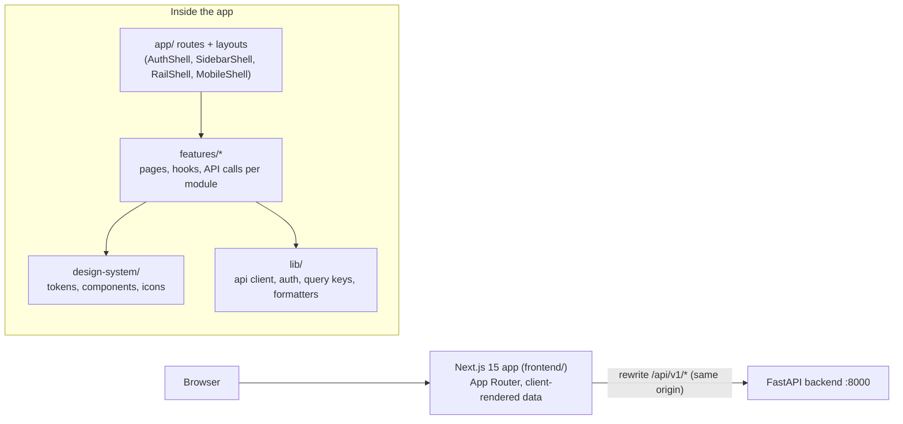

# Frontend Implementation Plan

**Status:** proposal approved for implementation, 2026-11-25. **Progress (2026-11-26):** F0-A, F0-B and F1 complete
(CI green); F2 implemented, awaiting CI ([`F2_GATE.md`](F2_GATE.md): GF2-29 recorded open, sign-off table empty);
F3-F5 not started. Section 11.3 decisions taken
so far are recorded in the F0A, F0B, F1 and F2 gate documents.
**Visual source of truth:** [`figma_ui_context.md`](figma_ui_context.md) (revision 2; cited as "UI §n"), and behind it
the Figma file itself. Nothing is redesigned, improved or invented. Where the backend cannot supply what a frame
shows, this plan says so (section 11). It never fills the gap with invented UI or sample data.
**Backend:** milestones M0-M5 approved (see [`BACKEND_ARCHITECTURE_FINAL.md`](BACKEND_ARCHITECTURE_FINAL.md),
[`backend/README.md`](../backend/README.md)).
**Stack (team decision):** Next.js 15 (App Router), TypeScript, Tailwind CSS, TanStack Query, React Hook Form, Zod.

---

## 1. Frontend architecture



* **Same-origin API through a Next.js rewrite.** `/api/v1/*` on the Next.js origin is rewritten to the backend.
  The browser talks to one origin, so the refresh cookie (`HttpOnly; Secure; SameSite=Strict;
  Path=/api/v1/auth`) and the CSRF header work without cross-origin requests. Browsers accept `Secure` cookies on
  `http://localhost`. In production, a reverse proxy serves both origins under one host (R1).
* **Client-rendered data.** The access token lives only in memory (backend contract JWT-07; never `localStorage`),
  and the refresh cookie is scoped to `/api/v1/auth`. So Next.js server components and middleware cannot see the
  session. Pages are server-rendered shells; all user data is fetched in client components through TanStack Query.
  Route guarding happens client-side (section 8). This keeps the backend's security model unchanged.
  A backend-for-frontend that holds the session on the Next.js server is not proposed: it would change the approved
  token model.
* **One component per Figma component set** (22 sets, UI §7, §12.5), plus the shared compositions of UI §7.23
  (Wordmark, Avatar, Stat card, Topic row, Source panel, Bottom sheet, Quiz bar, App bar, Tab bar, …).
* **Model output is untrusted (contract UPL-15).** Every AI-generated string (answers, summaries, quiz text,
  rationales, evidence) is rendered as React text, never as HTML: no `dangerouslySetInnerHTML`, no Markdown HTML.
  This is a production blocker in [`RELEASE_READINESS_PLAN.md`](RELEASE_READINESS_PLAN.md) and is tested in every
  milestone from F1.

## 2. Folder structure

```
frontend/
  app/
    (auth)/signin/page.tsx            AuthShell
    (auth)/signup/page.tsx
    (app)/layout.tsx                  auth guard, QueryClientProvider, theme
    (app)/(sidebar)/layout.tsx        SidebarShell: Dashboard, Upload, Analytics, Exam, Settings, Privacy
    (app)/(sidebar)/page.tsx          Dashboard  (route "/")
    (app)/(sidebar)/courses/[courseId]/upload/page.tsx
    (app)/(sidebar)/settings/page.tsx
    (app)/(sidebar)/privacy/page.tsx
    (app)/(rail)/layout.tsx           RailShell: Workspace, Summary, Chat, Quiz
    (app)/(rail)/courses/[courseId]/page.tsx
    (app)/(rail)/courses/[courseId]/documents/[documentId]/summary/page.tsx
    (app)/(rail)/courses/[courseId]/chat/page.tsx
    (app)/(rail)/quizzes/[quizId]/attempts/[attemptId]/page.tsx
    (app)/(rail)/attempts/[attemptId]/review/page.tsx
  design-system/
    tokens/       primitives.css, light.css, dark.css, typography.css (generated from UI §4)
    components/   Button, Input, Tab, Chip, Tag, CitationBadge, ProgressBar, MasteryRing, Card, SourceCard,
                  IconButton, Toast, Modal, EmptyState, Notice, FileUploadRow, NavItem, Toggle, AnswerOption,
                  ChatComposer, ChatMessage   (TableRow reserved, UI §7.12)
    compositions/ Wordmark, Avatar, UserCard, StatCard, TopicRow, SummarySection, SourcePanel, BottomSheet,
                  QuizBar, AppBar, TabBar, Breadcrumb
    icons/        30 SVGs exported from Figma (UI §11), one React component each
  features/
    auth/ dashboard/ courses/ materials/ summary/ chat/ quiz/ settings/ privacy/
      each: components/, hooks/ (TanStack Query), api.ts, schemas.ts (Zod), strings.ts (copy from UI §10)
  lib/
    api/          generated OpenAPI types, fetch wrapper, problem-details errors, upload (XHR with progress)
    auth/         in-memory token store, refresh with cross-tab lock, guard hook
    query/        query client, query keys, polling helpers
    format/       dates, relative time, bytes, plurals (UI §18 D-18, D-19)
  tests/          unit (Vitest), e2e (Playwright), a11y (axe), visual (Playwright screenshots)
```

The frontend lives in `frontend/` in this repository, so the backend contract and the UI share one CI.

## 3. Route map

Routes follow UI §12.4, adapted to backend ids. Every route maps to a drawn frame. The only exceptions are marked
**(no frame)**, and section 11.3 asks for a decision on each.

| Route | Frame (UI §3.4) | Shell | Backend | Milestone |
|---|---|---|---|---|
| `/signin` | 01 Auth / Sign in | Auth | `POST /auth/login` | F0 |
| `/signup` | 01 Auth / Sign up | Auth | `POST /auth/register`, then login | F0 |
| `/` | 02 Dashboard | Sidebar | `GET /auth/me`, `GET /courses`, documents per course | F0 |
| `/courses/[courseId]` | 03 Course workspace, M3 | Rail | `GET /courses/{id}`, `GET /courses/{id}/documents` | F0 |
| `/courses/[courseId]/upload` | 04 Upload flow | Sidebar | `POST /courses/{id}/documents`, polling, `DELETE`/`retry` | F0 |
| `/courses/[courseId]/documents/[documentId]/summary` | 05 Summary, M5 | Rail | `GET`/`POST /documents/{id}/summary` | F1 |
| `/courses/[courseId]/chat` (`?c=` conversation, `?source=n`) | 06 Chat (6 frames), M6 | Rail | conversations and messages | F1 |
| `/quizzes/[quizId]/attempts/[attemptId]` | 07 Quiz / Question (multiple choice) | Rail | attempts, answers, submit | F2 |
| `/attempts/[attemptId]/review` | 07 Quiz / Review | Rail | `GET /attempts/{id}/results`, `retry-missed` | F2 |
| `/settings` | 10 Settings | Sidebar | `GET /auth/me`, `POST /auth/change-password` (only) | F4 |
| `/privacy` | 10 Data & privacy | Sidebar | course/document deletion only | F4 |
| `/analytics` | 08 Analytics, M8 | Sidebar | **no backend** | F5 (blocked) |
| `/exam/new`, `/exams/[id]/results` | 09 Exam / Builder, Results | Sidebar | **out of scope (T-6: no adaptive exams)** | not planned |
| `/courses` | **(no frame)** Sidebar "Courses" destination | - | `GET /courses` | decision 11.3 |

## 4. Screen implementation order

1. **Foundations** (no screen): tokens, fonts, icons, the components needed by F0, shells, API client, auth.
2. **Sign up → Sign in** (the first real end-to-end path).
3. **Dashboard** (data-backed parts; see 11.1 for the parts without backend data).
4. **Course workspace** (file list, file details, stats that the backend can supply).
5. **Upload flow** (per-file upload with progress, processing statuses by polling).
6. **Summary** (sections, citations, source panel).
7. **Chat** (all five states, source panel).
8. **Quiz question → Review → Retry.**
9. **Mobile** frames M3, M5, M6, then the adopted mobile defaults for the rest (UI §18 D-4, after sign-off).
10. **Settings, Data & privacy** (only the parts the backend supports).
11. **Analytics, Exam:** blocked on backend features that do not exist (11.1).

## 5. Shared component library plan

| Order | Components (UI §7) | Needed by |
|---|---|---|
| F0 | Button (all variants and states), Input (6 states), Tab, Chip, Tag, ProgressBar (continuous value, UI §7.7), Card, Notice, NavItem, IconButton, FileUploadRow (7 statuses), EmptyState, Modal, Toast; compositions Wordmark, Avatar, UserCard, StatCard, Breadcrumb, Sidebar, Rail, AuthShell | Auth, Dashboard, Workspace, Upload |
| F1 | CitationBadge (Inline, 44×44 hit area, UI §18 D-6), SourceCard, ChatComposer, ChatMessage (6 types), SummarySection, SourcePanel, BottomSheet | Summary, Chat |
| F2 | AnswerOption (7 states), MasteryRing (computed sweep, UI §7.8), QuizBar | Quiz, Review |
| F3 | AppBar, TabBar, mobile variants | Mobile |
| F4 | Toggle | Settings |

Rules (UI §14):
- **Props mirror Figma properties:** `variant`, `state`, `tone`, `selected`, `size`, `type`, `level`, `status`.
- **Interaction states use CSS and ARIA, not props:** Hover, Focus and Disabled come from pseudo-classes and ARIA
  attributes.
- **Colours come from tokens only:** no hex literal in components (enforced by a lint rule).
- **Known Figma defects are not copied:** fixed progress widths, static ring sweeps, the 434 px mobile chat overflow.
- **Exact copy:** every string comes from UI §8/§10, curly quotes and middle dots included.
- **Isolated development:** each component gets Storybook stories (or equivalent) with every variant, for review
  against Figma.

**Icons.** Export the 30 `icon/*` components from Figma as SVG, using the Figma file key in UI §1.1
(open item UI A8). Do not redraw them.

## 6. Token and theme architecture

* **Three layers, as in Figma (UI §4):**
  1. **Primitives:** CSS variables, never referenced by components.
  2. **Semantic tokens:** `--color-bg-canvas`, `--color-accent-default`, … for Light on `:root` and Dark on
     `[data-theme="dark"]`, with the exact hex values of UI §4.1.2.
  3. **Tailwind theme:** semantic tokens only. Colours `bg-canvas`, `bg-surface`, `text-primary`, `border-default`,
     `accent`, `accent-subtle`, …; spacing 0-96 (UI §4.3); radius sm/md/lg/xl/full; shadows sm/md/lg with the exact
     CSS of UI §4.5; sizes `touch` 44, `control-md` 44, `sidebar` 264, `rail` 72.
* **Typography:** 12 utilities `text-display` … `text-caption-strong`, each setting size, line-height, weight and
  letter-spacing (percent converted to em, UI §4.2). Inter 400/500/600/700, self-hosted with `next/font` (UI §18 D-26).
* **Generated, not hand-typed:** a script turns a JSON copy of the Figma variables into the CSS files. A test asserts
  every value equals UI §4.1.2.
* **Theme:** Light ships first. Dark tokens are built but stay hidden until dark frames are approved (UI §18 D-24).
* **Tailwind version:** v4 (CSS-first `@theme`, maps directly onto CSS variables), pinned to an exact version.

## 7. API integration strategy

| Concern | Approach |
|---|---|
| Types | `openapi-typescript` generates types from the backend's `/openapi.json` (demo profile). CI regenerates them and fails on drift |
| Client | a thin `fetch` wrapper: base path `/api/v1`, `Authorization: Bearer` from memory, JSON, `X-Request-ID` passthrough |
| Errors | the backend returns RFC 7807 problems with `type: "about:blank#<code>"`. The wrapper maps the code to a typed error; the UI picks copy per code (`not_found`, `rate_limited` with `Retry-After`, `token_budget`, `llm_unavailable`, `document_not_ready`, `quiz_not_ready`, `upload_rejected` with per-file reasons, `queue_full`, …). Problem `detail` text is client-safe and may be shown |
| 401 | one silent refresh, then a single retry; a second 401 leads to sign-in (section 8) |
| Validation | Zod schemas mirror request models (unknown fields are rejected by the backend anyway); React Hook Form for forms |
| Server state | TanStack Query; query keys per resource (`['course', id]`, `['documents', courseId]`, …) |
| Polling | document processing (no push channel in the backend): `GET /courses/{id}/documents` every 2 s while any document is non-terminal, stopped when all are terminal or the tab is hidden (UI §18 D-19). Summary and quiz generation (202, then poll) the same way |
| Upload | **one request per file** with `XMLHttpRequest`: per-file upload progress, and the backend's upload is all-or-nothing per request (a rejected file would reject the others). Client-side pre-check of extension and size (100 MB, matching the backend). Server rejections (`unsupported_type`, `type_mismatch`, `macro_document`, …) become the row's status |
| Mapping backend → Figma statuses | `queued`, `extracting`, `embedding`, `indexing` → **Extracting** · `ready` → **Indexed** · `failed` + `no_text` / `empty_file` → **Empty** · `failed` + `unsupported_type` / 422 → **Not supported** · other `failed` → **Failed** (Retry) · `deleting` → hidden. **OCR has no backend signal** (11.1) |
| Chat states | backend `answered` / `partial` / `low_confidence` / `refused` map one to one onto UI §7.21; Loading is the pending request. `nearest` feeds the Refused "closest material" SourceCard; `context` feeds "SURROUNDING TEXT" |
| Summary | backend sections (`heading`, `text` with `[n]` markers, `source_range`) → SummarySection. Sentences are split and their `[n]` markers become CitationBadges; `citations[n]` feeds the SourcePanel |
| Quiz | attempt routes: start/resume, `PUT` answer, submit, results, retry-missed |

## 8. Authentication flow

```mermaid
sequenceDiagram
    participant U as User
    participant F as Frontend
    participant B as Backend /api/v1/auth
    U->>F: Sign up (name, email, password)
    F->>B: POST /register
    F->>B: POST /login
    B-->>F: access token (kept in memory) + refresh cookie (HttpOnly, path /api/v1/auth)
    Note over F: page reload loses the memory token
    F->>B: POST /refresh with X-Requested-With: IntelliStudy (under a cross-tab lock)
    B-->>F: new access token + rotated cookie
    U->>F: Sign out
    F->>B: POST /logout (CSRF header); clear memory, clear query cache
```

* **Token storage:** the access token is held in memory only, never in `localStorage` or `sessionStorage`. The
  refresh token is never readable by JavaScript.
* **Startup:** the app shell calls `refresh` once. On success the user lands on the requested page; on 401 the user
  goes to `/signin` with a return path.
* **Cross-tab safety (important):**
  - The backend revokes the whole session family when an already-rotated refresh token is reused (RT-05).
  - Two tabs refreshing at the same instant would trigger that and log the user out.
  - So every refresh runs under `navigator.locks.request('intellistudy-refresh')`; each tab then sends the latest
    cookie.
  - A `BroadcastChannel` shares the sign-out event across tabs.
- **Proactive refresh:** at about 13 minutes into the 15-minute token, while the tab is visible.
- **Forms:** Zod rules follow the backend, not the sample copy. Backend password policy: 10-128 characters, with a
  letter and a digit, and not a common password. The Figma copy says 12 (decision 11.3). The `.edu` rule is not
  enforced by the backend (decision 11.3).
- **Errors:** wrong credentials and lockout return the same generic message from the backend. 429 shows
  `Retry-After`.
- **Sign-out:** not drawn anywhere in Figma (UI D20). A placement decision is needed (11.3).

## 9. State management strategy

| State | Where |
|---|---|
| Server data (courses, documents, summaries, conversations, quizzes, attempts) | TanStack Query cache; invalidated after mutations; polling only while work is in progress |
| Session (access token, user) | an in-memory auth store (React context over a module singleton used by the API client) |
| URL state | active course, active tab (route), selected file (`?file=`), open citation (`?source=n`), conversation (`?c=`), analytics filter (UI §18 D-5, D-8) |
| Local UI state | expanded summary sections, selected quiz option before saving, upload rows in flight (client ids until the backend id exists) |
| Persisted on the device | none except the theme preference |

No global client store library is needed. Forms use React Hook Form with Zod resolvers.

## 10. Mobile strategy

* **Drawn mobile frames** (UI §3.4, §5.2): M3 Course workspace, M5 Summary (with source bottom sheet), M6 Chat
  (answered), M8 Analytics. They are implemented exactly, without the 434 px overflow defect.
* **Breakpoints and undrawn layouts** use the adopted defaults of UI §18 D-3 / D-4: below 768 px the mobile
  layout; 768-1023 the Rail; 1024 and up the Sidebar. These are **not Figma facts**: they need owner sign-off before
  F3, and the plan does not invent other mobile layouts.
* **Desktop-first build** (the reference is 1440). Mobile work is milestone F3, after the core flows work on desktop.
  Exception: F0 screens are built responsive-ready, using FILL/FIXED rules from UI §5.4, so F3 does not rewrite them.
* **Touch targets:** 44 px everywhere. The Inline citation badge gets a 44×44 hit area without visual change
  (UI §18 D-6).

## 11. Risks and missing Figma decisions

### 11.1 Figma shows data the backend does not have

The backend MVP covers accounts, courses, documents, chat, summaries, quizzes and attempts. Figma also draws
learning-analytics features. Rendering them with sample data would show students invented numbers, so each needs a
decision.

| Figma element | Frames | Backend status | Proposed handling (decision needed) |
|---|---|---|---|
| Next recommended action, study streak, weakest topics, recent activity | Dashboard rows A and C | none (no mastery, streak, recommendations or activity log) | **hide those rows** until the backend provides them; Dashboard shows header + "Your courses" |
| Course mastery %, "Topics found", topic list with mastery, topic chips of a file | Dashboard cards, Workspace stats and Topics card, file details | none | omit these elements; show what exists (files, indexed count, pages, size, indexed time) |
| OCR status row and "Scanned PDF detected" notice | Upload, Workspace, M3 | OCR runs, but no status or flag is exposed | treat OCR files as Extracting; a small backend addition (an `ocr` flag on documents) would enable the drawn state |
| "TRY ASKING" suggestion chips | Chat / Refused | none (the backend returns `missing_terms` and `nearest`) | omit the chips; keep the closest-material SourceCard |
| Analytics, score history, weak topics | 08 Analytics, M8 | none | F5, blocked until a backend analytics milestone exists |
| Personalised exam builder and results | 09 Exam | excluded by team decision T-6 | not planned |
| Short-answer questions | 07 Quiz / Short answer | excluded (T-5/T-6) | not planned |
| Profile editing, study and notification preferences, theme persistence | 10 Settings | only `GET /auth/me` and change-password | build only what is backed; others hidden (decision) |
| Export data, reset mastery, delete account | 10 Data & privacy | course/document deletion only; account deletion is planned work P1 | build the privacy copy and the backed deletions; others hidden until P1 |

### 11.2 Figma conflicts with the backend design

| Conflict | Detail | Proposed handling |
|---|---|---|
| **"Check answer" during the quiz** | Figma implies immediate per-question feedback (and a Settings toggle for it). The approved backend reveals correctness only after submission (ISO-04, G5-KEY-02) | the button saves the answer and moves on; feedback appears in Review. **The label "Check answer" would be misleading: copy decision needed** |
| **True/false questions** | Figma has no true/false frame; the backend generates them | render with the existing AnswerOption (two options, "True" / "False"); no new component |
| Password copy | Figma: "At least 12 characters"; backend: 10 minimum | align one side (decision) |
| `.edu` email rule | Figma error sample; backend accepts any address | decide whether to enforce (backend change) or drop the error copy |
| "Partly correct" tag in Review | only for short answers, which are excluded | never shown |

### 11.3 Decisions needed before F0 starts

1. **Dashboard and workspace without analytics data:** hide the undrawable elements (recommended), or wait for a
   backend analytics milestone.
2. **Course creation:** a new user has no course and cannot upload. Figma has a "New course" button but no flow.
   Proposal: the existing Modal with one Input "Course name" and a Primary button (existing components only).
   Needs copy approval.
3. **"Upload files" on the Dashboard:** the Upload frame belongs to one course. Proposal: it opens the course chooser
   from decision 2, or uses the course of the most recent activity.
4. **Courses list** (`/courses`, the Sidebar "Courses" destination): no frame. Proposal: the Sidebar item goes to the
   Dashboard's "Your courses" section until a frame exists.
5. **Sign-out placement:** not drawn. Proposal: make the Sidebar user card open a menu with "Sign out".
6. **Password rule and `.edu` rule** (11.2).
7. **Empty states:** only "No materials yet" has copy. Copy is needed for an empty dashboard (no courses).
8. **Mobile defaults** UI §18 D-3/D-4 (needed by F3, not F0).
9. **Icons:** export the 30 SVGs from Figma (designer or a Figma export, UI A8).

### 11.4 Technical risks

| Risk | Mitigation |
|---|---|
| Two tabs refreshing at once trigger refresh-token reuse detection and sign the user out | cross-tab lock and broadcast (section 8) |
| A per-user limit of 5 processing documents (`queue_full`, 429) during multi-file uploads | queue uploads client-side; show the backend message on the row |
| End-to-end tests hit the real limits: registration is limited to 3 per hour per IP, login to 5 per minute, refresh to 30 per hour per user | seed several test accounts once per run and reuse their sessions. The backend has no switch to relax limits today; if the suite needs one, it is a small backend change allowed only in the `test` profile, decided with the F0 gate |
| XSS through model output (UPL-15) | text-only rendering; a lint rule bans `dangerouslySetInnerHTML`; nonce-based CSP via Next.js middleware without `unsafe-inline` scripts; Playwright tests with `<script>`, `` and `javascript:` payloads in documents (from F1) |
| Polling load | poll only non-terminal items, every 2 s, paused when the tab is hidden |
| Drift between backend schema and frontend types | generated types, checked in CI |
| Figma sample numbers mistaken for data | the lint/test rule: no sample strings in feature code; copy only from `strings.ts` |

## 12. Milestones F0-F5

Each milestone follows the backend's practice:
- **Gate first:** a short gate list of testable items, approved before code.
- **One test per item:** Vitest for components, Playwright end-to-end against the real backend, axe for
  accessibility.
- **Green CI to close:** a frontend job (lint, type-check, unit, build, e2e) next to the backend jobs.

| Milestone | Delivers | Connected to the real backend | Exit criteria (summary) |
|---|---|---|---|
| **F0 Foundations + first slice** | Next.js app, tokens, fonts, icons; the F0 components; Auth, Sidebar and Rail shells; API client; auth with refresh. **Screens:** Register, Login, Dashboard (decision 11.3-1), Course Workspace, Upload Flow (with course creation per decision 11.3-2) | register, login, refresh, logout, me, courses, documents (upload, poll, retry, delete, download) | A new user can sign up, create a course, upload a PDF and a PPTX, see them become Indexed, and see them in the workspace. Exact copy and token checks per UI §20.1; another user's course URL shows the not-found state; tokens never in web storage; axe clean |
| **F1 Summary + Chat** | Summary with source panel; Chat with all five states and the source-open layout; CitationBadge, SourceCard, ChatComposer, ChatMessage | summaries (202 + polling), conversations, messages | Five chat states from real and fixture responses (UI §20.5); citation opens the right passage; **UPL-15 XSS tests pass** |
| **F2 Quiz** | Quiz generation request, quiz question screen (MCQ and true/false), Review, Retry missed | quizzes, attempts, answers, submit, results, retry-missed | Resume after reload; no correctness shown before submit; Review shows cited explanations; retry contains exactly the missed questions |
| **F3 Mobile** | M3, M5 (bottom sheet), M6, then D-4 defaults for the F0-F2 screens (after sign-off) | same | No horizontal overflow at 390 px; 44 px targets; sheet behaviour (UI §18 D-8) |
| **F4 Settings, privacy, hardening** | backed parts of Settings and Data & privacy; error, empty and loading states with existing components; CSP; visual regression baselines (UI §20.2) | me, change-password, deletions | Release checklist for the frontend half of R1 (UPL-15 verified, CSP live) |
| **F5 Analytics** | 08 Analytics and M8 | **requires a backend analytics milestone** (mastery, history, recommendations) | blocked until that milestone is approved |

The Exam builder and results screens are not planned: personalised and adaptive exams are excluded by team decision
T-6.

**Roadmap note:** F5 corresponds to Sprint 3 (adaptive learning UX) in the [`README.md` roadmap](../README.md#roadmap).
The backend milestone it waits for is Sprint 2 (mastery data model). Personalized practice quizzes also wait for the
proposed T-6 amendment [`TEAM_DECISION_T-7.md`](TEAM_DECISION_T-7.md). The exam builder stays excluded either way.
