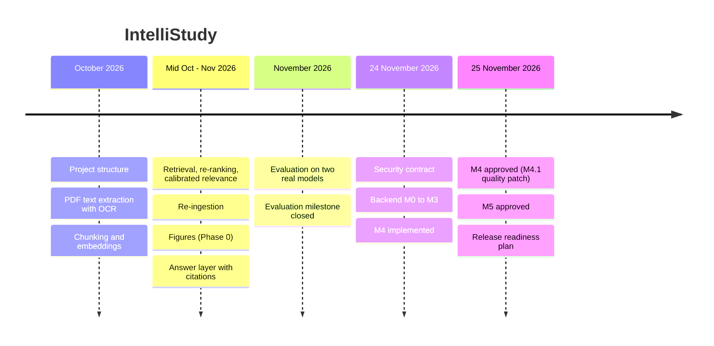

# IntelliStudy: Project Timeline

**For:** graduation-project reviewers. Dates come from the repository history, the CI runs and
[`project_context.md`](project_context.md) (changelog). Status as of 2026-11-25.

## Overview

## Phase 1: AI pipeline (October to mid-November 2026)

| Date | Milestone | Outcome |
|---|---|---|
| 2026-10-01 | Initial project structure | repository, package layout |
| 2026-10-09 | Ingestion | PDF text extraction with OCR for scanned pages and images |
| 2026-10-18 | Chunking and embeddings | heading-aware parent/child chunking; BGE embeddings; Chroma vector store |
| Oct-Nov 2026 | Retrieval service | user- and course-scoped semantic search, parent expansion, cross-encoder re-ranking, relevance assessment calibrated on 87 labelled queries |
| 2026-10-19 | Answer layer MVP | grounded answers with validated citations; extractive baseline refuses 24/24 unrelated questions before any model call |
| Oct-Nov 2026 | Re-ingestion | incremental re-indexing: unchanged files are a no-op (0.27 s for 3,000 chunks) |
| 2026-10-25 | First real-model evaluation (Qwen2.5-3B) | refusal and attribution held; correctness below its criterion, so a stronger model was needed |
| 2026-11-15 | Figures (Phase 0) and corpus coverage | figure detection, captions and OCR text indexed; measured reach on 30 real lecture files |

## Phase 2: Evaluation (November 2026)

| Date | Milestone | Outcome |
|---|---|---|
| 2026-11-23 | DeepSeek evaluation (111 gold cases, identical retrieval) | refusal recall 37/37, gold source cited 95%, citation precision 0.89, no over-answering |
| 2026-11-23 | Evaluation milestone closed | results checksummed; the NLI judge recorded as needing validation before its metrics are trusted |
| 2026-11-23 | Post-evaluation quality pass | list-aware citation parsing (cited lists no longer stripped) |

## Phase 3: Backend vertical slice (24-25 November 2026)

Every milestone started with an approved release gate, and ended on a green CI run.

| Date | Milestone | Gate items | CI run |
|---|---|---|---|
| 2026-11-24 | Security contract written before any backend code | - | - |
| 2026-11-24 | **M0** foundations: configuration and secrets, middleware, logging, LLM providers, CI pipeline | 74 tests | #1 |
| 2026-11-24 | **M1** identity, courses, ownership | 79 | #2 |
| 2026-11-24 | **M2** secure upload, sandboxed parsing, processing jobs | 39 | #3 |
| 2026-11-24 | **M3** grounded chat on READY-only scoped retrieval; release blocker F-M2-10 closed | 52 | #4, #5 |
| 2026-11-24 | Token budget moved to a non-refundable usage ledger (F-M3-05) | 9 tests | #6 |
| 2026-11-24 | **M4** cited summaries and validated quiz generation | 67 | #6 |
| 2026-11-25 | **M4.1** quality patch after a real-PDF run: quiz yield from 5/10 to 8-10/10 | 15 tests | #7 |
| 2026-11-25 | **M4 approved** | - | #7 |
| 2026-11-25 | **M5** quiz attempts, grading, results, retry; whole-API security verification; end-to-end tests | 61 | #8, #9 |
| 2026-11-25 | Manual demo with DeepSeek on real lectures: every performance target met | - | - |
| 2026-11-25 | **M5 approved**: OWASP review signed off; release readiness plan approved | - | #11, #13 |
| 2026-11-25 | Final architecture document | - | - |

Two CI runs failed during close-out (#10, #12), both on flaky tests: a CPU-timing ratio, and a Chroma check that used
approximate search to list stored records. Both tests were stabilised; runs #11 and #13 are green.

## Next (planned, not started)

| Phase | Content | Gate |
|---|---|---|
| **R1** production readiness | HTTPS and HSTS, client addresses behind a proxy, shared rate-limit store, secret management, alerting, backups; frontend renders model text as plain text | before any cloud deployment |
| **P1** public readiness | privacy notice and recorded consent for the AI provider, account deletion | before any non-team user |
| **M6** quality | repair split words in PDFs at ingestion, better quiz yield, question flagging | team decision |
| **Sprint 1** security and resilience | threat model, authorization matrix, abuse controls, concurrency limits, load baseline, before/after report (rate limiting, parser defenses and security regression tests already exist) | - |
| **Sprint 2** mastery data model | topic taxonomy, mastery events and scores, confidence, endpoints, migrations | - |
| **Sprint 3** adaptive learning UX | mastery dashboard, weak-topic cards, personalized practice quizzes, progress | after Sprint 2 and acceptance of [T-7](TEAM_DECISION_T-7.md) (proposed) |
| **Sprint 4** audio MVP | audio upload, transcription with timestamps, indexing, audio citations | - |

Details and owners: [`RELEASE_READINESS_PLAN.md`](RELEASE_READINESS_PLAN.md). Sprint status, item by item:
[`README.md`](../README.md#roadmap).
