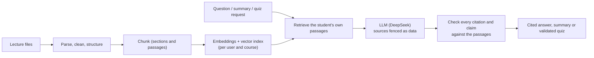

# IntelliStudy: System Overview

**For:** graduation-project reviewers. One-page summary; the details are in
[`BACKEND_ARCHITECTURE_FINAL.md`](BACKEND_ARCHITECTURE_FINAL.md).

## The problem

Students study from long lecture slides and PDFs. General chatbots answer from the internet, not from the course,
and invent facts with confidence. Students also lack quick, reliable ways to test themselves on their own material.

## The solution

IntelliStudy is a study assistant that works **only from the student's own lecture files** and **always shows where
an answer comes from**.

| Feature | What the student gets | What makes it trustworthy |
|---|---|---|
| Upload | PDF, PPTX and DOCX lectures, processed in seconds (a 44-page PDF in 10.4 s) | files checked by content and parsed in an isolated process without secrets |
| Grounded chat | answers with numbered citations to pages and slides | every sentence must cite and match the lecture; unrelated questions are refused, not guessed |
| Summaries | a structured summary per document, every sentence cited | unsupported sentences are removed; page ranges come from the citations |
| Quizzes | 5-30 multiple-choice and true/false questions in under 45 s | each answer is proven by a quote from the lecture; ambiguous questions are dropped |
| Quiz taking | save, resume, submit, instant grading, cited explanations, retry the missed questions | grading uses no AI; answers stay hidden until submission; results never change afterwards |

## How it works

This pattern is **Retrieval-Augmented Generation (RAG)**: the model writes only from passages retrieved from the
student's material, and the backend verifies the result before the student sees it.

## Technology

| Area | Choice |
|---|---|
| Backend | Python 3.12, FastAPI, SQLAlchemy 2, Alembic, SQLite (demo) / PostgreSQL |
| AI | BAAI/bge-small-en-v1.5 embeddings, Chroma vector store, MiniLM cross-encoder re-ranker, DeepSeek through an OpenAI-compatible interface |
| Document parsing | PyMuPDF, pdfplumber, python-pptx, python-docx, Tesseract OCR |
| Security | Argon2id, JWT access tokens with rotating refresh tokens, sandboxed parser, per-user rate limits and token budget |
| Quality | ruff, mypy, backend, AI-pipeline and frontend tests per CI run (417 backend and 800 AI-pipeline tests on 2026-11-28; 402 at M5 approval); gitleaks; pip-audit |

## Engineering approach

* **Security first:** a written security contract preceded the backend. Each of five milestones had a release gate
  in which every item is an automated test: **298 gate items** in total. They cover cross-user isolation, IDOR,
  uploads, prompt injection, answer-key secrecy, tokens and cost limits.
* **Measured AI quality:** retrieval was calibrated on 87 labelled queries. Answers were evaluated on 111 gold cases
  with two real models (DeepSeek: refusal recall 37/37, gold source cited 95%).
* **Verified release:** all 70 rows of the security test matrix are mapped to passing tests. The OWASP Top 10 and
  OWASP Top 10 for LLM Applications review has no open item.

## Status (2026-11-25)

Backend milestones M0-M5 are complete and approved, and CI is green. A manual demo on real lectures met every
performance target. The frontend and cloud deployment are the next phases
([`RELEASE_READINESS_PLAN.md`](RELEASE_READINESS_PLAN.md)). Planned feature sprints (security and resilience, mastery, adaptive
learning, audio) are listed in the [`README.md` roadmap](../README.md#roadmap).

## Further reading

| Document | For |
|---|---|
| [`BACKEND_ARCHITECTURE_FINAL.md`](BACKEND_ARCHITECTURE_FINAL.md) | flows, data model, security architecture, CI history |
| [`SECURITY_EXECUTIVE_SUMMARY.md`](SECURITY_EXECUTIVE_SUMMARY.md) | the security verdict in plain language |
| [`PROJECT_TIMELINE.md`](PROJECT_TIMELINE.md) | how the project progressed |
| [`DEMO_SCRIPT.md`](DEMO_SCRIPT.md) | the live demonstration |
| [`../CONTRIBUTING.md`](../CONTRIBUTING.md) | engineering process and rules |
